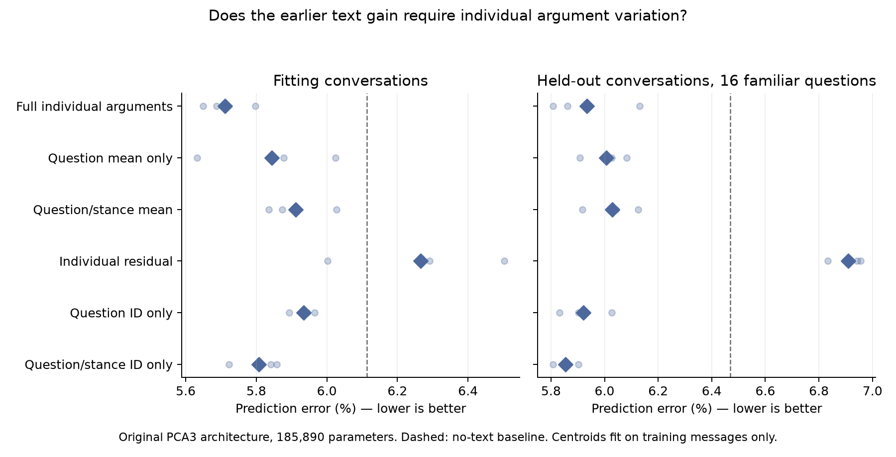
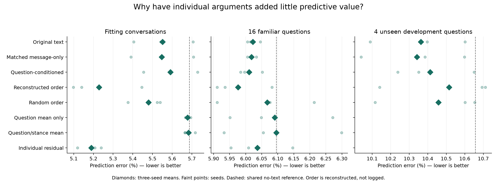

# Argument-state investigation

**Main finding:** the argument-enabled graph transformer does process every delivered neighbor message, but the earlier familiar-question improvement does not require individual argument language. A question-ID-only input reaches 5.92% familiar-question error, versus 5.93% with full arguments and 6.47% with no argument vector. Question/stance IDs reach 5.85%. These are three-seed means on held-out conversations about the same 16 questions, not results on new questions. The observed gain can therefore arise from an easier route to question-specific behavior.

This identifies a concrete contributor to the weak argument results. It does **not** establish that the source LLM ignores arguments, that the frozen vectors contain no useful reasoning, or that a compact transferable update rule is impossible. The source LLM's response to controlled argument-quality changes is still unmeasured.

The bounded session completed 54 controlled predictor fits, six deliberately small memorization fits, two local frozen-encoder passes, and read-only audits of 24 terminal checkpoints. Eighteen frozen reference fits were reused. No new source-LLM calls, consumed-test rescoring, graph changes or autonomous rollouts were performed. The authorized investigation window was 08:06:54–10:06:54 UTC on 2026-11-08; execution status and actual completion are recorded in `runs/argument_investigation_20261108/session.json`. The session was finalized at 2026-11-08T10:03:52.972803+00:00 after 117.0 minutes, within the two-hour limit.

## What the transformer receives

For each receiver, each incoming message has its own 384-dimensional frozen MiniLM vector. The trained one-hop graph transformer combines the projected vector with the sender's state/history/context and explicit A/B stance to compute attention keys and values. The receiver's state supplies its attention query. Prescribed friendly/unfriendly labels separately select learned attention biases and signed value coefficients; nonneighbors are masked out. The graph transformer is trained from scratch; MiniLM remains frozen. The graph predictor attends to individual message vectors, rather than directly to raw argument tokens. It sees messages delivered to that receiver, not hidden internal reasoning or every other agent's inbox.

A read-only computational trace differentiates the receiver's A-minus-B logit with respect to every input message vector, with weights fixed and next-state targets removed. Across six examples spanning the original, full-question and joint-encoding models, all 42 active incoming vectors have nonzero local derivatives; other receivers' message vectors and nonedges have zero derivatives. This verifies the intended individual-message, one-hop path. It does not establish useful semantics or causal influence on the source LLM.

The new joint-encoding comparison lets message tokens attend to the full question and choices inside the same frozen MiniLM encoder before pooling. A matched control uses the same paired-segment format and message-token pooling with an empty question. For long questions, nonoverlapping question windows each receive the complete message; their message-state means are weighted by question-token counts and normalized once. All tokens are retained. This does not permit interactions between distant question windows or train a mathematical reasoner.

There are 423,805 nonpadding question/message records. Naive 512-token concatenation would truncate 43,584 of them; that benchmark was rejected. The final windowed encoder covers all records, with 43,584 multiwindow inputs and zero truncated tokens. Original message-only sentence pooling had truncated only 12 unique texts at its 256-token limit. New message-only and question-conditioned conditions both use the no-truncation implementation, making their direct comparison matched.

## Cohorts and target

The task is next A/B choice prediction on objective mathematics problems. The target is the majority of five source-LLM samples. Prediction happens **after the current messages are available and before the next opinions**. It is not mathematical-answer accuracy and is not an autonomous replacement for message generation.

All current controlled comparisons use the previously fixed split: replicas 0/1 of 16 questions fit the model (256 episodes, 65,536 agent transitions); replica 2 of those questions selects the checkpoint (128 episodes, 32,768 transitions); replica 3 evaluates familiar questions (128 episodes, 32,768 transitions). The existing four unseen development questions supply another 128 episodes/32,768 transitions. The eight random graphs are shared across these cohorts. Both evaluation cohorts are excluded from checkpoint selection within these studies, but they have been repeatedly examined during development.

Means give each question equal weight, then average the three seeds 42/43/44. Intervals are descriptive paired-question bootstrap intervals after averaging seeds within question: 16 familiar or four unseen questions, 1,000 resamples. They are pointwise, exploratory intervals, not fresh confirmatory evidence or equivalence tests. New fitting scores should not be compared directly with the older full-data opinion-only training error: the cohort and information conditions differ.

## The familiar-question gain largely survives removing message language

The following models all use the original 185,890-parameter PCA3-context graph architecture and the same fitting/stopping protocol. Means are fitted only from replicas 0/1, without next-state labels. Question-ID inputs are padded one-hot vectors with no message-language information. The baseline still contains its original persona/question context, opinions and history.

| Input supplied to the argument branch | Training error | Familiar-question error |
| --- | ---: | ---: |
| No argument vector | 6.11% | 6.47% |
| Full individual arguments | 5.71% | 5.93% |
| One average vector per question | 5.84% | 6.01% |
| One average vector per question/stance | 5.91% | 6.03% |
| Individual residual after subtracting question/stance mean | 6.27% | 6.91% |
| Question ID only | 5.93% | 5.92% |
| Question/stance ID only | 5.81% | 5.85% |

Question means retain about 87% of the original mean accuracy improvement over the no-text baseline; question/stance means retain about 82%. These ratios describe observed mean gains, not causal fractions. Means may retain common reasoning content. The ID controls go further: they remove language from the added branch while reproducing its familiar-question performance. Question-ID versus full-argument accuracy differs by +0.013 [-0.097, +0.127] percentage points; question/stance IDs differ by +0.079 [-0.052, +0.206] points. Neither comparison establishes formal equivalence.

All variants have the same nominal parameter count, but their input geometry and effective capacity differ. ID inputs activate only 16 or 32 input dimensions, so only 2,048 or 4,096 text-projection weights receive data gradients. This control shows that language is unnecessary for the observed familiar-question gain; it does not equalize every statistical property. IDs and fitting-derived centroids are evaluated only on familiar questions, because there is no corresponding fitted representation for a new question.

The probability metric supports the same limited conclusion: familiar NLL is 0.14051 without argument vectors, 0.12982 with full arguments, 0.13031 with question IDs, and 0.12900 with question/stance IDs. Question-ID minus full-argument NLL is +0.00049 [-0.00098, +0.00194]; question/stance ID minus full is -0.00083 [-0.00254, +0.00090].

Input-only geometry agrees with this interpretation: fitting-question centroids explain 83.97% of original message-vector variance on held-out familiar conversations, and question/stance centroids explain 86.25%. Nearest-centroid question identification is 100%. After joint question conditioning these fractions rise to 90.24% and 90.80%. High variance explained does not prove that small residual directions lack useful information.

## More question context and order did not produce a transferable remedy

These comparisons retain the full cached 1,536-dimensional question/choice input. The graph model has 382,498 parameters, or 382,882 with the order projection. Except for the indicated transformation, training and splitting are identical.

| Input / change | Training error | Familiar-question error | Unseen-question error |
| --- | ---: | ---: | ---: |
| No argument vector | 5.69% | 6.10% | 10.66% |
| Original individual arguments | 5.55% | 6.02% | 10.36% |
| Matched message-only encoding | 5.55% | 6.02% | 10.34% |
| Joint question-conditioned encoding | 5.59% | 6.01% | 10.41% |
| Individual argument residual | 5.19% | 6.04% | Not evaluated |
| Reconstructed presentation order | 5.23% | 5.98% | 10.52% |
| Independent random-order control | 5.48% | 6.07% | 10.46% |

Joint conditioning minus its matched message-only control changes unseen accuracy by -0.072 [-0.146, +0.002] percentage points, with NLL change +0.00041 [-0.00170, +0.00259]. Familiar accuracy changes by only +0.007 points and familiar NLL by +0.000004. This particular frozen joint encoding does not improve the argument response predictor; it does not rule out trainable token-level models or other encoders.

Subtracting the fitting question/stance mean and scaling residuals to unit fitting RMS improves full-context training error from 5.55% to 5.19%, but familiar error stays near 6.02–6.04% and NLL becomes worse by 0.00233 [0.00064, 0.00425]. Without the full question branch, residual-only inputs perform substantially worse. Making individual differences easier to fit has not made them reliably transferable.

The released generation function deterministically shuffles inboxes before separating friendly and unfriendly groups; the original graph model is order-invariant. The order experiment adds within-group position/first/last features and compares that reconstruction with an independent random permutation. Reconstructed order improves fitting, but unseen error is 10.52% versus 10.46% for the random-order control, and unseen NLL worsens by 0.01136 [0.00675, 0.01729]. The legacy episodes do not log complete prompts or actual presentation order, so the reconstruction is an explicit assumption. This is not evidence that the actual source agents are order-invariant.

The older PCA3 no-text model still has lower mean unseen error (9.84%) than these richer models. That is a descriptive result on four reused development questions, not a final model-selection claim.

## The branch can fit text differences; selected training error is not a capacity bound

A training-only diagnostic selected 62 pairs (124 examples) with identical tested nontext receiver/neighbor inputs, opposite next opinions and different messages. A deterministic no-text model must make 50% errors on that balanced set. The original transformer reached zero error for all three seeds with the original embedding scale, in 746–1,025 updates. Scaling text by 32 also reached zero error, in 89–106 updates. Forward outputs and parameter gradients of the receiver-only evaluation path were checked against the original full model.

This demonstrates that the branch is connected and can use vector differences. It is intentional memorization after selecting labels, with no dropout, no weight decay and no held-out stopping. Unique arbitrary identifiers could also support memorization; this is not evidence of mathematical reasoning, causal text influence, or broad capacity on the full dataset.

The read-only terminal-checkpoint audit adds the full-data counterpart. Already-saved terminal weights generally fit training data more closely while worsening selection NLL. For the full-context residual model, training error goes from 5.19% to 4.86%, while selection NLL rises from 0.12800 to 0.13028. No optimizer steps or held-out-evaluation rescoring were added for this audit. Early stopping intentionally selects a less-fitted checkpoint.

Repeated-input audits give empirical deterministic fitting floors of 3.02% for the tested local opinion/context key, 1.64% with history, and 0.50% with message identities on the current fitting cohort. Of the 327 unavoidable errors under the history-plus-text key, 326 belong to isolated receivers. Among 64,000 targets with incoming messages, only one collision error remains, largely because complete inboxes are almost always unique. These are in-sample lower bounds, not Bayes error estimates or evidence that text contains transferable information. The older full four-replica fitting pool gives 3.41%, 1.99% and 0.59%, respectively.

A separate conditional-neighbor probe compared messages only among exactly matched nontext states. All three encodings selected uniform weighting, rather than text-similarity weighting, on the selection cohort. Familiar evaluation contains 11,409 matched states, but only 724 match conflicting fitting outcomes, and only 264 of those receive any messages. This small-support, similarity-based negative result cannot exclude more useful nonlinear features.

## Aggregate scores do not mean that every argument effect is zero

The exploratory subgroup audit reports all ten declared input/baseline-confidence strata for six comparisons (80 paired subgroup contrasts). With full question context, the full-argument model gains 0.56 accuracy points on unseen examples with degree at least two and an absolute signed opinion sum at most one; its pointwise interval is [0.12, 1.01]. On unseen examples where the frozen no-text ensemble has confidence at most 0.75, the gain is 2.49 points, interval [-0.14, 5.12]. These are post-hoc, overlapping subgroups with many comparisons and only four questions, so they are leads rather than confirmatory discoveries.

For the original PCA3 model, text improves familiar uncertain examples by 4.36 points but worsens unseen uncertain examples by 3.94 points. Question-average vectors preserve most of the familiar benefit in that subgroup. Mixed-opinion inboxes likewise show a small familiar gain and an unseen loss for the original model. The evidence is more consistent with question-specific fitting and weak transfer than with a uniformly broken text input. Small conditional benefits remain plausible.

## What the released messages represent

The released objective-choice instruction asks for a direct snap judgment and explicitly says not to compute or work through the problem. The message-writing instruction supplies the sender's current answer and asks for a two-sentence justification of that answer. The feature audit verifies that all 573,440 delivered development messages explicitly state the sender's current A/B choice. Thus the baseline already knows the conclusion that the message advertises. The added value being tested is the wording/reason beyond that conclusion and the other supplied state.

A fixed-seed illustrative sample (one message per question and stance; no next-outcome selection) includes a correct 45-second faucet answer justified by an incorrect 100-gallons-per-minute rate and inconsistent timing. Another message argues for the wrong product-sign probability using six favorable pairs out of fifteen, where ten is the correct number of distinct unordered pairs. Correct conclusions can therefore accompany faulty rationales. These examples are not a prevalence estimate. The source bank also records nearly balanced initial A/B probe rates across the 20 development questions (47.27–54.69%, mean 50.37%).

The historical caveat matters: released source and metadata are available, but complete historical prompts are not logged and the release documents legacy generation differences. The prompt design is a plausible contributor to weak incremental argument signal, not an established causal explanation of every recorded transition.

## A concrete next test is prepared, without source-model execution

The refined draft pilot contains 24 unique mixed-opinion inbox contexts on the four existing development questions: three receivers for each question and relationship-sign category. Cases are selected using only frozen no-text ensemble predictions and observed inputs, never next-state outcomes. Every selected no-text prediction has confidence at most 0.51. This replaces an initial first-eligible-context draft, which often produced confident predictions; the original draft is preserved separately.

Each case has a valid rationale, a minimally edited invalid rationale with the same correct-option A/B conclusion, and a valid paraphrase. Persona, question, graph cue, background messages and presentation order are identical within each triple. Arithmetic and one-message-only edits are checked. The refined draft contains 72 exact prompts and proposes 20 raw samples per prompt (1,440 total) as a pilot count, not a powered confirmatory design. No API client or source-model invocation is present in either preparation script.

Nine frozen predictors were evaluated read-only on the refined authored states, with true next-opinion targets discarded. One of 216 model/seed/context pairs changed its binary prediction between valid and invalid rationales. Mean absolute probability changes were 0.90 percentage points for the original PCA3 model, 0.34 for the full-question model, and 0.16 for the joint-encoding model. These are modest but not identically zero responses. The first draft had no such flips; its greater confidence limits that observation. Larger paraphrases cause larger changes, but also change more tokens and are not length-matched, so magnitude comparisons cannot isolate logical sensitivity. Standalone encoding was independently reproduced against cached real messages within 1e-5 (the initial check's maximum difference was 1.8e-7).

A target distinction must be preserved in future execution: the predictor estimates the majority of five responses, whereas 20 raw pilot samples estimate an individual-response probability and provide only four disjoint five-vote groups. Raw fractions must not be scored as if they were majority probabilities. `controlled_probe_uncertain/analysis_plan.json` separates these estimands and requires a matching grouped-vote budget before predictor-accuracy evaluation. A binomial mapping would require an explicit conditional-independence assumption and uncertainty propagation.

These are predictor sensitivities, not counterfactual accuracies or observed LLM effects. The next step is to measure source-LLM sensitivity on the fixed-stance interventions, then design a sufficiently powered, target-matched comparison. All target messages favor the correct answer: an agent that solves the question independently could keep that answer despite a flawed rationale. Model uncertainty is only a proxy for source uncertainty, and a null result needs manipulation and power checks. Broader fresh questions would still be required. The signed communication cues remain in place; learning emergent credibility is deferred.

## Reproducibility and artifacts

All prior experiment code, caches and checkpoints remain frozen. New studies are isolated under `runs/argument_investigation_20261108/`, with configurations in `configs/`, drivers and analysis in `scripts/`, and checks in `tests/`. The main audit recomputes every reported metric, verifies identical comparison targets/cohorts and hashes, and audits 72 selected models: 54 new plus 18 references. The six small capacity models and 24 terminal checkpoints have separate integrity records. Twelve GPU smoke fits and 21 focused scientific tests passed.

- Main tables: `argument_investigation_summary.csv`, `argument_investigation_runs.csv`, `argument_investigation_by_question.csv`, `argument_investigation_paired.json`, `argument_investigation_sensitivity.csv`.
- Input/capacity audits: `argument_investigation_geometry.json`, `argument_investigation_collision_breakdown.csv`, `argument_investigation_capacity.csv`, `argument_investigation_conditional_support.csv`.
- Additional immutable results: `terminal_fit_audit/`, `stratified_diagnostic/`, `conditional_neighbors/`, `input_trace/`, `quality_predictor_probe/`, `quality_uncertain_probe/` inside the investigation run directory.
- Current reviewable future inputs: `controlled_probe_uncertain/prompts.jsonl`, `cases.json`, `argument_variants.json`, `manifest.json`, `analysis_plan.json`; status is `draft_not_executed`, source calls zero. The initial draft remains in `controlled_probe_draft/`.
- Qualitative sample: `reports/argument_investigation_examples.json`. These are original recorded texts with traceable episode/message IDs.
- Rebuild audited tables/figures: `.venv/bin/python scripts/report_argument_investigation.py all --require-complete`.
- Rebuild this report: `.venv/bin/python scripts/write_argument_investigation_report.py`.

The remaining uncertainty is substantive: existing observational conversations cannot separate weak source-agent use of argument quality from a predictor/encoder that fails to recover that use. The experiments explain much of the familiar-question benefit and reject several simple implementation explanations, while leaving that causal distinction open.
