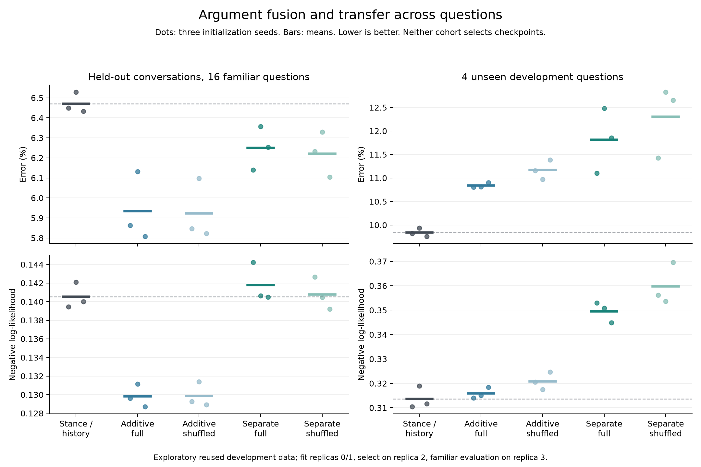

# Why does adding argument text fail to improve prediction?

This follow-up tests two possible limitations: transfer from familiar to unseen questions, and how frozen text vectors are combined with opinion features. It is exploratory development research, not fresh confirmation.

The strongest clue is reliance on shared question content with limited transfer. Original additive text reduces error on held-out conversations about familiar questions from 6.47% to 5.93%, but raises error on the four unseen questions from 9.84% to 10.84%. Replacing every familiar-question message with a fitting-only question/stance average changes error only from 5.93% to 5.99%. Most of the familiar-question benefit therefore survives removal of individual-message variation. Common reasons may remain in those averages, so this does not mean the model uses only superficial topic labels.

The alternative normalized text branch fits training data more closely but performs worse than additive fusion on both evaluation cohorts. This tested architectural change does not rescue the argument benefit. Full text nevertheless beats the matched-shuffled control slightly on unseen questions (+0.33 accuracy points for additive fusion), so the evidence is not an absence of all content dependence. The remaining question is whether useful reasoning differences are missing from the frozen representation, scarce in these conversations, or difficult to learn across questions. These causes are not identified separately by this study.

## Design

All 16 fitting questions remain represented. For every question and graph, replicas 0/1 fit the model (256 conversations; 65,536 agent transitions), replica 2 selects stopping time (128; 32,768), and replica 3 evaluates new conversations about familiar questions (128; 32,768). All 128 conversations on the four unseen development questions form a separate evaluation cohort. Entire conversations are disjoint across roles; neither evaluation cohort enters fitting or checkpoint selection in this study.

The familiar and unseen cohorts contain different questions and are not paired. The original question PCA still fits exactly the same 16 fitting questions. These runs use half the original fitting conversations and a different selection cohort, so direct comparisons with earlier full-data results do not isolate architecture.

Original additive fusion sums text, sender features and stance before a shared normalization. The alternative gives text its own normalization and key/value maps, combining the two branches in attention. It changes fusion and normalization together. It adds 24,576 parameters (210,466 total versus 185,890). With zero text, shared weights, outputs and optimizer updates agree exactly on CPU and GPU, allowing a shared stance-only control.

Fifteen fits cover three initializations, the shared stance control and full/matched-shuffled text under both fusion methods. Donor substitutions are rebuilt separately inside each of the four roles; no fitting input borrows held-out text. Other matching fields and their limitations are unchanged. The original encoder, experiment files and checkpoints remain untouched.

Splitting by replica reduces available swap partners: about 53.3% of fitting messages, 14.5% of selection/familiar-evaluation messages and 77.3% of unseen-question messages actually change. Full-versus-shuffled comparisons are consequently a weak test of message specificity on familiar questions. The all-message centroid probe below addresses this coverage limitation, with a different input-distribution limitation of its own.

## Results

Values average three seeds; errors are 100% minus accuracy. NLL is the stopping metric.

| Inputs | Training error | Familiar-question error | Unseen-question error | Familiar NLL | Unseen NLL |
| --- | ---: | ---: | ---: | ---: | ---: |
| Stance/history | 6.11% | 6.47% | 9.84% | 0.14051 | 0.31370 |
| Additive: full text | 5.71% | 5.93% | 10.84% | 0.12982 | 0.31589 |
| Additive: shuffled text | 5.78% | 5.92% | 11.17% | 0.12986 | 0.32087 |
| Separate: full text | 5.47% | 6.25% | 11.81% | 0.14177 | 0.34956 |
| Separate: shuffled text | 5.49% | 6.22% | 12.30% | 0.14078 | 0.35979 |

| Cohort / comparison | Accuracy difference, percentage points [95% interval] | NLL difference [95% interval] |
| --- | ---: | ---: |
| familiar/A2: full minus stance_only | +0.54 [+0.29, +0.78] | -0.01069 [-0.01554, -0.00658] |
| familiar/A2: full minus shuffled_arguments | -0.01 [-0.10, +0.08] | -0.00004 [-0.00058, +0.00051] |
| familiar/separate: full minus stance_only | +0.22 [-0.14, +0.56] | +0.00126 [-0.00569, +0.00777] |
| familiar/separate: full minus shuffled_arguments | -0.03 [-0.11, +0.05] | +0.00099 [-0.00073, +0.00279] |
| familiar/full_arguments: separate minus additive | -0.32 [-0.52, -0.14] | +0.01195 [+0.00848, +0.01554] |
| familiar/shuffled_arguments: separate minus additive | -0.30 [-0.47, -0.16] | +0.01092 [+0.00768, +0.01413] |
| unseen/A2: full minus stance_only | -1.00 [-1.81, -0.20] | +0.00218 [-0.01930, +0.02098] |
| unseen/A2: full minus shuffled_arguments | +0.33 [+0.01, +0.72] | -0.00499 [-0.01039, +0.00047] |
| unseen/separate: full minus stance_only | -1.98 [-3.42, -0.31] | +0.03586 [-0.00720, +0.06935] |
| unseen/separate: full minus shuffled_arguments | +0.49 [+0.02, +1.00] | -0.01023 [-0.02421, -0.00112] |
| unseen/full_arguments: separate minus additive | -0.97 [-1.61, -0.07] | +0.03367 [+0.01210, +0.04886] |
| unseen/shuffled_arguments: separate minus additive | -1.13 [-1.94, -0.32] | +0.03892 [+0.01426, +0.06478] |

Intervals average seeds within question and use 1,000 paired question bootstrap draws. They are descriptive, pointwise intervals on 16 familiar or four unseen questions, after prior development work. They do not adjust for all comparisons. The fixed replica split does not measure split-to-split variability.

## What is represented in the frozen text vectors?

Centroids below are fitted using input messages from fitting replicas only; no response targets are used. Reconstruction is evaluated on distinct familiar-question conversations. Variance uses message-occurrence weights, including repeated strings.

| Cohort | Variance explained by question centroid | By question + stated stance | Question identified by nearest centroid | Exact text previously seen in fit |
| --- | ---: | ---: | ---: | ---: |
| train | 83.95% | 86.34% | 100.00% | 100.00% |
| validation | 83.78% | 86.07% | 100.00% | 7.82% |
| familiar | 83.97% | 86.25% | 100.00% | 8.36% |

Most Euclidean variation is associated with which problem is discussed. This quantifies a strong question signal; it is not a measure of mutual information, proof that reasoning is absent, or proof that a downstream network cannot use small residual directions. Some messages share exact wording across conversations, as shown above; none of the unseen-question messages exactly matches fitting text. Merely holding out conversations does not remove question, persona or graph familiarity.

## Sensitivity to matched text substitutions

The full-text predictor is also evaluated after matched substitutions without retraining. Differences concern this predictor, not a causal change in the original LLM's response. Substitutions may exchange paraphrases and leave singleton strata unchanged.

| Fusion | Cohort | Choice changes | Mean absolute probability change, points | NLL change |
| --- | --- | ---: | ---: | ---: |
| A2 | familiar | 0.16% | 0.152 | +0.00038 |
| A2 | unseen | 1.32% | 0.962 | +0.00179 |
| separate | familiar | 0.45% | 0.402 | +0.00013 |
| separate | unseen | 2.86% | 2.768 | +0.00187 |

## Removing individual-message variation

A separate read-only probe replaces every real message vector with a fitting-only question average or question/stance average, normalized to unit length like the original embeddings. Padding, graph, states, history and all model weights are unchanged. It evaluates the six selected full-text models on familiar-question replica 3; no unseen-question centroids are fitted. No response targets enter the averages.

| Fusion | Replacement | Familiar error | Accuracy change, points [95% interval] | NLL change [95% interval] | Choices changed |
| --- | --- | ---: | ---: | ---: | ---: |
| A2 | question_mean | 6.04% | -0.10 [-0.20, -0.01] | +0.00111 [+0.00011, +0.00211] | 0.93% |
| A2 | question_stance_mean | 5.99% | -0.05 [-0.12, +0.01] | +0.00085 [+0.00001, +0.00171] | 0.84% |
| separate | question_mean | 6.48% | -0.23 [-0.40, -0.06] | +0.00018 [-0.00340, +0.00414] | 2.15% |
| separate | question_stance_mean | 6.32% | -0.07 [-0.22, +0.09] | -0.00216 [-0.00528, +0.00151] | 1.87% |

These replacements remove variation between individual message vectors, while retaining average problem content (and, for the second variant, average stance-specific content). They do not remove every trace of reasoning: common reasons can be present in the averages. They are inference-time distribution shifts, not independently trained controls. Small effects describe the fitted predictor's dependence on those distinctions; they cannot establish that the original LLM is insensitive to arguments. Protocol and unchanged-checkpoint audit: `runs/argument_centroid_probe_v1/`.

## Scope and artifacts

Neither an absent gain nor a benefit from the separate branch isolates logical argument quality. Full text contains topic, stance, numbers, wording and reasoning; the shuffled control retains much of that content while disrupting its pairing with a response. The current generic frozen encoder, three-dimensional question PCA, content redundancy and untested source-LLM sensitivity remain distinct possible limitations. The next focused representation check should retain the full problem and choices and compare same-stance arguments with changed numerical or logical claims against paraphrase controls. A causal claim requires controlled argument changes evaluated with the source LLM and new held-out questions.

Completed 15 fits at `2026-11-08T05:51:48.321384+00:00`; the driver recorded 418.9 seconds, including evaluation. All 7 focused checks passed. Protocol: `runs/argument_mechanisms_v1/protocol.json`. Run scores, per-question/round scores, paired contrasts, sensitivity, geometry and integrity audits are saved beside this report. The PNG and PDF are standalone figures. No new LLM calls or test scoring were performed.
