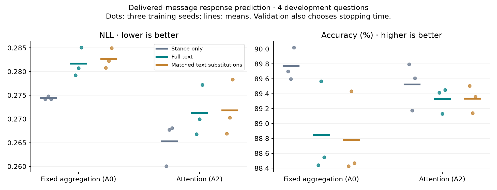

# Argument-aware response prediction: development diagnostic

**Exploratory results, not a fresh test.** The study uses 16 fitting questions and four validation questions. Validation chooses stopping time and has been used in previous studies. Paired intervals below describe these four questions; they are not confirmatory evidence.

The predictor observes `messages_history[t]` after delivery and predicts `s[t+1]`. This starts later than the completed opinion-only forecast. It is response prediction with real incoming messages, not autonomous simulation.

Primary attention comparison, full text minus stance only: NLL **+0.00603 [-0.00040, +0.01335]**; accuracy **-0.19 [-0.52, +0.26] percentage points** (descriptive pointwise 95% question-bootstrap intervals).

In this completed cohort, adding full text improves neither mean accuracy nor mean NLL over stance alone in either architecture. Original and matched-substituted messages give very similar results. This representation has not demonstrated an added predictive benefit; the experiment does not establish that arguments are irrelevant.

## Matched conditions

Every condition retains opinions, two-snapshot history, training-only-PCA context, sender/recipient associations, and the prescribed friendly/unfriendly labels. The source messages explicitly favor the sender's current option in all audited cases. The frozen 384-dimensional encoder is reused from the earlier screen, but each delivered message is now attached to its own edge; inboxes are not pre-averaged.

- **Stance only:** zero text embedding; all other inputs retained.
- **Full text:** the original individual message embedding.
- **Matched substitutions:** text is permuted between different episodes within question, round, sender, recipient, relationship, communicated stance, sender opinion, and receiver opinion. Training and validation are kept separate. Singleton strata retain their original message.

The text projection and all other parameter shapes are identical within each architecture, with the same initialization for each seed. The text projection is inactive in stance only. Equal nominal parameter counts therefore do not mean equal effective capacity.

## Results

| Aggregation | Input | NLL | Accuracy | Flip accuracy | Parameters |
| --- | --- | ---: | ---: | ---: | ---: |
| A0 | Stance only | 0.27441 | 89.77% | 84.04% | 169,498 |
| A0 | Full text | 0.28169 | 88.85% | 83.51% | 169,498 |
| A0 | Matched text substitutions | 0.28266 | 88.78% | 83.36% | 169,498 |
| A2 | Stance only | 0.26530 | 89.53% | 84.14% | 185,890 |
| A2 | Full text | 0.27133 | 89.33% | 85.06% | 185,890 |
| A2 | Matched text substitutions | 0.27186 | 89.33% | 85.06% | 185,890 |

Question means are averaged over seeds 42, 43, and 44. Each run has 4,096 fitting snapshots (131,072 agent transitions) and 1,024 validation snapshots (32,768 transitions).



## Paired contrasts

Negative NLL differences and positive accuracy differences favor the first condition. Evaluation-time substitution uses a full-text model without retraining; positive NLL there means prediction deteriorated.

| Aggregation | First minus second | NLL difference [95% interval] | Accuracy difference, points [95% interval] |
| --- | --- | ---: | ---: |
| A0 | Full text − Stance only | +0.00728 [-0.00494, +0.01568] | -0.92 [-1.32, -0.52] |
| A0 | Full text − Matched text substitutions | -0.00098 [-0.00156, -0.00034] | +0.07 [+0.06, +0.08] |
| A0 | Full model, substituted at evaluation − Full text | +0.00060 [-0.00006, +0.00174] | -0.06 [-0.15, +0.02] |
| A2 | Full text − Stance only | +0.00603 [-0.00040, +0.01335] | -0.19 [-0.52, +0.26] |
| A2 | Full text − Matched text substitutions | -0.00053 [-0.00175, +0.00049] | -0.00 [-0.05, +0.07] |
| A2 | Full model, substituted at evaluation − Full text | +0.00037 [-0.00039, +0.00168] | +0.02 [-0.05, +0.07] |

Average seeds within each question, then take 1,000 paired bootstrap resamples of questions, seed 1729. No agent-level pseudo-replication or multiplicity-adjusted claims. Subset analyses for messages that can be exchanged and for actual text changes are saved in `argument_response_paired.json`.

As a descriptive check on model sensitivity, the same full-text models were evaluated with the matched substitutions, without retraining:

| Model | Mean absolute probability change | Fraction of predicted choices changed |
| --- | ---: | ---: |
| A0 | 0.449 percentage points | 0.539% |
| A2 | 0.378 percentage points | 0.497% |

### Primary comparison by question

| Question | Full-text NLL − stance NLL | Full-text accuracy − stance accuracy |
| --- | ---: | ---: |
| math_train_133 | +0.00440 | -0.25 points |
| math_train_162 | +0.01633 | -0.55 points |
| math_train_359 | +0.00585 | -0.48 points |
| math_train_497 | -0.00246 | +0.50 points |

## Substitution coverage

| Seed | Partition | Matched messages | Actually different text | Receiver updates with different text |
| ---: | --- | ---: | ---: | ---: |
| 42 | train | 358,664/458,752 | 358,470/458,752 | 118,239/131,072 |
| 42 | validation | 88,710/114,688 | 88,668/114,688 | 29,431/32,768 |
| 43 | train | 358,664/458,752 | 358,481/458,752 | 118,241/131,072 |
| 43 | validation | 88,710/114,688 | 88,673/114,688 | 29,430/32,768 |
| 44 | train | 358,664/458,752 | 358,476/458,752 | 118,237/131,072 |
| 44 | validation | 88,710/114,688 | 88,672/114,688 | 29,431/32,768 |

Graph identity and complete prior inbox/history are not matched. Thus substitutions can alter other contextual associations besides reasoning quality. Unchanged or repeated text weakens the perturbation. Neither model-only substitutions nor attention weights establish causal influence on the source LLM.

## Earlier history-model reference

These saved models used the same examples and compact context, with no delivered-message input. Their architecture differs from the new edge-message model, so the primary matched comparison above is the appropriate test of added text for this implementation.

| Earlier model | NLL | Accuracy |
| --- | ---: | ---: |
| A0/history | 0.27304 | 89.38% |
| A2/history | 0.25998 | 89.66% |

## Provenance, costs and limits

All 6 scientific checks passed, including CPU/MPS agreement, message timing, future-state exclusion, shuffle partition/cue preservation, graph locality, isolated agents and permutation equivariance. Reporting independently verifies raw-source hashes and donor matching, recomputes every saved score, and confirms identical prediction keys and targets.

All 18 declared fits completed. Predictor fitting plus final evaluation took 278.5 recorded seconds; the cohort driver recorded 279.8 seconds. Feature preparation took 42.0 seconds, including 28.7 seconds in the new-encoding stage. These are local preprocessing/training costs, not complete autonomous-simulation speedups.

The encoder has 22,713,216 frozen parameters, revision `1110a243fdf4706b3f48f1d95db1a4f5529b4d41`. 383,576 vectors were reused and 40,229 new vectors encoded. Of 423,805 unique messages, 12 exceed its 256-token cap (12 message occurrences). No new source-LLM calls or paid APIs were used.

Full text contains reasoning and other linguistic cues. A gain would show useful extra content for the tested representation, not specifically logical reasoning or a universal law. A null result would not establish that arguments are irrelevant: the generic encoder, compact context, update architecture and four-question validation can limit this comparison.

No test messages were encoded or scored in this study. Existing test outcomes were inspected in the preceding study, so a future confirmatory experiment needs fresh questions/outcomes. No autonomous rollout is reported because this model requires observed messages. A compact memory with its own learned update remains a separate next step.

Prescribed graph labels remain intact. The deferred emergent-credibility experiment was not run.

## Reproduce

```bash
.venv/bin/python -u scripts/argument_response.py prepare --device mps
.venv/bin/python -u scripts/argument_response.py validation --device mps
.venv/bin/python scripts/report_argument_response.py
```

The independent implementation, config, data and protocol hashes must match before runs can resume. Completed artifacts are verified before reuse. Core training/evaluation and previous frozen study files are unchanged. The protocol is in `runs/argument_response_v1/protocol.json`; all predictions, checkpoints and manifests are stored under the same run root. Audit results are in `argument_response_integrity.json` and `argument_feature_audit.json`.
