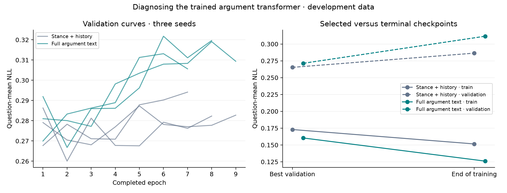

# Investigating the argument-response transformer

**Yes, the small graph transformer was trained.** Its 185,890 parameters include the message projection, attention query/key/value matrices, signed aggregation and output layers. AdamW updated them from random initialization. The 22,713,216-parameter MiniLM text encoder remained frozen; this experiment learned how to combine fixed message vectors, without fine-tuning token-level argument representations.

All analyses here are post-hoc and use the existing 16 fitting and four validation questions. No test set or source-LLM intervention is involved. The original experiment and its checkpoints remain unchanged.

## What the checkpoints establish

| Seed | Training epochs completed | Optimizer updates | Selected epoch |
| ---: | ---: | ---: | ---: |
| 42 | 8 | 1024 | 2 |
| 43 | 7 | 896 | 1 |
| 44 | 9 | 1152 | 3 |

Every full-text run has optimizer state for all 28 parameter tensors. Text-projection and Q/K/V weights changed, and a representative-batch gradient check found finite, nonzero gradients through each branch. The trained full-text model improves validation accuracy from 47.14% at initialization to 89.33% at the selected checkpoint. A disconnected or untrained argument branch does not explain the result.

## Continued fitting overfits the development questions

Values average the same three seeds. Training scores are reconstructed in evaluation mode from the saved checkpoints; they were not recorded as full training curves during the original run.

| Input | Checkpoint | Train NLL | Validation NLL | Train accuracy | Validation accuracy |
| --- | --- | ---: | ---: | ---: | ---: |
| Stance + history | Initialization | 0.80586 | 0.80360 | 47.23% | 47.07% |
| Stance + history | Best validation | 0.17295 | 0.26530 | 92.05% | 89.53% |
| Stance + history | End of training | 0.15156 | 0.28640 | 92.85% | 90.04% |
| Full argument text | Initialization | 0.80568 | 0.80356 | 47.21% | 47.14% |
| Full argument text | Best validation | 0.16040 | 0.27133 | 92.63% | 89.33% |
| Full argument text | End of training | 0.12605 | 0.31155 | 94.12% | 88.97% |

The full-text model keeps improving its training fit while validation NLL worsens. Its validation accuracy also falls after the selected checkpoint. The stance-only model's later NLL worsens even though its thresholded accuracy rises, illustrating that calibration and classification accuracy are different. Checkpoint selection was specified by NLL before these comparisons.

There are 131,072 fitting transitions but only 16 distinct training questions. The train/validation gap is consistent with limited cross-question generalization. These data do not identify whether the particular cause is the representation, model capacity, optimizer, or limited question diversity.



## The text input is small, but its branch learns

The model adds a projected unit-normalized text vector to the normalized sender state and a stance projection before normalizing the combined edge representation. Mean text/base vector-norm ratios on validation messages are:

| Checkpoint | Text/base norm ratio |
| --- | ---: |
| initial | 2.75% |
| selected | 3.80% |
| terminal | 6.07% |

This measured scale imbalance is a plausible optimization limitation, not proof that it caused the failed comparison. The text projection's terminal weight change is 1.19–1.32 times its initial weight norm across seeds, so the text branch was actively updated despite the small activation scale.

### Controlled rescaling

A separate six-fit diagnostic multiplies only the message vector by 32, bringing its initial contribution to the same order of magnitude as the other edge features. The multiplier was chosen from the measured 2.75% initial ratio, without a scale sweep. Model size, initial weights, data, batch order, optimizer and stopping rule are unchanged. The zero-text stance-only condition is exactly identical and its frozen runs are reused.

The larger text scale did not improve mean validation NLL or accuracy over the original full-text model. Simply increasing text magnitude did not rescue performance at this tested scale; other scaling or optimization choices remain untested.

| Text scale | Input | Validation NLL | Validation accuracy |
| ---: | --- | ---: | ---: |
| 1 | full_arguments | 0.27133 | 89.33% |
| 1 | shuffled_arguments | 0.27186 | 89.33% |
| 1 | stance_only | 0.26530 | 89.53% |
| 32 | full_arguments | 0.31859 | 88.32% |
| 32 | shuffled_arguments | 0.32003 | 88.03% |

| First minus second | NLL difference [95% interval] | Accuracy difference, points [95% interval] |
| --- | ---: | ---: |
| 32× full_arguments − 1× full_arguments | +0.04726 [+0.03514, +0.05939] | -1.01 [-1.90, -0.01] |
| 32× full_arguments − 1× stance_only | +0.05329 [+0.04623, +0.06098] | -1.20 [-2.27, -0.14] |
| 32× full_arguments − 32× shuffled_arguments | -0.00144 [-0.00312, -0.00026] | +0.29 [+0.22, +0.36] |

Intervals average seeds within question and use 1,000 paired question bootstrap draws. With four reused validation questions and stopping selected on their NLL, these intervals are descriptive and pointwise. No confirmatory superiority or equivalence claim follows.

## What information does the original text branch use?

| Partition | Intervention on the trained model | NLL change | Accuracy change, points | Mean absolute probability change, points | Choices changed |
| --- | --- | ---: | ---: | ---: | ---: |
| train | matched_substitution | +0.00027 | +0.00 | 0.312 | 0.366% |
| train | zero_text | +0.01430 | -0.64 | 1.857 | 2.190% |
| validation | matched_substitution | +0.00037 | +0.02 | 0.378 | 0.497% |
| validation | zero_text | -0.00259 | +0.13 | 0.771 | 1.080% |

Deleting the entire text input harms the training fit but slightly improves validation on average. That is consistent with text features that fit the training questions without transferring reliably. Deletion is an input distribution shift; the separately trained stance-only control remains the fair performance comparator.

Matched argument swaps alter predictions much less. They retain question, communicated stance and source/receiver cues, and may replace a reason with a paraphrase rather than a genuinely different argument. Low sensitivity therefore cannot establish that the source LLM ignores reasoning.

### Message and embedding inspection

The following input-only geometry audit samples 20,000 different-text matched pairs per partition, using seed 48216; it uses no target labels.

| Partition | Mean cosine similarity | Median | 5th–95th percentiles |
| --- | ---: | ---: | ---: |
| train | 0.908 | 0.929 | 0.758–0.983 |
| validation | 0.888 | 0.910 | 0.741–0.982 |

Inspection of pairs selected at fixed cosine quantiles found both paraphrases and reasoning differences. For example, two page-number arguments both use n(n+1)=18,360, n=135 and the sum 271; exchanging them changes wording but retains the mathematical argument. A faucet pair with cosine 0.947 gives the same answer, while one computes a per-faucet flow rate and the other incorrectly describes the new filling time as half of the original. The actual ratio is one eighth: one quarter of the volume at twice the flow rate.

High cosine similarity is not proof that a downstream model cannot distinguish those claims, and lower similarity is not proof of different reasoning. This small qualitative sample identifies limitations of the perturbation and encoder diagnostics; it is not a corpus-wide quality annotation. The sampled raw pairs are saved in `runs/argument_diagnostics_v1/argument_pair_examples.json`.

The predictor receives the question/persona context through the earlier compact PCA features (three question components, plus persona and interaction terms). The generic frozen message encoder is not trained to judge an argument against the full problem and choices. A question-conditioned argument representation remains untested.

## Target-vote disagreement

Each source target aggregates five response samples. This retrospective breakdown uses those target votes only for error analysis, never as predictor inputs. Values pool validation transitions within each vote-agreement group, then average over model seeds.

| Votes supporting target | Fraction of transitions | Full-text accuracy | Fraction of full-text errors |
| --- | ---: | ---: | ---: |
| 3/5 | 3.34% | 54.62% | 14.19% |
| 4/5 | 4.05% | 60.58% | 14.96% |
| 5/5 | 92.62% | 91.84% | 70.85% |

Vote disagreement indicates response variability for the same prompt, but five samples per prompt do not identify an irreducible accuracy ceiling. Errors on unanimous targets also need to be explained by representation/generalization rather than attributed automatically to noise.

## What is established and what remains open

The transformer was trained and its argument branch receives gradients. Continued full-text fitting overfits these development questions. The original text contribution is small, and the scale control above tests that specific concern; it does not test all possible ways to represent arguments. The frozen encoder, compact question context and limited variation between matched messages remain plausible limitations. None of these results establishes argument irrelevance or opinion-state sufficiency.

The next focused comparison should make argument meaning explicit relative to the problem and choices, retaining a matched stance control and genuine reasoning contrasts. Any later confirmatory claim needs new questions/outcomes. Do not tune on the previously consumed test set.

## Reproduce

```bash
.venv/bin/python -u scripts/diagnose_argument_response.py --device mps
.venv/bin/python -m pytest tests/test_argument_scale_diagnostic.py
.venv/bin/python -u scripts/argument_scale_diagnostic.py --device mps
.venv/bin/python scripts/report_argument_diagnostics.py
```

The read-only checkpoint/gradient audit took 26.2 seconds. The six scale-control fits recorded 111.2 seconds. No source-LLM generation or paid API was used. The original model/feature/source hashes were verified before and after analysis; the scale control uses a separate run namespace and adapter hash. Two focused tests verify its isolated namespace and text-only transform.
