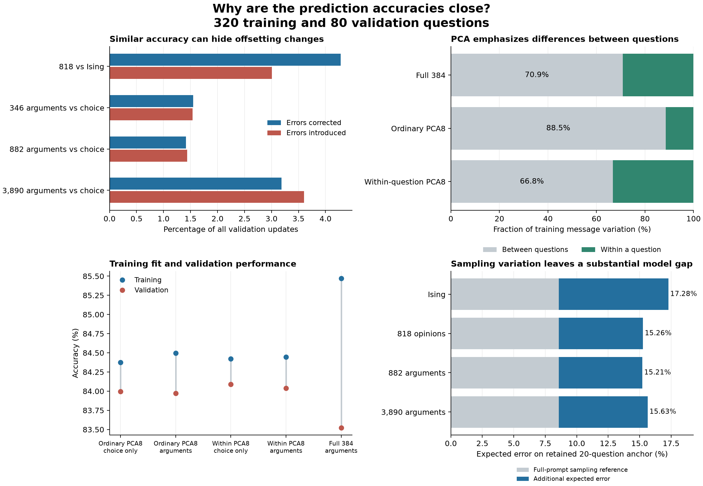

# Why the opinion prediction accuracies remain close

The models share many errors, and most new argument-driven decisions correct one error while introducing another. Source sampling contributes substantial uncertainty, but a retained probability diagnostic leaves a sizeable gap beyond it. A controlled change to text compression does not produce a clear accuracy gain. It does reveal a modest improvement in probability loss from arguments on the reused validation set.

The dataset contains 320 training and 80 validation MATH-based Llama-3.1-8B conversations on eight familiar signed graphs. Accuracy predicts each agent’s next majority-of-five A/B opinion, not mathematical correctness. Neural scores average three fitted seeds, not an ensemble. All analyses use the existing development corpus; the 40 assessment questions remain untouched.

## Corrections and new errors cancel

| Comparison | Decisions changed | Errors corrected | Errors introduced | Net accuracy gain |
| --- | ---: | ---: | ---: | ---: |
| 818 vs Ising | 7.287% | 4.281% | 3.006% | +1.274 pp |
| 346 arguments vs choice | 3.091% | 1.551% | 1.540% | +0.011 pp |
| 882 arguments vs choice | 2.856% | 1.416% | 1.440% | -0.024 pp |
| 3,890 arguments vs choice | 6.789% | 3.185% | 3.604% | -0.418 pp |

The 882-parameter argument model agrees with its matched choice-only control on 97.14% of decisions. Of its errors, 91.01% are shared with that control. On decisions where they disagree, the argument model is correct only 49.57% of the time. Equal aggregate accuracy therefore reflects both largely shared predictions and cancellation among the changed ones.

## Split source votes account for most errors

| Next-state vote agreement | Share of validation updates | Ising error | 818 opinion error | 882 argument error | 3890 argument error |
| --- | ---: | ---: | ---: | ---: | ---: |
| 3/5 | 19.10% | 40.44% | 39.73% | 40.06% | 40.39% |
| 4/5 | 23.31% | 23.15% | 21.44% | 21.46% | 22.27% |
| 5/5 | 57.59% | 7.05% | 5.77% | 5.86% | 6.20% |

Split votes account for 79.13% of the 818 model’s errors. Vote agreement uses the realized target votes, so this is a retrospective difficulty breakdown, not a usable predictor feature or an estimated noise ceiling.

## The source probabilities leave room for improvement

Saved source probabilities cover the retained 20 validation questions, rather than all 80. Their complete source prompts and votes match the present data. Normalize the first A/B-token probabilities to p, then compute majority-A probability q = p³(10 − 15p + 6p²). Averaging errors under q reduces dependence on the single observed five-vote label.

| Model or reference | Expected error on retained validation questions |
| --- | ---: |
| Full-prompt sampling reference | 8.576% |
| Ising | 17.283% |
| 818 opinion model | 15.260% |
| 882 argument model | 15.212% |
| 3890 argument model | 15.631% |

The 818 model has 6.68 percentage points of expected error above the full-prompt sampling reference. Sampling variation explains part of the error but does not support a claim that current accuracy is optimal. This first-token approximation conditions on the full realized inbox and question; it is not a universal ceiling for the compressed predictor inputs. The anchor differs in composition from the full 80-question validation set.

## What the eight text features preserve

| Representation | Between-question variation | Within-question variation |
| --- | ---: | ---: |
| Full 384-dimensional embeddings | 70.88% | 29.12% |
| Ordinary PCA8 | 88.52% | 11.48% |
| Within-question PCA8 | 66.81% | 33.19% |

These fractions describe numerical embedding variation, not percentages of information about reasoning correctness. The between-question component can include question content and question-associated message patterns. The residual also includes wording, stance, persona and round effects, not just argument quality.

The follow-up replaces ordinary PCA with the top eight directions of the within-question covariance of training messages. Under the same unique-text weighting, it retains 16.99% of within-question variation versus 10.68% previously. Its retained total variance decreases from 26.89% to 14.84%. Thus the intended redistribution of representation capacity occurred.

## Controlled compression experiment

Both representations use the same 882-parameter transformer, frozen MiniLM, signed graphs, question/persona context, training examples and three initialization seeds. Each condition reuses its original learning rate, penalty and training duration. Six new models were fitted, with no new hyperparameter search. All three seeds began from exactly the corresponding original weights.

Training-only question means construct the covariance. Every message at prediction time uses a single fixed global training mean and fixed projection; held-out question means, future messages and future labels are not needed. The 882 count excludes the frozen encoder and transforms.

| Compression and input | Training accuracy | Validation accuracy | Validation NLL |
| --- | ---: | ---: | ---: |
| Ordinary PCA8, choice only | 84.375% | 83.996% | 0.35951 |
| Ordinary PCA8, arguments | 84.498% | 83.971% | 0.35764 |
| Within-question PCA8, choice only | 84.420% | 84.089% | 0.35872 |
| Within-question PCA8, arguments | 84.447% | 84.038% | 0.35611 |

| Contrast | Accuracy gain in percentage points | 95% interval | NLL reduction | 95% interval |
| --- | ---: | --- | ---: | --- |
| New versus ordinary compression with arguments | +0.067 | [-0.093, +0.226] | +0.00153 | [-0.00024, +0.00330] |
| New versus ordinary compression with choice only | +0.093 | [-0.029, +0.217] | +0.00079 | [-2.69e-07, +0.00159] |
| Arguments versus choice under new compression | -0.050 | [-0.208, +0.106] | +0.00261 | [+0.00031, +0.00501] |
| New argument model versus original 818 | -0.054 | [-0.197, +0.091] | +0.00272 | [+0.00077, +0.00473] |

The revised compression changes argument-model accuracy by only +0.067 percentage points, with interval [-0.093, +0.226]. Under that compression, arguments versus choice alone change accuracy by -0.050 points, interval [-0.208, +0.106]. The same comparison reduces NLL by 0.00261, interval [0.00031, 0.00501], and reduces Brier loss. Thus the probability scores show a small benefit that classification accuracy does not capture. NLL evaluates the assigned probability, even when the predicted A/B class stays unchanged.

After subtracting the change in the choice-only control, the change in argument accuracy benefit is -0.026 points, with interval [-0.230, +0.163]. These are pointwise paired-question bootstrap intervals, conditional on the fitted models and reused validation set.

This fixed-recipe experiment tests whether one specific unsupervised compression change improves transfer. It does not establish the best achievable performance after retuning or show that the retained directions encode argument validity.

## Interpretation

The shared-error and correction accounting explains mechanically why the reported accuracies remain close. For the 3890-parameter model, full arguments raise training accuracy from 84.32% to 85.47% but lower validation accuracy from 83.94% to 83.52%, supporting a generalization problem in the tested pipeline. The source-probability diagnostic rules against attributing the entire remaining error to vote sampling.

Ordinary PCA does emphasize differences between questions. Preserving more within-question variation does not provide a clear accuracy improvement at the original training settings, so this particular compression choice is not a sufficient explanation of the accuracy gap. The new argument model improves probability loss versus its matched control and the original 818 model, while both accuracy contrasts remain uncertain. Its improvement over the original argument representation is also uncertain; the experiment does not establish that the new projection is superior.

MiniLM geometry and the graph predictor may still fail to represent how a particular argument bears on a particular question and receiver. That is a hypothesis, not a demonstrated root cause. More question diversity and representations trained to predict the source response to controlled argument changes remain discriminating directions; another parameter sweep alone would not distinguish them.

## Verification

All four focused tests passed. Six new refits took 4.69 fit minutes. The independent audit recomputed 68 prediction arrays and 30 paired contrasts, checked the covariance against explicit weighted residuals, verified the global transform and original initializations, and matched all 100 source-anchor episodes. Maximum aggregate metric discrepancy was 3.45e-08. Frozen earlier artifacts and background source collection remain unchanged.

Artifacts: `runs/argument_variance_320_v1/protocol.json`, `models_frozen.json`, `results/summary.json` and `completion_audit.json`.

