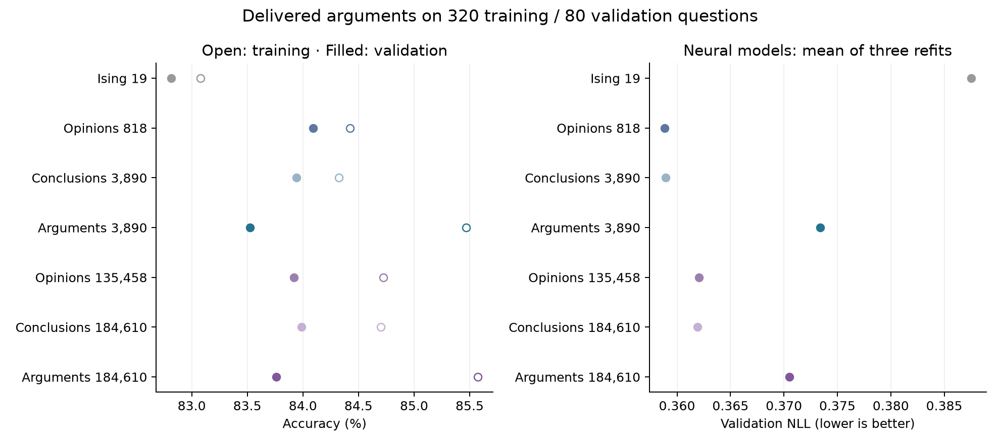

# Delivered arguments on 320 Llama training questions

For **3,890 parameters**, delivered arguments change validation accuracy by **-0.42 percentage points** (descriptive paired 95% interval **-0.81 to -0.03**) versus the conclusion-only control. NLL changes by **+0.01443** (interval +0.00840 to +0.02112; negative is better).

For **184,610 parameters**, delivered arguments change validation accuracy by **-0.23 percentage points** (descriptive paired 95% interval **-0.55 to +0.09**) versus the conclusion-only control. NLL changes by **+0.00860** (interval +0.00461 to +0.01264; negative is better).

This is the first argument-aware comparison on the expanded 320/80 corpus. It is separate from the earlier 818-parameter opinion-only size and question-count sweeps. Scores predict the next sampled majority-of-five opinion, not mathematical correctness. The same 80 validation questions select settings, so these are exploratory development results. The 40 reserved assessment conversations were not generated, loaded, encoded or scored.

## Matched data and inputs

All models use 320 training questions (81,920 agent transitions) and the same 80 validation questions (20,480 transitions). Entire questions stay within their existing partitions. The exact previous training-only question PCA, known-persona PCA, and 16-component context are reused. Current opinions, prescribed signed graph and fixed persona population are shared. Each receiver consumes its neighbors’ current broadcasts through the prescribed graph. Arguments, when present, are observed after delivery for the target update and before target votes. The original opinion-only models and Ising therefore forecast from an earlier information boundary. No autonomous rollout is attempted.

The compact argument model extends the 818-weight network with a learned bias-free 384-to-8 projection (3,890 parameters total). The larger model extends the 135,458-weight network with a 384-to-128 projection (184,610 total). Projected text is added to normalized sender state for attention keys and values; receiver queries and local state are unchanged. Unit-length input text vectors are scaled by sqrt(384), equally in both conditions, to avoid an unnecessarily small initial text activation. The pretrained 22,713,216-weight MiniLM encoder remains frozen and is excluded from these trainable counts. There is no PCA on arguments and no encoder fine-tuning.

The matched conclusion-only control receives the fixed string “I favor option A.” or “I favor option B.” determined solely by the sender’s current opinion. Both conditions predict the same original outcomes generated with full messages; the source conversations are never altered. The control shares all parameter shapes, initialization, learning-rate search, optimizer and stopping policy with its argument counterpart. Its text projection is active, although the two-value input has much lower rank; equal nominal parameter count is not equal effective statistical capacity. The original 818 and 135,458 opinion-only checkpoints and Ising coefficients are reproduced without refitting.

## Accuracy, probability loss and fitting

| Predictor | Trainable parameters | Training accuracy | Validation accuracy | Validation NLL | Validation two-class Brier |
| --- | ---: | ---: | ---: | ---: | ---: |
| Ising reference | 19 | 83.08% | 82.82% | 0.38751 | 0.24122 |
| Opinion/context graph transformer | 818 | 84.42% | 84.09% | 0.35884 | 0.22343 |
| Compact + conclusion-only text | 3,890 | 84.32% | 83.94% | 0.35894 | 0.22370 |
| Compact + delivered arguments | 3,890 | 85.47% | 83.52% | 0.37338 | 0.23311 |
| Larger opinion/context transformer | 135,458 | 84.73% | 83.92% | 0.36208 | 0.22568 |
| Larger + conclusion-only text | 184,610 | 84.70% | 83.99% | 0.36189 | 0.22547 |
| Larger + delivered arguments | 184,610 | 85.57% | 83.76% | 0.37050 | 0.23123 |

Neural values average the three individual model scores, not ensemble predictions. NLL and Brier are lower when better. Brier here sums over both binary classes and is twice the single-probability binary Brier.

Arguments improve training accuracy by 1.15 percentage points in the compact model and 0.87 points in the larger model, while both validation accuracy and probability loss worsen on average. This pattern is consistent with overfitting under the tested representation and training procedure. It does not establish that argument information is inherently unhelpful or that another representation or more training questions cannot help.

## Selected settings and variation

| Width / condition | Candidate | Fixed refit updates | Validation seed accuracies |
| --- | --- | ---: | --- |
| nano / conclusion | c3 | 15,360 | 142: 83.86%, 143: 84.03%, 144: 83.94% |
| nano / arguments | c7 | 2,560 | 142: 83.37%, 143: 83.75%, 144: 83.46% |
| full / conclusion | c1 | 3,584 | 142: 83.99%, 143: 84.00%, 144: 83.98% |
| full / arguments | c1 | 1,024 | 142: 83.82%, 143: 83.66%, 144: 83.79% |

Each width/condition receives nine choices from learning rates 0.0001/0.0003/0.001 and output-logit penalties 0/0.001/0.01, at tuning seed42. AdamW uses weight decay 0.001, dropout 0.1, batch32 snapshots, gradient clipping1, a 32,768-update cap, validation every512 updates, and ten-check patience. Validation NLL fixes settings and duration before fresh seeds142/143/144 train. Checkpoints preserve optimizer and RNG state for exact same-backend recovery.
Selected checkpoints at the update cap: none. This is a finite search and does not establish an architecture or optimization optimum.

Paired intervals resample 80 whole questions with 5,000 bootstrap draws after seed averaging. They are pointwise, conditional on the fitted models, and do not include training-data resampling or adjustment for repeated validation/model selection. A small interval containing zero does not establish equivalence.

## Opinion switches and predictor sensitivity

| Predictor | Error on opinion stays | Error on opinion switches |
| --- | ---: | ---: |
| Ising reference | 13.72% | 22.93% |
| Opinion/context graph transformer | 11.19% | 23.73% |
| Compact + conclusion-only text | 11.02% | 24.40% |
| Compact + delivered arguments | 12.26% | 23.46% |
| Larger opinion/context transformer | 11.19% | 24.19% |
| Larger + conclusion-only text | 11.05% | 24.24% |
| Larger + delivered arguments | 11.85% | 23.53% |

These subgroups use observed future changes for retrospective evaluation, never as predictor inputs.

| Argument model | Mean probability change when replacing arguments by conclusions | Predicted-class changes | Accuracy with replaced text |
| --- | ---: | ---: | ---: |
| nano | 7.52 pp | 7.02% | 83.33% |
| full | 5.71 pp | 6.14% | 83.18% |

Replacement is an input sensitivity check on a fixed fitted predictor, scored against the original observed outcomes. It is not a new source-model intervention, nor an estimate of what agents would do under the replaced text.

## Encoding, source audit and limitations

The 100,000 sender messages correspond to 358,400 delivered edges. Broadcasting, edge identities and alignment to the current opinion were verified. The source-message audit finds 96,983 standard explicit stance claims matching the prescribed opinion, 3,015 without that standard phrase, and two conflicting claims. Benefits from text may include stance expression, wording, topic and earlier conversational information; they do not isolate valid reasoning. No messages were excluded on the basis of prediction outcomes.

The encoding cache has 80,191 unique texts including two controls, 7,437,990 retained tokens, maximum length 372 tokens, and zero dropped tokens. Frozen encoding took 58.2 seconds; new predictor fitting took 61.4 minutes. These are measured stage costs, not an end-to-end source-model speedup. No source LLM calls were made.

There are 64,067 unique training argument strings and 16,122 unique validation strings, with 0 exact string overlaps. On training broadcasts, question centroids explain 70.88% of embedding variance; question/current-stance centroids explain 72.73%. This diagnostic weights each connected sender broadcast once. These variance fractions are not measures of mathematical information or proof that residual features are useless.

The question/persona representations still use three PCA components each. A lack of argument gain could reflect question context, the frozen embedding, fusion/optimization, limited generalization, stochastic targets or the task itself; this comparison does not distinguish all of them. A gain would establish useful extra information for this conditional response task, not a universal update law, causal credibility weights or logical-quality recognition. The same 32 personas, eight familiar graphs, entropy-selected objective MATH questions and one conversation per question limit generalization. No new graph-family, persona or untouched-assessment evaluation was added.

## Verification and artifacts

Eight focused checks cover temporal isolation, source alignment, parameter counts, exact recovery of the old graph model with zero text, one-hop masking, isolated nodes, permutation equivariance, text gradients, synthetic tuning/refitting, checkpoint recovery, paired statistics and CPU/GPU agreement. The independent completion audit recomputed 38 saved prediction arrays, 6 replacement diagnostics and 21 paired contrasts, verified 400 source episodes, 515 previous artifacts and 328 new frozen artifacts. All twelve fresh refits have nonzero text-projection gradients and changed text weights. CPU replay and backend discrepancies are recorded explicitly in the audit.

These are computational implementation checks, not independent external replication. Existing scientific code, earlier model/results artifacts, assessment protocols and the separate HPC3 collection remain unchanged.

- Protocol, preprocessing, encoding, checkpoints, predictions and by-question scores: `runs/breadth_arguments_320_v1/`
- Full numerical results and paired intervals: `runs/breadth_arguments_320_v1/results/summary.json`
- Completion audit: `runs/breadth_arguments_320_v1/completion_audit.json`
- Design and commands: `experiments/breadth_arguments_320_v1/README.md`
- Recompute the audit: `.venv/bin/python scripts/audit_breadth_arguments.py`
