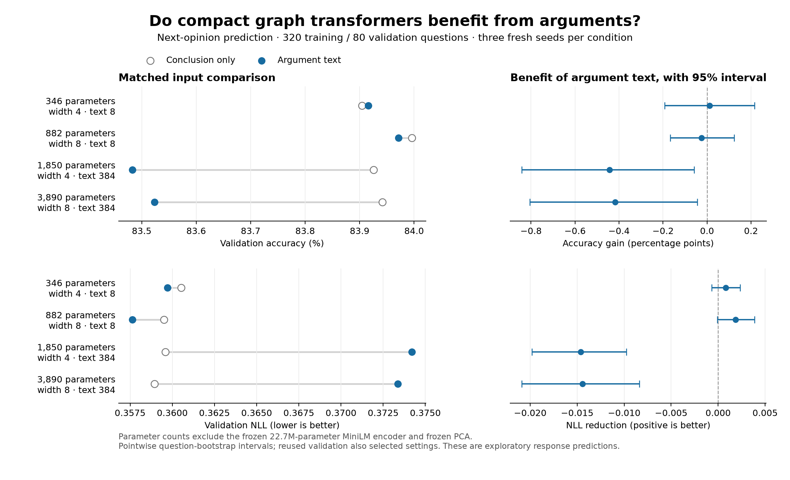

# Compact argument-aware transformers: 320/80 questions

Dataset: the existing MATH-based Llama-3.1-8B conversation corpus, with 320 training and 80 validation questions on eight familiar signed graphs. This is separate from the original paper’s GPT dataset.

Accuracy measures prediction of each agent’s next majority-of-five A/B opinion, not the correctness of its mathematical answer.

All scores below average the three fresh refit seeds; they are not an ensemble or a selected best seed.

| Model/input | Trainable parameters | Training accuracy | Validation accuracy | Validation NLL |
| --- | ---: | ---: | ---: | ---: |
| Ising | 19 | 83.081% | 82.817% | 0.38751 |
| Opinion/context model, width 4 | 314 | 84.260% | 83.937% | 0.35992 |
| Opinion/context model, width 8 | 818 | 84.422% | 84.092% | 0.35884 |
| Width 4, 8 text features: choice only | 346 | 84.244% | 83.905% | 0.36053 |
| Width 4, 8 text features: arguments | 346 | 84.266% | 83.916% | 0.35971 |
| Width 8, 8 text features: choice only | 882 | 84.375% | 83.996% | 0.35951 |
| Width 8, 8 text features: arguments | 882 | 84.498% | 83.971% | 0.35764 |
| Width 4, 384 text features: choice only | 1,850 | 84.198% | 83.926% | 0.35958 |
| Width 4, 384 text features: arguments | 1,850 | 84.905% | 83.483% | 0.37420 |
| Width 8, 384 text features: choice only | 3,890 | 84.324% | 83.942% | 0.35894 |
| Width 8, 384 text features: arguments | 3,890 | 85.469% | 83.524% | 0.37338 |

## Added value of argument text

Both rows in each comparison have the same architecture and trainable parameter count. The control receives only the sender’s stated A/B choice.

| Argument model | Accuracy gain (percentage points) | 95% interval | NLL reduction | 95% interval |
| --- | ---: | --- | ---: | --- |
| pico_pca8 | +0.011 | [-0.192, +0.216] | +0.00083 | [-0.00069, +0.00233] |
| nano_pca8 | -0.024 | [-0.168, +0.124] | +0.00187 | [-0.00009, +0.00389] |
| pico_full | -0.443 | [-0.841, -0.059] | -0.01462 | [-0.01983, -0.00976] |
| nano_full | -0.418 | [-0.806, -0.044] | -0.01443 | [-0.02088, -0.00837] |

## Interpretation of the completed comparison

Neither compressed model shows a clear validation-accuracy benefit from arguments. The 346-parameter accuracy change is +0.011 percentage points, with a 95% interval of [-0.192, +0.216]. The 882-parameter change is -0.024 points, with interval [-0.168, +0.124]. Its NLL reduction of 0.00187 is suggestive but uncertain: the interval [-0.00009, +0.00389] includes zero.

Using all 384 text features increases fitting ability but worsens validation performance. At 1,850 parameters, argument text raises training accuracy by 0.708 points and lowers validation accuracy by 0.443 points. At 3,890 parameters, the corresponding changes are +1.145 and -0.418 points. This is an overfitting pattern under the tested encoder, architecture and training procedure. The original 818-parameter opinion/context model remains slightly more accurate on validation than all four tested argument models.

The message branch is active: gradients, changed weights and text substitutions all verify that messages affect predictions. For the 3,890-parameter model, actual messages outperform the matched cross-round substitutions by 0.330 points, despite underperforming the separately trained choice-only control. This suggests some update-specific predictive information is present alongside the generalization cost. The substitution is an offline sensitivity diagnostic with unmatched receiver states and histories, so it does not isolate argument validity or establish a causal effect.

## Scope and interpretation

- The smallest tested argument model is 346 trainable parameters: four hidden dimensions and eight compressed message features. This is not a universal minimum.
- MiniLM has 22,713,216 frozen parameters. Message PCA adds 3,457 stored values (384 means, 8×384 components and one scale), fitted without labels on training texts and then frozen. The inherited question/persona transforms are also frozen during predictor training. The 346 count describes the trained update rule, not the entire text-processing system.
- Message PCA8 was fitted to 64,067 unique training texts and retains 26.89% of training embedding variance. The full-vector alternatives avoid that compression.
- Inputs use the actual message delivered after current opinions and before the next opinion update. No answer keys, solutions, future opinions, raw vote probabilities or extra history were added.
- The 400 development conversations provide 81,920 training and 20,480 validation transitions across eight familiar signed graphs. The 40 reserved assessment questions remain ungenerated/unscored in this study.
- Both the hyperparameter search and previous investigations used this validation set. Bootstrap intervals are pointwise, conditional on these fitted models and exploratory; they are not fresh confirmatory test intervals.
- An improvement establishes predictive value for this message representation. It does not establish that the model understands mathematical arguments, that text alone is sufficient, or that a universal interaction law has been found.

## Frozen-model substitution diagnostic

Substitutions preserve question, sender, graph, persona and current sender stance, using another round of the same conversation. They change 96.287% of message texts. Donor rounds may be later in the conversation: this is an offline diagnostic, not a prospective prediction procedure. Receiver state, round and full history are not matched; this is predictor sensitivity, not a causal source-agent intervention.

| Model | Probability change, mean absolute (percentage points) | Changed predicted classes | Accuracy gain of actual over substituted text (percentage points) | 95% interval |
| --- | ---: | ---: | ---: | --- |
| pico_pca8 | 0.511 | 0.684% | +0.013 | [-0.052, +0.078] |
| nano_pca8 | 0.970 | 1.100% | +0.091 | [-0.005, +0.182] |
| pico_full | 3.088 | 3.866% | +0.090 | [-0.083, +0.259] |
| nano_full | 5.001 | 5.132% | +0.330 | [+0.138, +0.526] |

## Verification

The study completed 54 new tuning fits and 18 fresh refits, using 78.4 fit minutes. Six full-vector width-eight refits and six original opinion-model refits were reused, plus the Ising baseline.
The independent audit recomputed 74 prediction arrays and 57 paired contrasts; verified 400 episode hashes, training-only PCA, donor matching, all frozen artifacts and learned text gradients. The largest score discrepancy was 0.

Artifacts: `runs/compact_arguments_320_v1/results/summary.json`, `completion_audit.json`, `models_frozen.json`, and `protocol.json`. The companion models and original datasets remain unchanged.

