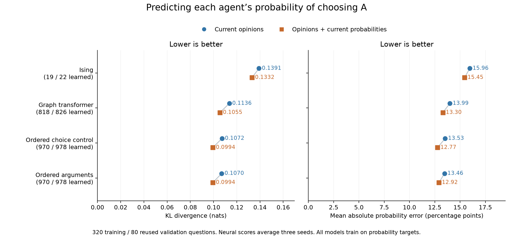

# Predicting opinion distributions instead of sampled opinions

Completed and audited November 14, 2026, 11:16 PM Central.

This experiment implements both requested input states on the existing **320 training /80 validation MATH/Llama conversations**, generated with the pinned Llama-3.1-8B MLX 4-bit checkpoint. It compares the original Ising rule, a graph transformer, and matched ordinary-attention models with and without argument content. All eight models predict the source agent’s next single-response probability of choosing A. No new source calls were needed.

**Current probabilities help every family; arguments have no clear additional KL benefit in this representation.** The graph transformer improves validation MAE from 13.989 to 13.303 percentage points when current probabilities are added, while the ordered choice-only model improves from 13.530 to 12.772. The corresponding enriched Ising baseline has 15.451 points of error. All four current-probability gains have positive paired KL and MAE reduction intervals. Ordered arguments reach 12.918 points, slightly worse than the matched choice-only model in MAE, with effectively identical KL.

## What is being predicted

\[p_i(t)=\frac{P(\text{first literal token A}\mid\text{actual prompt}_{i,t})}{P(A\mid\text{actual prompt}_{i,t})+P(B\mid\text{actual prompt}_{i,t})},\qquad \boldsymbol p_i(t)=(1-p_i(t),p_i(t)).\]

The probabilities were saved at the actual source temperature 0.7. They describe how the source answers a repeated identical prompt, not a direct measure of subjective belief or correctness. They are probabilities of one response, not the empirical count from five responses. The primary target is this normalized first-token distribution; its interpretation as the complete parsed-opinion distribution is approximate. All cases remain included.

\[\hat p_i(t+1)=\sigma\!\left(f_\theta(s_t,J,\phi[,p_t][,\text{delivered arguments and order}])_i\right).\]

Here s is the recorded current majority opinion, J is the signed communication graph, and φ is the original frozen question/persona context. In the enriched state, every agent additionally supplies its current probability through m=2p−1. Current probabilities come from round t; only p at t+1 is a training target. These numerical probabilities enrich the predictor’s inputs; the source agents were not newly prompted with probability vectors. This is one-step prediction with observed current state and already-delivered messages. It does not test a free-running rollout using the predictor’s own previous probability estimates.

All predictors are newly trained on probability targets. The old majority-of-five distribution is q=M₅(p)=10p³(1−p)²+5p⁴(1−p)+p⁵; it is reported only as a secondary check. The earlier approximately 91.4% expected sampled-majority accuracy does **not** cap probability fidelity. Perfect distribution prediction would have zero KL and zero probability error.

## Primary results

\[\mathrm{KL}(p\Vert\hat p)=p\log\frac{p}{\hat p}+(1-p)\log\frac{1-p}{1-\hat p},\qquad \mathrm{MAE}=\mathbb E[|p-\hat p|].\]

KL (source || predictor), in nats, is the primary metric. MAE is shown in percentage points: a 12-point error means, for example, predicting 0.62 when the target is 0.50. “Within 5 points” counts updates with |p−p̂|≤0.05; it is not sampled-opinion accuracy. Scores average questions, and then the three individual neural-seed scores, without probability ensembling.

| Input state | Model | Learned parameters | Train MAE, pp | Validation MAE, pp | Validation KL | Within 5 points |
| --- | --- | ---: | ---: | ---: | ---: | ---: |
| Opinions | Ising | 19 | 15.723 | 15.960 | 0.13911 | 23.50% |
| Opinions | Graph transformer | 818 | 13.643 | 13.989 | 0.11358 | 25.80% |
| Opinions | Ordered choice control | 970 | 13.110 | 13.530 | 0.10724 | 27.84% |
| Opinions | Ordered arguments | 970 | 13.154 | 13.464 | 0.10697 | 27.81% |
| Opinions + probabilities | Ising | 22 | 15.346 | 15.451 | 0.13319 | 25.26% |
| Opinions + probabilities | Graph transformer | 826 | 13.104 | 13.303 | 0.10553 | 30.66% |
| Opinions + probabilities | Ordered choice control | 978 | 12.492 | 12.772 | 0.09945 | 33.80% |
| Opinions + probabilities | Ordered arguments | 978 | 12.688 | 12.918 | 0.09943 | 31.87% |

The original opinion graph model has 818 weights. Adding the current probability costs eight weights, giving 826. Ordered choice and argument models have 970/978 weights and share the same actual message order and architecture. Their difference isolates the tested argument representation. Frozen MiniLM has **22,713,216 pretrained parameters**, excluded from these learned-rule counts; PCA8 is fitted only on training messages. Thus the entire text-processing system is larger than the update rule.

Two descriptive references were fixed before any outer scoring, separately from model selection. Persistence predicts p(t+1)=p(t); the constant predicts the training-only mean probability 0.38793. Their validation MAE /KL are **29.946 pp /0.75435** for persistence and **33.056 pp /0.34638** for the training mean. These distinguish learning the update from merely carrying current probabilities forward.

## Paired comparisons

Positive reductions favor the first model. Brackets are pointwise 95% intervals from 5,000 paired whole-question bootstrap samples. These are exploratory intervals conditional on fitted models, not fresh-assessment or multiple-comparison-adjusted claims.

| Comparison | KL reduction, nats [95% interval] | MAE reduction, pp [95% interval] |
| --- | ---: | ---: |
| 818 graph vs Ising19 | +0.0255 [+0.0221, +0.0291] | +1.971 [+1.728, +2.225] |
| 826 graph vs enriched Ising22 | +0.0277 [+0.0244, +0.0312] | +2.148 [+1.892, +2.423] |
| Add current probabilities: Ising | +0.0059 [+0.0043, +0.0076] | +0.509 [+0.373, +0.652] |
| Add current probabilities: Graph transformer | +0.0081 [+0.0064, +0.0098] | +0.686 [+0.551, +0.827] |
| Add current probabilities: Ordered choice control | +0.0078 [+0.0062, +0.0096] | +0.758 [+0.614, +0.911] |
| Add current probabilities: Ordered arguments | +0.0075 [+0.0060, +0.0093] | +0.547 [+0.420, +0.680] |
| Arguments vs choice: opinion state | +0.0003 [-0.0010, +0.0016] | +0.066 [-0.042, +0.182] |
| Arguments vs choice: probability state | +0.0000 [-0.0009, +0.0009] | -0.145 [-0.232, -0.058] |
| Ordered architecture vs graph: opinion state | +0.0063 [+0.0050, +0.0077] | +0.459 [+0.353, +0.566] |
| Ordered architecture vs graph: probability state | +0.0061 [+0.0049, +0.0073] | +0.530 [+0.433, +0.630] |

The ordered-versus-graph comparison changes both architecture and available order; it does not isolate order alone. Within each ordered architecture, arguments and the choice-only control have identical parameter counts and actual positions.

## Fitting, seed variation, and secondary accuracy

| Model / state | Train KL | Validation KL | Validation MAE seed range, pp | Source modal-choice agreement | Sampled-majority accuracy (secondary) |
| --- | ---: | ---: | ---: | ---: | ---: |
| Ising, opinions | 0.13570 | 0.13911 | 15.960–15.960 | 84.73% | 82.79% |
| Graph transformer, opinions | 0.10892 | 0.11358 | 13.936–14.078 | 86.50% | 83.96% |
| Ordered choice control, opinions | 0.10166 | 0.10724 | 13.431–13.596 | 86.97% | 84.37% |
| Ordered arguments, opinions | 0.10253 | 0.10697 | 13.272–13.675 | 87.01% | 84.48% |
| Ising, + probabilities | 0.13135 | 0.13319 | 15.451–15.451 | 85.21% | 83.25% |
| Graph transformer, + probabilities | 0.10237 | 0.10553 | 13.046–13.522 | 87.25% | 84.42% |
| Ordered choice control, + probabilities | 0.09539 | 0.09945 | 12.727–12.862 | 87.85% | 84.90% |
| Ordered arguments, + probabilities | 0.09564 | 0.09943 | 12.719–13.033 | 87.89% | 84.87% |

Modal-choice agreement compares the predictor’s more likely option with the source distribution’s more likely option. Sampled-majority accuracy compares it with a random recorded outcome. Neither is the same as matching the probability distribution. A successful change must be described using the metric it actually improves.

The selected ordered choice model with probabilities has 12.492 pp training MAE and 12.772 pp validation MAE. Its remaining error is therefore already substantial on the training set, while its train–validation gap is small. This points toward investigating the fitted rule and available representation; it does not establish an information-theoretic limit or exclude effects of regularization and optimization.

## Model and fitting definitions

\[\hat p_i=\sigma\left(\phi_i^\top w+\beta_+\sum_jJ^+_{ij}s_j+\beta_-\sum_jJ^-_{ij}s_j+\beta_0\sum_j|J_{ij}|s_j\right),\quad J^+=\max(J,0),\ J^-=\min(J,0).\]

The original Ising baseline keeps 16 context coefficients plus three graph coefficients, and the author’s pinned two-stage optimizer. The 22-coefficient version adds the receiver’s mᵢ and signed friendly/unfriendly sums of neighboring mⱼ. It retains all original opinion fields. Both use fractional-target Bernoulli cross-entropy and the unchanged regularization; neither is tuned on the 80 validation questions. An independent training-gradient check confirms convergence below 1e−6 in standardized second-stage coordinates.

Each neural condition tests the same nine learning-rate/output-penalty settings on the same internal **256 fit /64 tune** split within the training 320. Preprocessing is fitted on 256 during tuning and 320 during final fitting. Selection minimizes soft cross-entropy, equivalent to minimizing KL because the target entropy is fixed. Selected durations are refitted with seeds142/143/144. All eighteen neural refits and both Ising fits freeze before the outer80 are scored.

Execution completed **54 tuning fits, 18 neural refits, and 2 Ising fits**, using four local CPU workers. Neural fitting took 37.8 elapsed minutes and 117.2 summed worker-minutes. There was no new LLM generation or text-encoder training.

## Data quality and limits

There are 81,920 training and 20,480 validation agent updates, from 32 known personas and eight updates per conversation. All cases are retained. Validation target outside-A/B first-token mass averages 1.54e-07 and peaks at 0.000646. Training has 31 target states with outside-A/B mass above 0.001, with a maximum of 0.4682. These remain legitimate conditional A/B targets but are weaker approximations to the full parsed-response distribution.

The 80 validation questions have been reused in earlier experiments and helped motivate this study. Results remain developmental. The 40 reserved assessment conversations stay ungenerated and unused. This study tests familiar signed graphs; it adds no unseen-graph distribution claim. Original source logs, prior experiments and the separate HPC3 collection are unchanged.

Probability targets remove the random final choice from the label, but they do not guarantee zero error from a compressed state. Opinion-only predictors omit the realized arguments; argument predictors retain only compressed text and context. Under soft cross-entropy, the best predictor from available information X is the conditional mean E[p_source(t+1)|X]. Variation in the source probability that remains hidden from X can therefore still limit fidelity. The old sampled-label reference no longer applies, but this is not proof that the present inputs determine the full source distribution.

The independent audit checks all input/model hashes and split boundaries; reconstructs current and next probabilities from source logs; verifies all 54 tuning fits and six selections; recomputes all **40 prediction files /8,000 seed-question rows /60 paired contrasts**, plus two fixed references and their six contrasts; replays all 18 neural checkpoints and both Ising fits; and verifies the intended input branches have trained gradients while target replacement leaves outputs unchanged. Maximum aggregate numerical difference is 2.22e-16. Six focused pre-training checks also passed.

Artifacts: [experiment protocol](../experiments/distribution_prediction_320_v1/README.md), [frozen configuration](../configs/distribution_prediction_320.yaml), [numerical results](../runs/distribution_prediction_320_v1/results.json), [completion audit](../runs/distribution_prediction_320_v1/completion_audit.json), [training settings](../runs/distribution_prediction_320_v1/selection.json).
