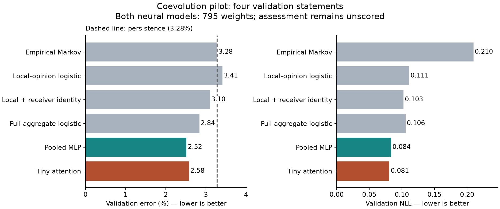

# Coevolution: first external prediction pilot

The compact attention model improves validation probability scores over the logistic baselines, but its advantage over an equally sized pooled neural network is small and metric-dependent. This is a validation-selected pilot on four statements, not an independent assessment result.

| Predictor | Parameters / stored coefficients | Training error | Validation error | Training NLL | Validation NLL |
| --- | ---: | ---: | ---: | ---: | ---: |
| Empirical Markov | 6 | 11.51% | 3.28% | 0.39741 | 0.20979 |
| Local-opinion logistic | 21 | 10.56% | 3.41% | 0.28743 | 0.11129 |
| Local + receiver identity | 66 | 9.11% | 3.10% | 0.23528 | 0.10265 |
| Full aggregate logistic | 207 | 7.99% | 2.84% | 0.20777 | 0.10561 |
| Pooled MLP | 795 | 6.36% | 2.52% | 0.16283 | 0.08359 |
| Tiny attention | 795 | 7.40% | 2.58% | 0.18688 | 0.08102 |

Neural rows average the three seed scores, not ensemble predictions. Logistic counts are stored softmax coefficients, not identifiable degrees of freedom; Markov reports six free transition probabilities.

## Data and input definition

The source is [CoevolveSim](https://github.com/carlomarxdk/coevolve-sim), pinned at `b5ca480ccf292d0fa6a531475abbf47433f3a342`. This bounded pilot uses 40 runs: the 20 medical-indication statements under matched specialist roles, on `erdos-renyi-01` and `watts-strogatz-01`. Each run has 48 agents and ten updates. This is not a replication of all 32 original graph realizations.

The split has 12 fitting, 4 validation, and 4 reserved assessment statement groups, balanced by source true/false labels. All graphs and agents for a statement stay together. Ground truth and question identifiers are excluded from predictor features. We predict the native next belief category (true/false/neither), not answer correctness.

The recorded neighbor summaries provide role identities and counts by current belief. The models use that information, the receiver’s current belief/identity, round, and degree. Source probability distributions are excluded. The full aggregate baseline and MLP receive exact role-by-belief fractions, so they retain the same visible multiset information as attention. The graph carries no friendship signs.

The attention architecture is adapted from the original width-eight/four-head predictor to these inputs and three outputs; it has 795 weights, not 818. The pooled model is `68 → 8 → 20 → 3`, also 795 weights. Both are trained from scratch; no text encoder or pretrained neural weights are used in this pilot.

## Fitting and selection

Four logistic penalties are compared on validation NLL. Each neural family uses two learning rates and three seeds, with up to 1,536 updates, checks every 128 steps, and validation early stopping. The mean seed NLL selects the learning rate. Training-only standardization is used for logistic models and the pooled MLP. The selected rate is 0.003 for both neural models.

A preliminary run with an accidentally unmatched 895-weight MLP versus 795-weight attention was archived after the parameter-count check failed. Exact original source and outputs are retained under `runs/external/coevolve_pilot_v1/superseded/unmatched_budget_895_795/`. The reported table uses the corrected matched-budget refits. No assessment scores were involved in the correction.

## Interpretation and limits

- Persistence error is 11.51% on fitting statements and only 3.28% on validation statements. Lower validation than training error reflects a substantially easier question group; it is not evidence of generalization beyond fitting performance.
- The pooled MLP has slightly lower validation classification error; attention has slightly lower validation NLL. Four statements do not support a strong architecture ranking, and the validation set selects the models.
- The native source interaction compresses arguments to belief/role summaries. This pilot cannot answer whether full argument text would add predictive information.
- These rates are not directly comparable to the original Ising/818-weight results: questions, source models, labels, graph protocol, and sampling differ. The appropriate simple controls here are categorical transition and logistic models.
- This is a fixed-budget pilot. Several fits reach the training cap; their selected training errors are not architecture capacity bounds.

## Verification

All 12 checkpoints were reloaded independently and reproduce saved fitting and validation probabilities with maximum difference 0. All four baselines were reconstructed from saved coefficients with maximum difference 0. The causal-input, masking, permutation, parameter-count, and question-overlap checks pass. All 51 protected original implementation/protocol files remain unchanged.

Assessment predictions were neither generated nor scored. The trainer removes reserved examples before fitting and does not use the recorded source confidence vectors.

See `audit.md`, `metrics.csv`, and `validation_by_question.csv` in this folder for data coverage and per-statement scores.
