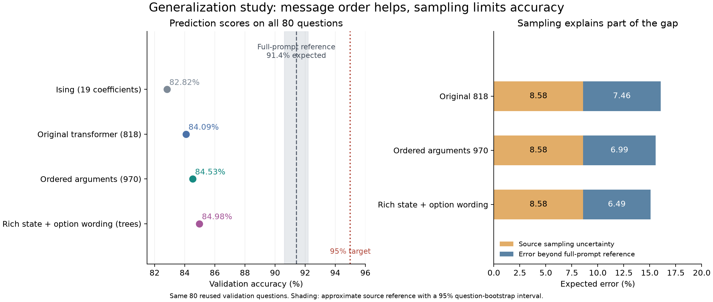

# Generalization investigation: four hypothesis cycles

Completed on the fixed MATH/Llama **320 training /80 validation** cohort. The target was approximately 95% next-opinion accuracy. **That target was not achieved.** The best observed accuracy in this investigation is 84.980%. The new 970-parameter ordered argument transformer reaches 84.526%.

The full source audit estimates a **91.415% best expected accuracy** for a predictor given the source model’s full-prompt response probabilities, under the checked first-token/parsed-response approximation. The 95% target is therefore unsupported for this particular sampled-majority outcome. This does not prevent improvement from 84–85% toward the reference, and it is not a universal ceiling for other targets or datasets.

## Task and evaluation boundary

Predict each agent’s next majority-of-five A/B opinion, not the mathematical answer. There are 81,920 training and 20,480 validation agent updates: 32 known personas, eight updates per question, familiar signed graphs J0–J7. Argument predictors see messages already generated for that update. This is conditional prediction after delivery, not autonomous rollout before message generation.

All new hyperparameter/duration choices use an internal 256-fit/64-tune whole-question split drawn only from the 320 training questions, stratified by graph and retained/new origin. Context and message PCA are fitted on 256 during tuning and 320 for final fitting. Every cycle freezes all final models before outer 80 scoring. Neural results average three fresh seed scores; trees use one deterministic fit. No seed ensembling or best-seed reporting.

**The 80 validation questions have been reused throughout the project, including to motivate later hypotheses.** Results and paired intervals are exploratory, not a fresh confirmatory test. Pointwise 5,000-draw question-bootstrap intervals do not adjust for multiple experiments or model-selection uncertainty. The 40 reserved assessment conversations remain ungenerated and unused.

## Cycle 1: missing state, nonlinear fits, and exact message order

Hypothesis: the original state omits useful order/history/context, or small attention misses nonlinear interactions. Six boosted-tree feature variants used the same six-recipe search. “Base” contains current opinions, signed-neighbor summaries and original 16 context features. “Rich” adds actual order, current/past vote confidence, 32 question PCs, known-persona indicators and current/initial global vote summaries. “Arguments” adds 64 PCA8 message summaries by relationship/stance and first/last messages.

| Model | Training accuracy | Validation accuracy | Validation NLL |
| --- | ---: | ---: | ---: |
| Ising (19) | 83.081% | 82.817% | 0.38751 |
| Original transformer (818) | 84.422% | 84.092% | 0.35884 |
| Base state trees | 85.309% | 83.862% | 0.36123 |
| Independent random order | 85.105% | 83.809% | 0.36145 |
| Actual order | 85.459% | 84.595% | 0.35208 |
| Vote/history state | 85.692% | 84.238% | 0.35126 |
| Rich state | 86.166% | 84.849% | 0.33853 |
| Rich state + PCA8 arguments | 86.643% | 84.751% | 0.33803 |

Actual order versus random order: **+0.786 pp [+0.508, +1.064]** accuracy. Rich state versus original 818: **+0.757 pp [+0.400, +1.131]**. Adding compressed argument summaries to rich state does not clearly improve accuracy. These trees are larger models, not parameter-matched substitutes for 818.

Revision: actual inbox order is a concrete missing variable. Broader state improves transfer, while simply providing compressed semantics still leaves a large gap.

## Source uncertainty: verified on the full 400 conversations

The export read saved source logs on a short HPC3 CPU job; it made zero source-model calls. All 400 episode hashes, 115,200 reconstructed prompt hashes and 576,000 finalized raw votes matched. Reconstructing the complete prompts verifies that the order used in these experiments is the actual source order, not an assumed historical order.

For a source first-vote probability p of choosing A, the majority-of-five probability is

\[q=M_5(p)=10p^3(1-p)^2+5p^4(1-p)+p^5.\]

Even a predictor that knows q exactly must choose between stochastic outcomes. Its best expected accuracy is

\[\mathbb{E}[\max(q,1-q)]=91.415\%,\qquad \mathbb{E}[\min(q,1-q)]=8.585\%.\]

The whole-question 95% interval for expected accuracy is **90.617–92.191%**. Its realized accuracy on the saved labels is **91.548%**. The retained 20 and added 60 validation questions give **91.424% and 91.412%** expected accuracy, respectively; the old small-cohort result was not an anomaly.

Assumptions and checks: first-token A/B probabilities are recorded at the actual sampling temperature 0.7 and agree across all five repetitions. They approximate parsed complete-response probabilities, with independent request-level sampling. On validation update responses, outside-A/B first-token mass averages 1.54e-7; only 2 of 102,400 initial responses are not bare A/B, and no final vote is invalid. Validation vote and majority calibration-bias intervals include zero. Later-token parsing anomalies are not mathematically bounded by first-token mass alone, so this remains a carefully checked approximation rather than an exact impossibility proof.

For the original 818 model, expected error is 16.041%: 8.585 points of sampling uncertainty and 7.457 points beyond the full-prompt reference. Thus sampling explains about 53.5% of its expected error, not all of it.

## Cycle 2: more precise training targets

Hypothesis: replace noisy training majority labels by source-majority probabilities. Only training questions supply teacher labels; probabilities never enter predictor inputs. 38 of 81,920 training labels fall back to the observed outcome due to nontrivial outside-A/B mass, non-bare responses or retries. No case is removed. Hard and soft controls use the same weighted Bernoulli representation, features, search and internal observed-label NLL selection.

| Model | Training accuracy | Validation accuracy | Validation NLL |
| --- | ---: | ---: | ---: |
| order hard | 85.459% | 84.595% | 0.35208 |
| order soft | 85.424% | 84.385% | 0.35147 |
| rich hard | 86.166% | 84.849% | 0.33853 |
| rich soft | 86.198% | 84.824% | 0.33586 |
| arguments hard | 86.643% | 84.751% | 0.33803 |
| arguments soft | 86.249% | 84.761% | 0.33546 |

Accuracy changes, soft versus hard: order: -0.210 pp [-0.469, +0.044]; rich: -0.024 pp [-0.239, +0.190]; arguments: +0.010 pp [-0.220, +0.239]. All three intervals include zero. Rich/argument probability estimates improve in NLL, but more precise labels alone do not solve the accuracy gap. Hard-label controls reproduce cycle 1 exactly.

Revision: sampling noise matters, but input representation and conditional response modeling remain limiting. A numerical guard caught probability-polynomial roundoff before the first attempt could evaluate validation; that unscored attempt was archived, corrected and rerun without reusing fits.

## Cycle 3: transfer the order signal to a compact transformer

The shared pair encoder receives sender state/text, relationship sign and three within-sign position features: normalized rank, first and last. It uses ordinary scaled-dot-product attention. All four conditions have **970 learned parameters**, 24 more than the preceding 946-parameter pair-token model. The text encoder remains frozen MiniLM; its 22.7M pretrained parameters and PCA fitting are separate from the 970 count.

| Model | Training accuracy | Validation accuracy | Validation NLL |
| --- | ---: | ---: | ---: |
| Random position, choice only | 84.478% | 83.970% | 0.35789 |
| Actual position, choice only | 84.731% | 84.357% | 0.35332 |
| Random position, arguments | 84.397% | 83.874% | 0.35635 |
| Actual position, arguments | 84.899% | 84.526% | 0.34989 |

Actual order versus random order for arguments: **+0.653 pp [+0.439, +0.866]**. Ordered arguments versus original 818: **+0.435 pp [+0.174, +0.705]**. Arguments versus the matched ordered choice-only control: **+0.169 pp [+0.023, +0.314]**.

This is a small positive argument result once actual order is represented. It does not establish that all argument representations work or that the entire remaining gap is positional. The additional exploratory order×argument accuracy interaction is +0.265 pp [+0.054, +0.480].

## Cycle 4: preserve explicit option wording

Hypothesis: semantic compression blurs simple option-specific details. Eight fixed textual features replace each PCA8 message vector: A/B counts, first/last uppercase mention, explicit option-A/B counts, last explicit option mention, and message length. The same 64 receiver summaries make the lexical model 255-dimensional, matching the rich+PCA8 argument model. A combined variant appends both representations. A final mention can refer to an option being criticized; it is a feature, not a guaranteed extracted recommendation.

| Model | Training accuracy | Validation accuracy | Validation NLL |
| --- | ---: | ---: | ---: |
| Rich state + option wording | 86.423% | 84.980% | 0.33689 |
| Rich state + PCA8 + option wording | 86.470% | 84.854% | 0.33669 |

Explicit option wording versus PCA8 argument summaries: **+0.229 pp [+0.015, +0.454]**. Versus original 818: **+0.889 pp [+0.550, +1.224]**. The gain over rich state without arguments is uncertain: +0.132 pp [-0.068, +0.327]. This supports a narrow representation issue, not a claim that MiniLM is universally unsuitable.

## Where the remaining errors occur

A retrospective split by the source model’s own majority confidence explains why improvements remain modest. These source probabilities are diagnostic references, not available inputs to the small predictor or a basis for filtering its primary score.

| Source majority confidence | Share of all updates | Original 818 accuracy | Best new tree accuracy | Sampling-error contribution to total |
| --- | ---: | ---: | ---: | ---: |
| 50–80% | 18.350% | 55.127% | 55.029% | 6.370 pp |
| 80–99% | 29.170% | 79.277% | 81.051% | 2.153 pp |
| 99–100% | 52.480% | 96.896% | 97.637% | 0.061 pp |

The 18.3% of updates with source confidence below 80% contribute 6.37 percentage points of irreducible error by themselves under the checked source approximation—already above a 5% error budget. Most observed improvement occurs in more decisive cases; the small model still misses some of those, leaving room for better representations and more data. Every update remains included in the primary accuracy.

## What this establishes and what remains open

There is now a verified, specific improvement: represent actual message order. It benefits both a larger tree model and a 970-parameter ordinary-attention model, and it reveals a small matched argument benefit. Richer context and transparent option wording also improve exploratory scores. The strongest simple signal was already captured well by the 19-coefficient Ising model; complexity alone cannot supply omitted information or predict fresh sampling randomness.

The best observed variant still has 15.020% error. Under the source-probability diagnostic its expected accuracy is 84.929%, leaving 6.486 predictable percentage points below the full-prompt reference. It closes 13.0% of the original 818 model's excess expected error. The remaining gap is not fully explained by these experiments.

A scientifically useful update law here should predict a response distribution, for example

\[q_i=F_\theta(\text{question, persona, signed ordered messages, available state}),\quad s_i^{t+1}=2\operatorname{Bernoulli}(q_i)-1.\]

Keep observed accuracy as a metric, but compare probability loss and excess error above the source reference as well. The independently running 3,200/800 collection can test whether the newly identified state variables transfer with more questions. It was not altered by this investigation. Achieving 95% would require evidence that this noise estimate is wrong or an explicitly different target/protocol; neither is claimed here.

## Verification and artifacts

**96 tuning fits and 26 final refits completed**, plus the separately recorded failed unscored attempt. All four cycle audits pass. Saved validation predictions replay from checkpoints without class differences; scores and paired intervals independently reproduce. Source/prompt identity, training-only transforms, target isolation, position masks, padding and weighted fractional loss were checked. The prediction/contrast totals and complexity metadata are in the audit files below.

- [Hypothesis journal](../experiments/generalization_investigation_320_v1/README.md)
- [Source audit](../runs/generalization_investigation_320_v1/noise_audit_v1/audit.json)
- [State models and audit](../runs/generalization_investigation_320_v1/state_models_v1/completion_audit.json)
- [Probability supervision and audit](../runs/generalization_investigation_320_v1/distillation_v1/completion_audit.json)
- [Ordered transformer and audit](../runs/generalization_investigation_320_v1/ordered_transformer_v1/completion_audit.json)
- [Explicit option wording and audit](../runs/generalization_investigation_320_v1/lexical_v1/completion_audit.json)
- [Consolidated numerical results](../runs/generalization_investigation_320_v1/report_v1/summary.json)
- [Saved source-confidence error regimes](../runs/generalization_investigation_320_v1/report_v1/source_confidence_regimes.json)
