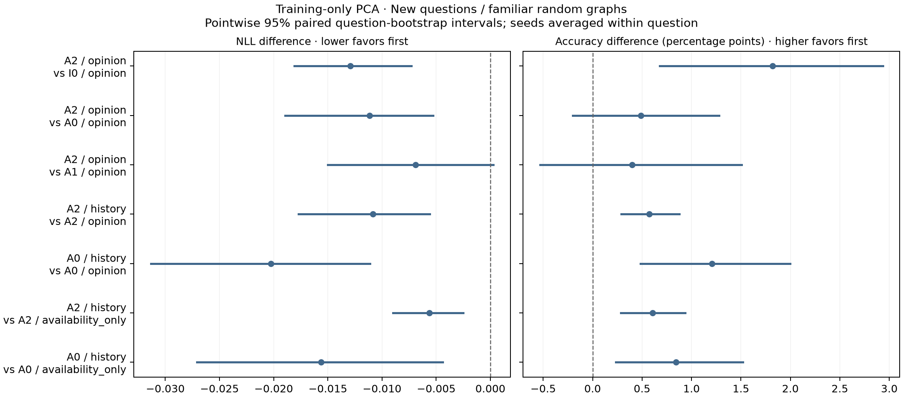
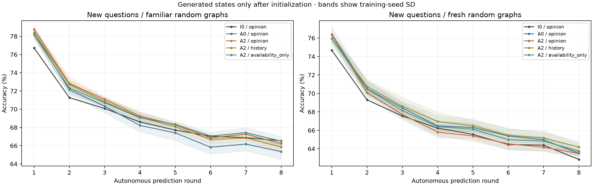

# Frozen test evaluation with training-only PCA

A2/opinion minus I0 on **new questions / familiar random graphs**: accuracy difference +1.82 percentage points, paired 95% interval [+0.68, +2.93]. The interval is above zero for this predeclared comparison; the magnitude and other evaluation roles still matter.

The NLL difference is -0.01292, interval [-0.01808, -0.00730] (negative favors A2). NLL was the predeclared primary probability metric; accuracy is reported alongside it. Intervals average seeds within each question before resampling questions. They are pointwise, not adjusted for the multiple secondary comparisons.

## Findings for the research question

The held-out study supports a small one-step advantage over the Ising baseline on random graphs: +1.82 pp [+0.68, +2.93] on familiar graphs and +1.86 pp [+0.51, +3.25] on fresh graphs. Both NLL and accuracy improve in these comparisons. This is more evidence than the earlier four-question validation screen, while the practical accuracy gain remains modest.

A transformer-specific accuracy advantage is unresolved: A2 minus the simpler A0 control is +0.49 pp [-0.20, +1.28] on familiar graphs and -0.01 pp [-0.92, +1.08] on fresh graphs. The pointwise NLL advantage over A0 is clearer on familiar graphs and unresolved on fresh graphs. The fixed-aggregation/history model has mean accuracy 89.35% and 88.47% on those two roles, compared with 89.20% and 87.89% for attention/history; these descriptive means do not establish a universal winner.

Actual past opinion values provide a small additional one-step benefit over the matched initialization-only control: A2/history minus A2/availability-only is +0.60 pp [+0.29, +0.94] on familiar graphs and +0.88 pp [+0.51, +1.30] on fresh graphs, with lower NLL in both roles. This separates part of the history benefit from the initialization cue. It does not establish that two snapshots form a sufficient state, and the accuracy gain does not extend uniformly to the structured graph families.

There is no demonstrated general improvement in autonomous simulation. A2/opinion minus I0 at round eight is -0.30 pp [-4.20, +3.61] on familiar graphs and +0.65 pp [-4.10, +4.79] on fresh graphs. Final-fraction distribution distances are higher on average for A2 in both roles, with paired intervals spanning zero. History's one-step improvements do not yield consistent rollout gains. The next scientific target is explaining the trajectory/distribution mismatch using development data, rather than further tuning against these now-observed test outcomes.

The declared cohort contains 24 fits: three baselines and seven neural configurations at seeds 42/43/44. Neural configurations are A0/A1/A2 with opinions, A0/A2 with history, and A0/A2 with the matched availability-only control. Every candidate was retained; no best-seed selection was performed.

PCA is fitted on raw frozen question-plus-options embeddings from the 16 training questions only. Its mean/components and every context vector were reconstructed independently. Perturbing held-out embeddings did not change fitted PCA. All other arrays, example identities, targets, and graphs match the earlier author-context study. All 32 personas appear in training. Architectures, hyperparameters, stopping rules, graph signs, and forecast boundaries are unchanged.

The availability-only control uses the same six-feature history architecture, zeroing past-opinion values while retaining availability and current-opinion features. The transform is applied consistently in fitting, one-step evaluation, and generated-history rollout. Study-specific implementation hashes prevent ordinary CLI evaluation from silently omitting it.

Selection was frozen at `2026-11-08T03:56:24.319393+00:00` before any controlled test scoring. All checkpoints, manifests, preprocessing files, and the study implementation were verified against the freeze record. No retraining, preprocessing changes, or reselection followed test evaluation.

New-question tests include 20 questions on familiar random graphs, fresh random graphs, and square/triangular graphs; low-rank graphs have ten questions. Known-training-question tests on square/triangular graphs have 16 questions and are reported separately. The primary role was fixed as new questions on familiar random graphs.

## New questions / familiar random graphs

20 questions; 81,920 agent transitions per run. Means ± sample SD across neural training seeds. Accuracy means matching agent opinion, not task correctness.

| Model | State | Parameters | NLL ↓ | Brier ↓ | Accuracy % | FCBA % |
| --- | --- | ---: | ---: | ---: | ---: | ---: |
| P0 | opinion | 0 | — | — | 63.16 | 50.00 |
| P1 | opinion | 2 | 0.6611 | 0.4683 | 63.16 | 50.00 |
| I0 | opinion | 19 | 0.2552 | 0.1571 | 86.81 | 83.38 |
| A0 | opinion | 119,066 | 0.2534 ± 0.0082 | 0.1557 ± 0.0051 | 88.14 ± 0.74 | 85.74 ± 0.07 |
| A1 | opinion | 119,714 | 0.2492 ± 0.0048 | 0.1544 ± 0.0037 | 88.23 ± 0.20 | 85.91 ± 0.19 |
| A2 | opinion | 135,458 | 0.2423 ± 0.0023 | 0.1504 ± 0.0017 | 88.63 ± 0.08 | 85.48 ± 0.58 |
| A0 | history | 119,834 | 0.2332 ± 0.0032 | 0.1443 ± 0.0027 | 89.35 ± 0.22 | 86.35 ± 0.40 |
| A2 | history | 136,226 | 0.2315 ± 0.0052 | 0.1450 ± 0.0039 | 89.20 ± 0.33 | 85.94 ± 0.43 |
| A0 | availability_only | 119,834 | 0.2488 ± 0.0088 | 0.1564 ± 0.0062 | 88.50 ± 0.43 | 85.04 ± 0.55 |
| A2 | availability_only | 136,226 | 0.2371 ± 0.0035 | 0.1503 ± 0.0017 | 88.60 ± 0.20 | 85.04 ± 0.56 |

Autonomous simulation from the observed initialization: deterministic trajectories and 32 samples per initial state, eight rounds. Each model uses generated states after initialization.

| Model | State | Round-8 accuracy % | Final-fraction Wasserstein ↓ | Sampled switches / agent | Observed switches / agent |
| --- | --- | ---: | ---: | ---: | ---: |
| P0 | opinion | 61.73 | 0.2212 | 0.000 | 2.947 |
| P1 | opinion | 61.73 | 0.2323 | 3.160 | 2.947 |
| I0 | opinion | 66.53 | 0.2062 | 3.670 | 2.947 |
| A0 | opinion | 65.35 ± 0.86 | 0.2267 ± 0.0022 | 3.469 | 2.947 |
| A1 | opinion | 65.34 ± 0.26 | 0.2271 ± 0.0079 | 3.472 | 2.947 |
| A2 | opinion | 66.23 ± 0.24 | 0.2199 ± 0.0036 | 3.695 | 2.947 |
| A0 | history | 65.49 ± 0.76 | 0.2325 ± 0.0189 | 3.380 | 2.947 |
| A2 | history | 65.85 ± 0.46 | 0.2169 ± 0.0065 | 3.721 | 2.947 |
| A0 | availability_only | 65.27 ± 0.27 | 0.2307 ± 0.0018 | 3.428 | 2.947 |
| A2 | availability_only | 66.49 ± 0.53 | 0.2148 ± 0.0025 | 3.695 | 2.947 |

Paired differences: first model minus reference. Positive accuracy and negative NLL favor the first model.

| First | Reference | Δ accuracy pp [95% interval] | Δ NLL [95% interval] |
| --- | --- | --- | --- |
| A2 / opinion | I0 / opinion | +1.82 [+0.68, +2.93] | -0.01292 [-0.01808, -0.00730] |
| A2 / opinion | A0 / opinion | +0.49 [-0.20, +1.28] | -0.01114 [-0.01895, -0.00527] |
| A2 / opinion | A1 / opinion | +0.40 [-0.53, +1.51] | -0.00690 [-0.01500, +0.00027] |
| A2 / history | A2 / opinion | +0.57 [+0.29, +0.88] | -0.01083 [-0.01771, -0.00559] |
| A0 / history | A0 / opinion | +1.21 [+0.49, +2.00] | -0.02026 [-0.03133, -0.01112] |
| A2 / history | A2 / availability_only | +0.60 [+0.29, +0.94] | -0.00562 [-0.00897, -0.00251] |
| A0 / history | A0 / availability_only | +0.84 [+0.23, +1.52] | -0.01564 [-0.02709, -0.00440] |
| A2 / availability_only | A2 / opinion | -0.03 [-0.33, +0.19] | -0.00520 [-0.00948, -0.00191] |
| A0 / availability_only | A0 / opinion | +0.36 [-0.60, +1.37] | -0.00462 [-0.02107, +0.00774] |

## New questions / fresh random graphs

20 questions; 81,920 agent transitions per run. Means ± sample SD across neural training seeds. Accuracy means matching agent opinion, not task correctness.

| Model | State | Parameters | NLL ↓ | Brier ↓ | Accuracy % | FCBA % |
| --- | --- | ---: | ---: | ---: | ---: | ---: |
| P0 | opinion | 0 | — | — | 62.38 | 50.00 |
| P1 | opinion | 2 | 0.6647 | 0.4718 | 62.38 | 50.00 |
| I0 | opinion | 19 | 0.2790 | 0.1751 | 85.36 | 82.55 |
| A0 | opinion | 119,066 | 0.2700 ± 0.0096 | 0.1686 ± 0.0071 | 87.23 ± 0.92 | 84.77 ± 0.17 |
| A1 | opinion | 119,714 | 0.2690 ± 0.0060 | 0.1698 ± 0.0045 | 87.01 ± 0.32 | 84.58 ± 0.22 |
| A2 | opinion | 135,458 | 0.2663 ± 0.0022 | 0.1689 ± 0.0022 | 87.22 ± 0.50 | 83.60 ± 1.34 |
| A0 | history | 119,834 | 0.2506 ± 0.0036 | 0.1569 ± 0.0032 | 88.47 ± 0.26 | 85.62 ± 0.39 |
| A2 | history | 136,226 | 0.2518 ± 0.0051 | 0.1608 ± 0.0044 | 87.89 ± 0.36 | 84.66 ± 0.38 |
| A0 | availability_only | 119,834 | 0.2651 ± 0.0096 | 0.1670 ± 0.0059 | 87.82 ± 0.58 | 84.51 ± 0.42 |
| A2 | availability_only | 136,226 | 0.2600 ± 0.0043 | 0.1678 ± 0.0028 | 87.02 ± 0.27 | 83.22 ± 1.01 |

Autonomous simulation from the observed initialization: deterministic trajectories and 32 samples per initial state, eight rounds. Each model uses generated states after initialization.

| Model | State | Round-8 accuracy % | Final-fraction Wasserstein ↓ | Sampled switches / agent | Observed switches / agent |
| --- | --- | ---: | ---: | ---: | ---: |
| P0 | opinion | 60.92 | 0.2186 | 0.000 | 3.010 |
| P1 | opinion | 60.92 | 0.2270 | 3.166 | 3.010 |
| I0 | opinion | 62.84 | 0.2269 | 3.725 | 3.010 |
| A0 | opinion | 63.51 ± 0.37 | 0.2418 ± 0.0011 | 3.457 | 3.010 |
| A1 | opinion | 63.59 ± 0.40 | 0.2393 ± 0.0039 | 3.439 | 3.010 |
| A2 | opinion | 63.49 ± 0.19 | 0.2374 ± 0.0059 | 3.641 | 3.010 |
| A0 | history | 63.61 ± 0.32 | 0.2468 ± 0.0167 | 3.401 | 3.010 |
| A2 | history | 64.18 ± 0.64 | 0.2332 ± 0.0046 | 3.727 | 3.010 |
| A0 | availability_only | 63.68 ± 0.58 | 0.2402 ± 0.0051 | 3.446 | 3.010 |
| A2 | availability_only | 63.74 ± 0.82 | 0.2312 ± 0.0036 | 3.672 | 3.010 |

Paired differences: first model minus reference. Positive accuracy and negative NLL favor the first model.

| First | Reference | Δ accuracy pp [95% interval] | Δ NLL [95% interval] |
| --- | --- | --- | --- |
| A2 / opinion | I0 / opinion | +1.86 [+0.51, +3.25] | -0.01269 [-0.02005, -0.00477] |
| A2 / opinion | A0 / opinion | -0.01 [-0.92, +1.08] | -0.00373 [-0.01236, +0.00334] |
| A2 / opinion | A1 / opinion | +0.20 [-0.93, +1.60] | -0.00264 [-0.01123, +0.00504] |
| A2 / history | A2 / opinion | +0.68 [+0.45, +0.95] | -0.01452 [-0.02121, -0.00950] |
| A0 / history | A0 / opinion | +1.24 [+0.49, +2.17] | -0.01941 [-0.03049, -0.01092] |
| A2 / history | A2 / availability_only | +0.88 [+0.51, +1.30] | -0.00818 [-0.01176, -0.00527] |
| A0 / history | A0 / availability_only | +0.66 [+0.18, +1.21] | -0.01443 [-0.02598, -0.00328] |
| A2 / availability_only | A2 / opinion | -0.20 [-0.58, +0.13] | -0.00634 [-0.01000, -0.00332] |
| A0 / availability_only | A0 / opinion | +0.59 [-0.37, +1.64] | -0.00498 [-0.02042, +0.00767] |

## New questions / square graph

20 questions; 20,480 agent transitions per run. Means ± sample SD across neural training seeds. Accuracy means matching agent opinion, not task correctness.

| Model | State | Parameters | NLL ↓ | Brier ↓ | Accuracy % | FCBA % |
| --- | --- | ---: | ---: | ---: | ---: | ---: |
| P0 | opinion | 0 | — | — | 63.89 | 49.17 |
| P1 | opinion | 2 | 0.6607 | 0.4677 | 63.89 | 49.17 |
| I0 | opinion | 19 | 0.1335 | 0.0679 | 95.19 | 93.18 |
| A0 | opinion | 119,066 | 0.1229 ± 0.0027 | 0.0690 ± 0.0008 | 95.19 ± 0.07 | 92.03 ± 0.16 |
| A1 | opinion | 119,714 | 0.1212 ± 0.0014 | 0.0690 ± 0.0014 | 95.17 ± 0.02 | 92.25 ± 0.33 |
| A2 | opinion | 135,458 | 0.1204 ± 0.0048 | 0.0691 ± 0.0025 | 95.13 ± 0.01 | 92.23 ± 0.50 |
| A0 | history | 119,834 | 0.1162 ± 0.0027 | 0.0678 ± 0.0007 | 95.05 ± 0.10 | 92.96 ± 0.92 |
| A2 | history | 136,226 | 0.1171 ± 0.0046 | 0.0696 ± 0.0030 | 94.94 ± 0.20 | 93.08 ± 0.43 |
| A0 | availability_only | 119,834 | 0.1152 ± 0.0037 | 0.0680 ± 0.0017 | 95.07 ± 0.20 | 92.80 ± 0.94 |
| A2 | availability_only | 136,226 | 0.1147 ± 0.0023 | 0.0679 ± 0.0014 | 94.98 ± 0.20 | 93.06 ± 0.38 |

Autonomous simulation from the observed initialization: deterministic trajectories and 32 samples per initial state, eight rounds. Each model uses generated states after initialization.

| Model | State | Round-8 accuracy % | Final-fraction Wasserstein ↓ | Sampled switches / agent | Observed switches / agent |
| --- | --- | ---: | ---: | ---: | ---: |
| P0 | opinion | 60.90 | 0.2676 | 0.000 | 2.889 |
| P1 | opinion | 60.90 | 0.2937 | 3.165 | 2.889 |
| I0 | opinion | 65.70 | 0.2477 | 3.729 | 2.889 |
| A0 | opinion | 67.83 ± 1.19 | 0.2640 ± 0.0047 | 3.376 | 2.889 |
| A1 | opinion | 68.11 ± 0.30 | 0.2625 ± 0.0122 | 3.375 | 2.889 |
| A2 | opinion | 68.27 ± 0.25 | 0.2561 ± 0.0061 | 3.680 | 2.889 |
| A0 | history | 65.94 ± 2.45 | 0.2795 ± 0.0193 | 3.472 | 2.889 |
| A2 | history | 67.11 ± 2.44 | 0.2681 ± 0.0175 | 3.806 | 2.889 |
| A0 | availability_only | 65.65 ± 3.37 | 0.2804 ± 0.0179 | 3.354 | 2.889 |
| A2 | availability_only | 66.28 ± 2.82 | 0.2629 ± 0.0163 | 3.739 | 2.889 |

Paired differences: first model minus reference. Positive accuracy and negative NLL favor the first model.

| First | Reference | Δ accuracy pp [95% interval] | Δ NLL [95% interval] |
| --- | --- | --- | --- |
| A2 / opinion | I0 / opinion | -0.05 [-0.56, +0.43] | -0.01308 [-0.03470, +0.00242] |
| A2 / opinion | A0 / opinion | -0.06 [-0.26, +0.15] | -0.00246 [-0.00865, +0.00225] |
| A2 / opinion | A1 / opinion | -0.04 [-0.21, +0.11] | -0.00082 [-0.00429, +0.00176] |
| A2 / history | A2 / opinion | -0.19 [-0.50, +0.15] | -0.00335 [-0.00945, +0.00186] |
| A0 / history | A0 / opinion | -0.14 [-0.66, +0.39] | -0.00671 [-0.01518, +0.00092] |
| A2 / history | A2 / availability_only | -0.03 [-0.12, +0.06] | +0.00235 [+0.00148, +0.00327] |
| A0 / history | A0 / availability_only | -0.02 [-0.17, +0.13] | +0.00092 [-0.00207, +0.00471] |
| A2 / availability_only | A2 / opinion | -0.15 [-0.45, +0.16] | -0.00570 [-0.01176, -0.00037] |
| A0 / availability_only | A0 / opinion | -0.12 [-0.61, +0.39] | -0.00763 [-0.01813, +0.00079] |

## New questions / triangular graph

20 questions; 20,480 agent transitions per run. Means ± sample SD across neural training seeds. Accuracy means matching agent opinion, not task correctness.

| Model | State | Parameters | NLL ↓ | Brier ↓ | Accuracy % | FCBA % |
| --- | --- | ---: | ---: | ---: | ---: | ---: |
| P0 | opinion | 0 | — | — | 83.02 | 50.00 |
| P1 | opinion | 2 | 0.5793 | 0.3876 | 83.02 | 50.00 |
| I0 | opinion | 19 | 0.1738 | 0.0825 | 93.44 | 87.12 |
| A0 | opinion | 119,066 | 0.1443 ± 0.0043 | 0.0857 ± 0.0020 | 93.48 ± 0.20 | 86.04 ± 0.26 |
| A1 | opinion | 119,714 | 0.1421 ± 0.0073 | 0.0858 ± 0.0051 | 93.68 ± 0.11 | 86.48 ± 0.17 |
| A2 | opinion | 135,458 | 0.1400 ± 0.0040 | 0.0850 ± 0.0020 | 93.37 ± 0.40 | 86.68 ± 1.10 |
| A0 | history | 119,834 | 0.1320 ± 0.0009 | 0.0834 ± 0.0008 | 93.15 ± 0.46 | 85.79 ± 0.48 |
| A2 | history | 136,226 | 0.1362 ± 0.0059 | 0.0862 ± 0.0036 | 93.14 ± 0.54 | 86.06 ± 0.37 |
| A0 | availability_only | 119,834 | 0.1345 ± 0.0041 | 0.0854 ± 0.0038 | 93.15 ± 0.61 | 85.49 ± 1.15 |
| A2 | availability_only | 136,226 | 0.1324 ± 0.0034 | 0.0838 ± 0.0023 | 93.08 ± 0.47 | 86.00 ± 0.31 |

Autonomous simulation from the observed initialization: deterministic trajectories and 32 samples per initial state, eight rounds. Each model uses generated states after initialization.

| Model | State | Round-8 accuracy % | Final-fraction Wasserstein ↓ | Sampled switches / agent | Observed switches / agent |
| --- | --- | ---: | ---: | ---: | ---: |
| P0 | opinion | 54.26 | 0.3926 | 0.000 | 1.358 |
| P1 | opinion | 54.26 | 0.3988 | 3.164 | 1.358 |
| I0 | opinion | 54.30 | 0.3277 | 1.641 | 1.358 |
| A0 | opinion | 57.20 ± 3.84 | 0.3426 ± 0.0064 | 1.546 | 1.358 |
| A1 | opinion | 58.26 ± 3.20 | 0.3489 ± 0.0220 | 1.534 | 1.358 |
| A2 | opinion | 58.05 ± 1.99 | 0.3453 ± 0.0118 | 1.745 | 1.358 |
| A0 | history | 56.97 ± 4.90 | 0.3569 ± 0.0236 | 1.634 | 1.358 |
| A2 | history | 55.29 ± 5.13 | 0.3662 ± 0.0517 | 1.713 | 1.358 |
| A0 | availability_only | 55.13 ± 7.46 | 0.3742 ± 0.0385 | 1.558 | 1.358 |
| A2 | availability_only | 55.39 ± 6.46 | 0.3519 ± 0.0320 | 1.746 | 1.358 |

Paired differences: first model minus reference. Positive accuracy and negative NLL favor the first model.

| First | Reference | Δ accuracy pp [95% interval] | Δ NLL [95% interval] |
| --- | --- | --- | --- |
| A2 / opinion | I0 / opinion | -0.07 [-0.77, +0.66] | -0.03372 [-0.06275, -0.00844] |
| A2 / opinion | A0 / opinion | -0.11 [-0.46, +0.22] | -0.00420 [-0.01010, +0.00047] |
| A2 / opinion | A1 / opinion | -0.31 [-0.64, +0.05] | -0.00203 [-0.00520, +0.00099] |
| A2 / history | A2 / opinion | -0.23 [-0.63, +0.16] | -0.00383 [-0.01004, +0.00173] |
| A0 / history | A0 / opinion | -0.34 [-1.15, +0.43] | -0.01223 [-0.02213, -0.00325] |
| A2 / history | A2 / availability_only | +0.06 [-0.03, +0.16] | +0.00384 [+0.00248, +0.00537] |
| A0 / history | A0 / availability_only | -0.01 [-0.24, +0.24] | -0.00251 [-0.00583, +0.00149] |
| A2 / availability_only | A2 / opinion | -0.29 [-0.69, +0.14] | -0.00767 [-0.01334, -0.00222] |
| A0 / availability_only | A0 / opinion | -0.33 [-1.11, +0.47] | -0.00973 [-0.02154, -0.00029] |

## New questions / low-rank graphs

10 questions; 30,720 agent transitions per run. Means ± sample SD across neural training seeds. Accuracy means matching agent opinion, not task correctness.

| Model | State | Parameters | NLL ↓ | Brier ↓ | Accuracy % | FCBA % |
| --- | --- | ---: | ---: | ---: | ---: | ---: |
| P0 | opinion | 0 | — | — | 59.53 | 50.00 |
| P1 | opinion | 2 | 0.6780 | 0.4848 | 59.53 | 50.00 |
| I0 | opinion | 19 | 0.1033 | 0.0351 | 97.88 | 95.98 |
| A0 | opinion | 119,066 | 0.0736 ± 0.0029 | 0.0358 ± 0.0023 | 97.62 ± 0.21 | 96.68 ± 0.34 |
| A1 | opinion | 119,714 | 0.0738 ± 0.0032 | 0.0360 ± 0.0008 | 97.61 ± 0.12 | 96.42 ± 0.40 |
| A2 | opinion | 135,458 | 0.0710 ± 0.0035 | 0.0332 ± 0.0004 | 97.83 ± 0.03 | 96.98 ± 0.06 |
| A0 | history | 119,834 | 0.0685 ± 0.0006 | 0.0350 ± 0.0009 | 97.62 ± 0.10 | 96.71 ± 0.21 |
| A2 | history | 136,226 | 0.0653 ± 0.0031 | 0.0340 ± 0.0010 | 97.71 ± 0.08 | 96.60 ± 0.45 |
| A0 | availability_only | 119,834 | 0.0767 ± 0.0083 | 0.0380 ± 0.0008 | 97.49 ± 0.17 | 96.52 ± 0.25 |
| A2 | availability_only | 136,226 | 0.0649 ± 0.0039 | 0.0336 ± 0.0009 | 97.75 ± 0.02 | 96.38 ± 0.42 |

Autonomous simulation from the observed initialization: deterministic trajectories and 32 samples per initial state, eight rounds. Each model uses generated states after initialization.

| Model | State | Round-8 accuracy % | Final-fraction Wasserstein ↓ | Sampled switches / agent | Observed switches / agent |
| --- | --- | ---: | ---: | ---: | ---: |
| P0 | opinion | 57.89 | 0.3430 | 0.000 | 3.238 |
| P1 | opinion | 57.89 | 0.3608 | 3.173 | 3.238 |
| I0 | opinion | 73.46 | 0.2337 | 3.207 | 3.238 |
| A0 | opinion | 71.36 ± 1.88 | 0.2490 ± 0.0025 | 3.260 | 3.238 |
| A1 | opinion | 68.26 ± 3.39 | 0.2869 ± 0.0271 | 3.211 | 3.238 |
| A2 | opinion | 73.26 ± 2.43 | 0.2477 ± 0.0066 | 3.457 | 3.238 |
| A0 | history | 72.34 ± 2.53 | 0.2523 ± 0.0085 | 3.331 | 3.238 |
| A2 | history | 68.61 ± 4.17 | 0.2755 ± 0.0364 | 3.557 | 3.238 |
| A0 | availability_only | 70.87 ± 4.56 | 0.2697 ± 0.0304 | 3.202 | 3.238 |
| A2 | availability_only | 70.20 ± 3.45 | 0.2596 ± 0.0201 | 3.519 | 3.238 |

Paired differences: first model minus reference. Positive accuracy and negative NLL favor the first model.

| First | Reference | Δ accuracy pp [95% interval] | Δ NLL [95% interval] |
| --- | --- | --- | --- |
| A2 / opinion | I0 / opinion | -0.05 [-0.16, +0.05] | -0.03229 [-0.04581, -0.02267] |
| A2 / opinion | A0 / opinion | +0.21 [+0.08, +0.33] | -0.00263 [-0.00640, +0.00087] |
| A2 / opinion | A1 / opinion | +0.22 [+0.11, +0.35] | -0.00281 [-0.00685, +0.00141] |
| A2 / history | A2 / opinion | -0.11 [-0.18, -0.05] | -0.00568 [-0.01246, -0.00051] |
| A0 / history | A0 / opinion | +0.00 [-0.07, +0.08] | -0.00511 [-0.01378, +0.00153] |
| A2 / history | A2 / availability_only | -0.04 [-0.10, +0.01] | +0.00042 [-0.00039, +0.00104] |
| A0 / history | A0 / availability_only | +0.14 [+0.07, +0.21] | -0.00823 [-0.01088, -0.00487] |
| A2 / availability_only | A2 / opinion | -0.07 [-0.14, +0.00] | -0.00610 [-0.01225, -0.00136] |
| A0 / availability_only | A0 / opinion | -0.14 [-0.22, -0.06] | +0.00313 [-0.00808, +0.01153] |

## Known training questions / square graph

16 questions; 16,384 agent transitions per run. Means ± sample SD across neural training seeds. Accuracy means matching agent opinion, not task correctness.

| Model | State | Parameters | NLL ↓ | Brier ↓ | Accuracy % | FCBA % |
| --- | --- | ---: | ---: | ---: | ---: | ---: |
| P0 | opinion | 0 | — | — | 59.88 | 50.00 |
| P1 | opinion | 2 | 0.6737 | 0.4806 | 59.88 | 50.00 |
| I0 | opinion | 19 | 0.1082 | 0.0549 | 96.20 | 94.24 |
| A0 | opinion | 119,066 | 0.0921 ± 0.0023 | 0.0532 ± 0.0018 | 96.15 ± 0.20 | 93.07 ± 0.15 |
| A1 | opinion | 119,714 | 0.0958 ± 0.0020 | 0.0552 ± 0.0016 | 96.01 ± 0.13 | 93.55 ± 0.39 |
| A2 | opinion | 135,458 | 0.1008 ± 0.0037 | 0.0567 ± 0.0025 | 96.03 ± 0.31 | 93.69 ± 0.31 |
| A0 | history | 119,834 | 0.0914 ± 0.0023 | 0.0538 ± 0.0015 | 96.17 ± 0.18 | 94.21 ± 0.77 |
| A2 | history | 136,226 | 0.0960 ± 0.0067 | 0.0561 ± 0.0020 | 96.10 ± 0.03 | 94.11 ± 0.57 |
| A0 | availability_only | 119,834 | 0.0957 ± 0.0048 | 0.0560 ± 0.0028 | 96.09 ± 0.24 | 93.84 ± 1.12 |
| A2 | availability_only | 136,226 | 0.0953 ± 0.0047 | 0.0551 ± 0.0010 | 96.20 ± 0.07 | 94.04 ± 0.36 |

Autonomous simulation from the observed initialization: deterministic trajectories and 32 samples per initial state, eight rounds. Each model uses generated states after initialization.

| Model | State | Round-8 accuracy % | Final-fraction Wasserstein ↓ | Sampled switches / agent | Observed switches / agent |
| --- | --- | ---: | ---: | ---: | ---: |
| P0 | opinion | 60.94 | 0.2441 | 0.000 | 3.210 |
| P1 | opinion | 60.94 | 0.2577 | 3.164 | 3.210 |
| I0 | opinion | 75.15 | 0.1815 | 3.825 | 3.210 |
| A0 | opinion | 77.15 ± 3.29 | 0.1628 ± 0.0389 | 3.238 | 3.210 |
| A1 | opinion | 73.63 ± 1.25 | 0.2024 ± 0.0215 | 3.357 | 3.210 |
| A2 | opinion | 73.83 ± 2.27 | 0.2084 ± 0.0211 | 3.699 | 3.210 |
| A0 | history | 75.55 ± 2.61 | 0.1838 ± 0.0213 | 3.197 | 3.210 |
| A2 | history | 75.44 ± 1.98 | 0.1924 ± 0.0021 | 3.564 | 3.210 |
| A0 | availability_only | 75.44 ± 3.42 | 0.2112 ± 0.0487 | 3.165 | 3.210 |
| A2 | availability_only | 75.67 ± 1.77 | 0.1935 ± 0.0007 | 3.541 | 3.210 |

Paired differences: first model minus reference. Positive accuracy and negative NLL favor the first model.

| First | Reference | Δ accuracy pp [95% interval] | Δ NLL [95% interval] |
| --- | --- | --- | --- |
| A2 / opinion | I0 / opinion | -0.16 [-0.52, +0.20] | -0.00739 [-0.03161, +0.00820] |
| A2 / opinion | A0 / opinion | -0.12 [-0.41, +0.14] | +0.00877 [+0.00034, +0.02004] |
| A2 / opinion | A1 / opinion | +0.02 [-0.15, +0.17] | +0.00505 [-0.00060, +0.01208] |
| A2 / history | A2 / opinion | +0.07 [-0.13, +0.29] | -0.00486 [-0.01793, +0.00489] |
| A0 / history | A0 / opinion | +0.02 [-0.27, +0.32] | -0.00065 [-0.00842, +0.00605] |
| A2 / history | A2 / availability_only | -0.10 [-0.20, -0.00] | +0.00069 [-0.00202, +0.00286] |
| A0 / history | A0 / availability_only | +0.09 [-0.01, +0.21] | -0.00427 [-0.00628, -0.00269] |
| A2 / availability_only | A2 / opinion | +0.17 [-0.04, +0.39] | -0.00556 [-0.01765, +0.00280] |
| A0 / availability_only | A0 / opinion | -0.07 [-0.37, +0.24] | +0.00361 [-0.00273, +0.00889] |

## Known training questions / triangular graph

16 questions; 16,384 agent transitions per run. Means ± sample SD across neural training seeds. Accuracy means matching agent opinion, not task correctness.

| Model | State | Parameters | NLL ↓ | Brier ↓ | Accuracy % | FCBA % |
| --- | --- | ---: | ---: | ---: | ---: | ---: |
| P0 | opinion | 0 | — | — | 83.17 | 50.00 |
| P1 | opinion | 2 | 0.5750 | 0.3835 | 83.17 | 50.00 |
| I0 | opinion | 19 | 0.1359 | 0.0682 | 95.32 | 88.77 |
| A0 | opinion | 119,066 | 0.1105 ± 0.0048 | 0.0695 ± 0.0037 | 94.69 ± 0.52 | 86.34 ± 1.07 |
| A1 | opinion | 119,714 | 0.1136 ± 0.0045 | 0.0710 ± 0.0035 | 94.61 ± 0.22 | 86.70 ± 1.14 |
| A2 | opinion | 135,458 | 0.1160 ± 0.0037 | 0.0710 ± 0.0025 | 94.68 ± 0.21 | 87.51 ± 0.52 |
| A0 | history | 119,834 | 0.1071 ± 0.0046 | 0.0681 ± 0.0031 | 94.78 ± 0.39 | 86.61 ± 0.90 |
| A2 | history | 136,226 | 0.1135 ± 0.0057 | 0.0720 ± 0.0019 | 94.54 ± 0.26 | 86.92 ± 0.81 |
| A0 | availability_only | 119,834 | 0.1140 ± 0.0091 | 0.0721 ± 0.0059 | 94.57 ± 0.48 | 86.22 ± 0.98 |
| A2 | availability_only | 136,226 | 0.1098 ± 0.0030 | 0.0691 ± 0.0008 | 94.80 ± 0.10 | 87.58 ± 1.01 |

Autonomous simulation from the observed initialization: deterministic trajectories and 32 samples per initial state, eight rounds. Each model uses generated states after initialization.

| Model | State | Round-8 accuracy % | Final-fraction Wasserstein ↓ | Sampled switches / agent | Observed switches / agent |
| --- | --- | ---: | ---: | ---: | ---: |
| P0 | opinion | 57.18 | 0.3569 | 0.000 | 1.346 |
| P1 | opinion | 57.18 | 0.3774 | 3.158 | 1.346 |
| I0 | opinion | 75.93 | 0.1877 | 1.553 | 1.346 |
| A0 | opinion | 75.02 ± 6.25 | 0.1881 ± 0.0590 | 1.449 | 1.346 |
| A1 | opinion | 72.41 ± 0.50 | 0.2222 ± 0.0399 | 1.457 | 1.346 |
| A2 | opinion | 74.90 ± 2.92 | 0.2200 ± 0.0104 | 1.623 | 1.346 |
| A0 | history | 76.17 ± 3.55 | 0.1986 ± 0.0259 | 1.508 | 1.346 |
| A2 | history | 72.95 ± 2.93 | 0.2231 ± 0.0242 | 1.592 | 1.346 |
| A0 | availability_only | 70.83 ± 7.92 | 0.2473 ± 0.0671 | 1.504 | 1.346 |
| A2 | availability_only | 73.29 ± 1.49 | 0.2050 ± 0.0145 | 1.638 | 1.346 |

Paired differences: first model minus reference. Positive accuracy and negative NLL favor the first model.

| First | Reference | Δ accuracy pp [95% interval] | Δ NLL [95% interval] |
| --- | --- | --- | --- |
| A2 / opinion | I0 / opinion | -0.64 [-1.34, -0.11] | -0.01994 [-0.05273, +0.00323] |
| A2 / opinion | A0 / opinion | -0.01 [-0.26, +0.23] | +0.00545 [+0.00086, +0.01150] |
| A2 / opinion | A1 / opinion | +0.08 [-0.25, +0.45] | +0.00235 [-0.00157, +0.00689] |
| A2 / history | A2 / opinion | -0.14 [-0.36, +0.10] | -0.00242 [-0.01390, +0.00494] |
| A0 / history | A0 / opinion | +0.09 [-0.39, +0.56] | -0.00345 [-0.01069, +0.00243] |
| A2 / history | A2 / availability_only | -0.25 [-0.42, -0.11] | +0.00372 [+0.00145, +0.00595] |
| A0 / history | A0 / availability_only | +0.21 [+0.05, +0.40] | -0.00692 [-0.00865, -0.00541] |
| A2 / availability_only | A2 / opinion | +0.12 [-0.15, +0.44] | -0.00614 [-0.01629, +0.00074] |
| A0 / availability_only | A0 / opinion | -0.12 [-0.62, +0.35] | +0.00347 [-0.00248, +0.00808] |

## Plots

## Interpretation limits and reproducibility

Question bootstrap intervals preserve all associated agents, rounds, and episodes. They condition on the tested graph collection and source model; they do not establish generalization across arbitrary graphs, agents, or LLMs. Three training seeds quantify optimization variability, not independent new questions. The low-rank subset contains fewer questions. Each question/graph has few observed replicas, so Monte Carlo samples do not provide additional reference observations.

Question features still come from a frozen externally produced embedding model; this study establishes training-only fitting of the PCA projection, not absence of any upstream knowledge of the questions. A small predictive model need not recover a causal interaction law. None of these experiments changes the source agents' prescribed relationship graph or tests emergent credibility.

Recorded fitting/validation time for the 24 models: 199.2 seconds. Test autonomous evaluation time: 306.3 seconds. Neural stages use MPS float32; baseline stages use CPU float64. These timings are not LLM speedups. No text encoder or generator is called by these opinion/history models. Peak memory was not instrumented.

[Run scores](inductive_test_runs.csv), [question scores](inductive_test_by_question.csv), [rollout question scores](inductive_test_rollouts_by_question.csv), [paired intervals](inductive_test_paired.json), [integrity audit](inductive_test_integrity.json).

Protocol, plans, exact configs, source/data/checkpoint hashes, predictions, and rollout trajectories are under `runs/inductive_study/`. The test selection and its linked protocol are immutable.

Regenerate: `.venv/bin/python scripts/report_inductive_study.py --partition test`.
