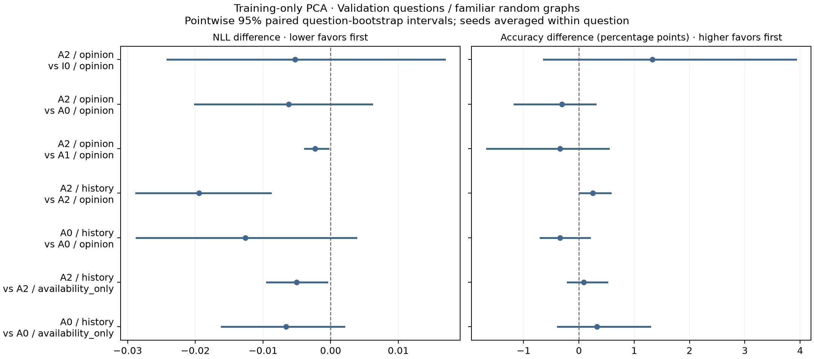
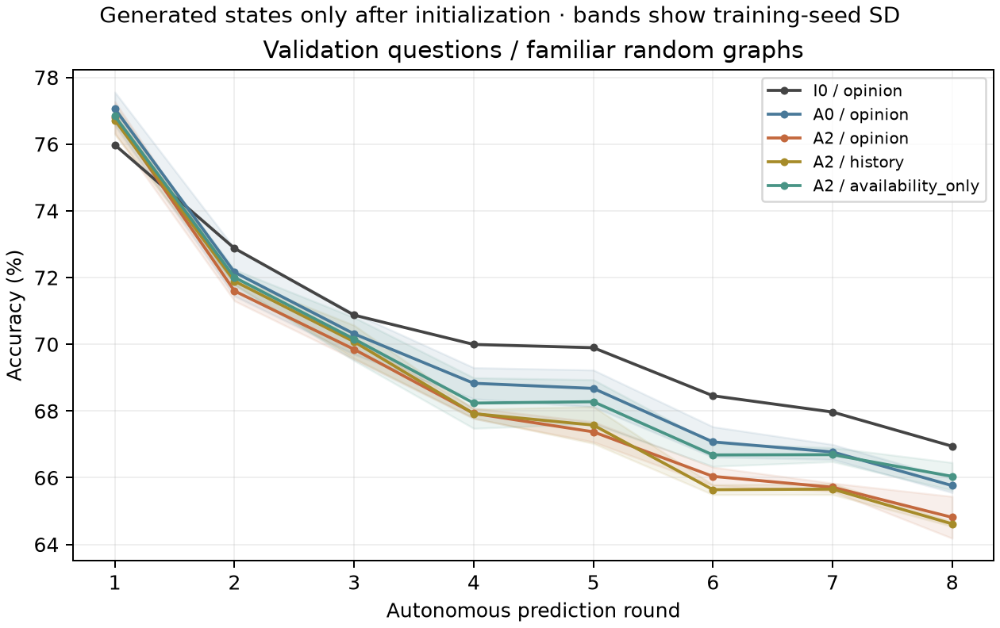

# Training-only PCA validation

A2/opinion minus I0 on **validation questions / familiar random graphs**: accuracy difference +1.32 percentage points, paired 95% interval [-0.64, +3.92]. The interval includes zero; an accuracy advantage is not established.

The NLL difference is -0.00526, interval [-0.02411, +0.01686] (negative favors A2). NLL was the predeclared primary probability metric; accuracy is reported alongside it. Intervals average seeds within each question before resampling questions. They are pointwise, not adjusted for the multiple secondary comparisons.

The declared cohort contains 24 fits: three baselines and seven neural configurations at seeds 42/43/44. Neural configurations are A0/A1/A2 with opinions, A0/A2 with history, and A0/A2 with the matched availability-only control. Every candidate was retained; no best-seed selection was performed.

PCA is fitted on raw frozen question-plus-options embeddings from the 16 training questions only. Its mean/components and every context vector were reconstructed independently. Perturbing held-out embeddings did not change fitted PCA. All other arrays, example identities, targets, and graphs match the earlier author-context study. All 32 personas appear in training. Architectures, hyperparameters, stopping rules, graph signs, and forecast boundaries are unchanged.

The availability-only control uses the same six-feature history architecture, zeroing past-opinion values while retaining availability and current-opinion features. The transform is applied consistently in fitting, one-step evaluation, and generated-history rollout. Study-specific implementation hashes prevent ordinary CLI evaluation from silently omitting it.

Only four validation questions are available and were also used for early stopping. These comparisons are developmental. The test set is not used in this report.

## Matched preprocessing comparison

Same examples, architecture, and seeds. The new context uses raw question-plus-options embeddings projected with PCA fitted only on training questions. The authors' projection provenance is unverified, so differences cannot be attributed solely to removal of leakage; the feature representation itself changes.

| Model / state | Author-context NLL | Training-only NLL | Author accuracy % | Training-only accuracy % |
| --- | ---: | ---: | ---: | ---: |
| A0 / availability_only | 0.2768 | 0.2796 | 89.35 | 89.05 |
| A0 / history | 0.2686 | 0.2730 | 89.53 | 89.38 |
| A0 / opinion | 0.2836 | 0.2857 | 89.31 | 89.72 |
| A1 / opinion | 0.2788 | 0.2818 | 89.49 | 89.75 |
| A2 / availability_only | 0.2706 | 0.2650 | 89.16 | 89.58 |
| A2 / history | 0.2657 | 0.2600 | 89.49 | 89.66 |
| A2 / opinion | 0.2762 | 0.2794 | 89.34 | 89.41 |
| I0 / opinion | 0.2943 | 0.2847 | 87.13 | 88.09 |

## Validation questions / familiar random graphs

4 questions; 32,768 agent transitions per run. Means ± sample SD across neural training seeds. Accuracy means matching agent opinion, not task correctness.

| Model | State | Parameters | NLL ↓ | Brier ↓ | Accuracy % | FCBA % |
| --- | --- | ---: | ---: | ---: | ---: | ---: |
| P0 | opinion | 0 | — | — | 61.05 | 50.00 |
| P1 | opinion | 2 | 0.6688 | 0.4759 | 61.05 | 50.00 |
| I0 | opinion | 19 | 0.2847 | 0.1642 | 88.09 | 83.41 |
| A0 | opinion | 119,066 | 0.2857 ± 0.0084 | 0.1513 ± 0.0027 | 89.72 ± 0.20 | 87.19 ± 0.28 |
| A1 | opinion | 119,714 | 0.2818 ± 0.0047 | 0.1521 ± 0.0014 | 89.75 ± 0.13 | 87.28 ± 0.19 |
| A2 | opinion | 135,458 | 0.2794 ± 0.0047 | 0.1541 ± 0.0018 | 89.41 ± 0.04 | 86.89 ± 0.12 |
| A0 | history | 119,834 | 0.2730 ± 0.0015 | 0.1523 ± 0.0014 | 89.38 ± 0.05 | 86.68 ± 0.36 |
| A2 | history | 136,226 | 0.2600 ± 0.0038 | 0.1486 ± 0.0040 | 89.66 ± 0.41 | 86.91 ± 0.42 |
| A0 | availability_only | 119,834 | 0.2796 ± 0.0043 | 0.1578 ± 0.0061 | 89.05 ± 0.34 | 86.28 ± 0.49 |
| A2 | availability_only | 136,226 | 0.2650 ± 0.0049 | 0.1503 ± 0.0018 | 89.58 ± 0.27 | 86.90 ± 0.26 |

Autonomous simulation from the observed initialization: deterministic trajectories and 32 samples per initial state, eight rounds. Each model uses generated states after initialization.

| Model | State | Round-8 accuracy % | Final-fraction Wasserstein ↓ | Sampled switches / agent | Observed switches / agent |
| --- | --- | ---: | ---: | ---: | ---: |
| P0 | opinion | 60.91 | 0.2024 | 0.000 | 3.116 |
| P1 | opinion | 60.91 | 0.2402 | 3.159 | 3.116 |
| I0 | opinion | 66.94 | 0.2043 | 3.739 | 3.116 |
| A0 | opinion | 65.76 ± 0.21 | 0.2099 ± 0.0129 | 3.574 | 3.116 |
| A1 | opinion | 65.74 ± 0.46 | 0.1996 ± 0.0230 | 3.589 | 3.116 |
| A2 | opinion | 64.81 ± 0.63 | 0.2065 ± 0.0253 | 3.752 | 3.116 |
| A0 | history | 64.55 ± 0.51 | 0.2511 ± 0.0363 | 3.483 | 3.116 |
| A2 | history | 64.62 ± 0.07 | 0.2001 ± 0.0186 | 3.799 | 3.116 |
| A0 | availability_only | 64.05 ± 0.52 | 0.2344 ± 0.0385 | 3.522 | 3.116 |
| A2 | availability_only | 66.04 ± 0.42 | 0.1990 ± 0.0069 | 3.749 | 3.116 |

Paired differences: first model minus reference. Positive accuracy and negative NLL favor the first model.

| First | Reference | Δ accuracy pp [95% interval] | Δ NLL [95% interval] |
| --- | --- | --- | --- |
| A2 / opinion | I0 / opinion | +1.32 [-0.64, +3.92] | -0.00526 [-0.02411, +0.01686] |
| A2 / opinion | A0 / opinion | -0.31 [-1.17, +0.30] | -0.00622 [-0.02008, +0.00609] |
| A2 / opinion | A1 / opinion | -0.34 [-1.66, +0.54] | -0.00233 [-0.00381, -0.00035] |
| A2 / history | A2 / opinion | +0.25 [+0.01, +0.57] | -0.01945 [-0.02876, -0.00887] |
| A0 / history | A0 / opinion | -0.34 [-0.69, +0.20] | -0.01261 [-0.02872, +0.00379] |
| A2 / history | A2 / availability_only | +0.08 [-0.20, +0.51] | -0.00502 [-0.00944, -0.00051] |
| A0 / history | A0 / availability_only | +0.32 [-0.38, +1.29] | -0.00657 [-0.01613, +0.00196] |
| A2 / availability_only | A2 / opinion | +0.17 [+0.06, +0.27] | -0.01443 [-0.02352, -0.00469] |
| A0 / availability_only | A0 / opinion | -0.66 [-1.79, +0.11] | -0.00604 [-0.01862, +0.00539] |

## Plots

## Interpretation limits and reproducibility

Question bootstrap intervals preserve all associated agents, rounds, and episodes. They condition on the tested graph collection and source model; they do not establish generalization across arbitrary graphs, agents, or LLMs. Three training seeds quantify optimization variability, not independent new questions. The low-rank subset contains fewer questions. Each question/graph has few observed replicas, so Monte Carlo samples do not provide additional reference observations.

Question features still come from a frozen externally produced embedding model; this study establishes training-only fitting of the PCA projection, not absence of any upstream knowledge of the questions. A small predictive model need not recover a causal interaction law. None of these experiments changes the source agents' prescribed relationship graph or tests emergent credibility.

Recorded fitting/validation time for the 24 models: 199.2 seconds. Validation autonomous evaluation time: 37.6 seconds. Neural stages use MPS float32; baseline stages use CPU float64. These timings are not LLM speedups. No text encoder or generator is called by these opinion/history models. Peak memory was not instrumented.

[Run scores](inductive_validation_runs.csv), [question scores](inductive_validation_by_question.csv), [rollout question scores](inductive_validation_rollouts_by_question.csv), [paired intervals](inductive_validation_paired.json), [integrity audit](inductive_validation_integrity.json).

Protocol, plans, exact configs, source/data/checkpoint hashes, predictions, and rollout trajectories are under `runs/inductive_study/`. The test selection and its linked protocol are immutable.

Regenerate: `.venv/bin/python scripts/report_inductive_study.py --partition validation`.
