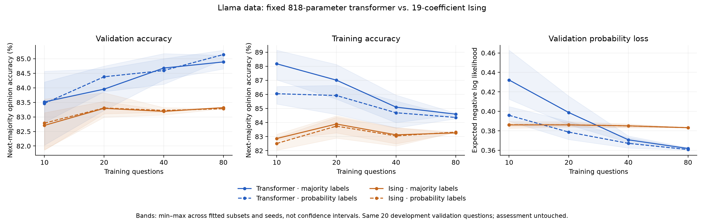

# Llama question-count and probability-target experiment

Development-only comparison of 10, 20, 40 and 80 training questions. Accuracy means predicting an agent's next five-vote majority opinion, not answering the math question correctly. Every model predicts the same 20 validation questions (5,120 agent updates). All 40 assessment conversations remain ungenerated and unscored.

The hard-label 818-parameter transformer's mean validation accuracy changes from 83.52% at 10 questions to 84.89% at 80: +1.37 percentage points. At 80 questions, replacing sampled majority labels with logged majority probabilities changes accuracy by +0.25 points. These are fixed-procedure development results, not independently tuned sample-size optima.

## Observed validation accuracy

| Training questions | Agent updates | Transformer, majority labels | Transformer, probability labels | Ising, majority labels | Ising, probability labels |
| ---: | ---: | ---: | ---: | ---: | ---: |
| 10 | 2,560 | 83.52% | 83.46% | 82.71% | 82.79% |
| 20 | 5,120 | 83.95% | 84.38% | 83.29% | 83.31% |
| 40 | 10,240 | 84.68% | 84.59% | 83.19% | 83.22% |
| 80 | 20,480 | 84.89% | 85.14% | 83.32% | 83.28% |

Each 10/20/40 point averages three nested subset paths and three transformer seeds; Ising has one deterministic fit per subset. The 80-question endpoint uses the full pool once with three transformer seeds. Scores are averaged, not prediction probabilities. Smaller subsets are balanced by topic, correct-answer label and graph; none is selected using performance.



## Training accuracy

| Questions | Transformer, majority labels | Transformer, probability labels | Ising, majority labels | Ising, probability labels |
| ---: | ---: | ---: | ---: | ---: |
| 10 | 88.17% | 86.05% | 82.86% | 82.51% |
| 20 | 87.01% | 85.92% | 83.89% | 83.74% |
| 40 | 85.09% | 84.69% | 83.13% | 83.05% |
| 80 | 84.59% | 84.36% | 83.26% | 83.32% |

Training scores are evaluated with dropout disabled on the actual subset used for fitting. Training sets differ in size and composition, so falling training accuracy alone does not mean optimization deteriorated.

## Paired size comparisons

Changes below are larger minus smaller training set; positive accuracy changes favor more questions. Brackets are descriptive 95% paired validation-question bootstrap intervals.

| Transformer targets | Question counts | Accuracy change, points [interval] | Expected NLL change [interval] |
| --- | --- | ---: | ---: |
| hard | 10 → 20 | +0.44 [+0.07, +0.80] | -0.03340 [-0.03946, -0.02728] |
| hard | 20 → 40 | +0.72 [+0.31, +1.15] | -0.02808 [-0.03624, -0.02030] |
| hard | 40 → 80 | +0.21 [-0.08, +0.50] | -0.00889 [-0.01259, -0.00573] |
| hard | 10 → 80 | +1.37 [+0.92, +1.82] | -0.07037 [-0.08136, -0.05980] |
| soft | 10 → 20 | +0.92 [+0.59, +1.25] | -0.01727 [-0.02092, -0.01361] |
| soft | 20 → 40 | +0.21 [-0.17, +0.63] | -0.01154 [-0.01680, -0.00683] |
| soft | 40 → 80 | +0.55 [+0.16, +0.94] | -0.00636 [-0.00924, -0.00359] |
| soft | 10 → 80 | +1.68 [+0.97, +2.39] | -0.03518 [-0.04072, -0.02967] |

These intervals average subset/seed scores within each validation question, then resample the 20 questions 5,000 times. They condition on the sampled training subsets, omit multiple-comparison adjustment, and use validation questions already involved in earlier tuning and diagnosis. They are not confirmatory significance tests.

## Does probability supervision help?

The soft target is the next-round majority-A probability q = p³(10 − 15p + 6p²), where p is the source's normalized first A/B-token probability. The input still contains only current opinions, signed graph, and question/persona context. Future probabilities are training labels only. This removes five-vote sampling noise from supervision conditional on the recorded prompt; it does not remove uncertainty about unobserved incoming messages.

| Questions | Transformer accuracy change, soft − hard (points) | Expected error change (points) | Expected NLL change | Probability MSE change |
| ---: | ---: | ---: | ---: | ---: |
| 10 | -0.05 | -0.13 | -0.03628 | -0.00914 |
| 20 | +0.43 | -0.38 | -0.02015 | -0.00582 |
| 40 | -0.08 | +0.06 | -0.00362 | -0.00108 |
| 80 | +0.25 | -0.24 | -0.00109 | -0.00028 |

Higher observed accuracy is better; lower expected error/NLL/MSE is better. Expected metrics average over the logged majority distribution rather than the one realized sample. Source probabilities are an approximation to parsed-answer probabilities: 12 of 144,000 responses were not a single bare A/B token, with mean outside-A/B first-token mass 2.18e−7. These probabilities condition on realized messages and do not give a universal irreducible-error bound for the predictor's input state.

### Full 80-question comparison

| Model and targets | Observed accuracy | Observed NLL | Expected accuracy | Expected NLL | Probability MSE |
| --- | ---: | ---: | ---: | ---: | ---: |
| Transformer · majority labels | 84.89% | 0.35420 | 84.40% | 0.36185 | 0.05130 |
| Transformer · probability labels | 85.14% | 0.35335 | 84.64% | 0.36076 | 0.05102 |
| Ising · majority labels | 83.32% | 0.37556 | 82.93% | 0.38322 | 0.05907 |
| Ising · probability labels | 83.28% | 0.37576 | 82.89% | 0.38322 | 0.05918 |

At 80 questions, soft-minus-hard transformer accuracy is +0.25 points [-0.05, +0.60], and expected NLL changes by -0.00109 [-0.00319, +0.00130].

## Sensitivity to question selection

Ranges below first average the three optimizer seeds within each selected subset, then take the minimum and maximum over the three subsets. They are not uncertainty intervals. There is only one full-80 composition, so composition variation cannot be estimated there.

| Questions | Hard-label transformer subset-mean accuracy range | Soft-label transformer subset-mean accuracy range |
| ---: | ---: | ---: |
| 10 | 83.00%–83.89% | 83.15%–83.87% |
| 20 | 83.55%–84.52% | 84.24%–84.51% |
| 40 | 84.38%–84.89% | 84.45%–84.86% |

## Interpretation

More training questions improve the transformer's validation results within this pipeline. With majority labels, training accuracy falls from 88.17% to 84.59% while validation accuracy rises from 83.52% to 84.89%. The training/validation gap falls from 4.66 points to −0.29 points, consistent with less overfitting. These sets differ in composition, and validation being slightly easier than training does not establish an absence of overfitting.

The Ising baseline changes less, from 82.71% to 83.32% validation accuracy. The transformer's advantage increases from 0.81 to 1.57 points. Most of the hard-label accuracy increase occurs before 40 questions; the 40→80 difference is only +0.21 points, with an interval spanning zero. Probability loss continues improving. These four points cannot establish a performance ceiling or predict the effect of hundreds of questions.

Probability targets substantially improve probability loss at 10 and 20 questions, but do not consistently improve classification accuracy across sizes. At 80 questions, both the accuracy and expected-NLL soft-minus-hard intervals include zero. Vote-sampling noise therefore does not appear sufficient to explain the remaining error under the tested architecture and training recipe. Different regularization or duration for soft targets remains untested. The earlier matched-state/message evidence still motivates investigating omitted argument information with an explicitly defined observation boundary.

## Controls and limits

- Architecture stays at 818 trainable parameters. Frozen MiniLM embeddings are reused; question PCA is refitted on each selected training subset only. The same 32 known personas are used throughout. No arguments or probability features are supplied to either predictor.
- Each transformer receives 1,280 optimizer updates with learning rate 0.001, output-logit penalty 0.001, dropout 0.1, AdamW weight decay 0.001, batch size up to 32, and seeds 142/143/144. Settings and duration come from the earlier full-80 validation selection, so this is a fixed-procedure curve favoring no newly tuned subset. Equal step counts are not equal epochs; the 10-question condition also has partial minibatches.
- Hard/soft pairs start from identical weights and use identical minibatch order. Ising uses the unmodified pinned author's two-stage fit, including its regularization, with the same subset context and either binary or fractional BCE targets.
- A seeded constrained selection uses only training metadata: exactly balanced A/B correct-answer labels and topic/graph counts within the floor/ceiling of full-pool proportions. Three paths are nested at 10/20/40, and all reach the same 80. Difficulty is recorded, not constrained. The sampler is not uniform over all feasible subsets.
- Increasing question count simultaneously increases unique transitions, question variety, and PCA fitting data. This does not isolate diversity from raw sample count or representation estimation. It provides no evidence about data sizes above 80.
- The predictor forecasts the next step on observed trajectories. Probability targets are conditioned on the actually generated future messages. No new message generation, autonomous rollouts, or untouched assessment evaluation is performed.

## Execution and verification

Completed 60 new transformer fits and 20 Ising fits. The neural run took 8.23 minutes. All seven focused checks passed (subset nesting/strata, holdout exclusion, next-round labels, label/input separation, paired training, PCA isolation and source-probability checks). Full-80 hard-label PCA and Ising weights reproduce the original artifacts. All three newly trained hard-label endpoint models reproduce the frozen predictions within 2e−5 probability tolerance. CPU inference independently verifies all 60 neural checkpoints and exact class predictions; maximum probability difference is 1.51e-05. Original primary model and diagnostic artifacts pass their stored hashes.

Protocol, selected question IDs, checkpoints, run and per-question metrics, all contrasts and completion audit are in `runs/llama_probability_curve_v1/`. The primary frozen study remains in `runs/question_breadth_v1/`.

```bash
.venv/bin/python -m pytest tests/test_breadth_probability_learning_curve.py tests/test_breadth_error_diagnosis.py tests/test_breadth_train.py::test_training_pca_applies_to_new_questions_without_refitting
.venv/bin/python -u scripts/breadth_probability_learning_curve.py prepare
.venv/bin/python -u scripts/breadth_probability_learning_curve.py run --device mps
.venv/bin/python scripts/report_breadth_probability_curve.py
```
