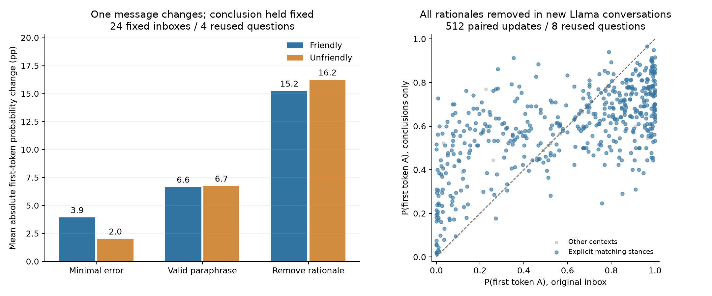

# Local open-weight source-model pilot

The paper does include open-weight source models: **Llama-3.1-8B-Instruct, Qwen3.5-9B and Gemma-3n-E4B-it**, alongside GPT-4o-mini. See [Appendix B.3](https://arxiv.org/html/2608.16578v2#A2.SS3). The released metadata agrees; older backend-registry names and folder names are not the authoritative model versions.

**New local inference has been executed.** This study uses a frozen 4-bit MLX conversion of Llama-3.1-8B-Instruct on the Mac Studio M2 Max (32 GB). It needs no API credential and made **zero paid API calls**. It is a separate local source model: quantization, serving backend and seeded sampling differ from the paper's hosted run. These measurements do not establish why the earlier GPT-4o-mini predictor failed to benefit from argument features.

## Single-message intervention: complete

There are 24 fixed receiver contexts across four reused development math questions, with three receivers for each question/relationship-sign combination. The background inboxes are from the earlier GPT-generated data. Their selection used mixed opinions and uncertainty of a frozen no-text predictor before observing these Llama responses. Each context has four versions: valid rationale, a minimal mathematical error with the same conclusion, a valid paraphrase, and the conclusion alone. Only one target message changes; expertise, question, choices, all other messages, graph cue and order stay fixed.

All **1,920 independent full responses** completed: 20 draws for each of 96 prompts, yielding **384 preassigned disjoint five-vote outcomes**. All responses were exactly A or B and stopped normally; no parsing failures or replacement samples occurred. Temperature is 0.7, top-p is 1, and the output cap is 256 tokens. The released instruction explicitly asks for a snap judgment without working through the problem.

| Intervention | Mean absolute probability change (pp) | Mean signed change toward target stance (pp) | Observed raw-response difference (pp) | Observed five-vote difference (pp) |
| --- | ---: | ---: | ---: | ---: |
| Valid vs minimally flawed rationale | 2.96 | 1.76 | 2.08 | -2.08 |
| Two valid phrasings | 6.69 | -1.64 | -1.67 | 6.25 |
| Valid rationale vs conclusion only | 15.73 | 12.32 | 15.42 | 12.50 |

The probability columns use the model's computed **first literal-A/B token distribution**, with the full vocabulary retained. They are distinct from sampled complete-response fractions and majority-of-five outcomes. The maximum other-token probability was 4.77e-07; all observed responses contained one A/B token followed by EOS. No probability was renormalized onto A/B. Signed changes use valid minus flawed, paraphrase minus valid, and valid minus conclusion-only, respectively.

The local source is sensitive to message content. Deleting a rationale has a substantially larger effect than the minimal validity edit, and rewording a valid argument also has a larger average effect than that edit. This is evidence of **text dependence**, not a clean demonstration that the model recognizes mathematical validity. A valid rationale can sometimes reduce support for its own conclusion. The deletion and paraphrase contrasts also change wording and sometimes length. Friendly and unfriendly contexts are different contexts, so comparing their averages does not estimate the causal effect of changing a graph sign.

The validity contrast has a limited interpretation: its flawed rationale still asserts the correct final choice. A solver could retain that choice after independently solving the question or consulting the other messages, even if it notices the flaw. A weak effect here therefore does not show an inability to recognize invalid reasoning.

| Intervention | Friendly: mean absolute change (pp) | Unfriendly: mean absolute change (pp) |
| --- | ---: | ---: |
| Valid vs minimally flawed rationale | 3.92 | 2.01 |
| Two valid phrasings | 6.64 | 6.73 |
| Valid rationale vs conclusion only | 15.23 | 16.22 |

Only 20 raw draws and four five-vote groups are available per prompt. The raw and majority differences are noisy pilot estimates; in particular, their direction can differ for a small effect. Per-prompt marginal Wilson intervals are saved in the data. The computed first-token probabilities avoid this Monte Carlo uncertainty but remain conditional on the chosen contexts and local model. There is no fresh-question confidence claim and no multiplicity-adjusted hypothesis test.

## Fully new Llama conversations

**Complete:** 8 new conversations, **512 agent transitions**, 3,840 opinion-response attempts and 496 generated broadcast messages. Every opinion and message comes from the local Llama model. There are 32 fixed expert personas, two synchronous update rounds, one replica per question, and signed graph J0 (112 directed nonzero edges: 70 friendly and 42 unfriendly). One agent is isolated, leaving 31 message senders per round. The paper's Llama protocol also uses one message per sender, broadcast to its neighbors; see [Appendix B.5](https://arxiv.org/html/2608.16578v2#A2.SS5).

The eight questions are four intervention questions plus the first four other development question IDs in lexicographic order, selected before viewing local outcomes. They remain reused objective math questions. Across the 512 updates, **229 (44.73%)** changed majority opinion; **50.39%** of update vote groups were unanimous. These describe dynamics, not prediction accuracy or mathematical correctness.

Opinion parsing failures: **0**. Messages hitting the 256-token cap: **18/496**. All messages, including truncated or mathematically inconsistent ones, are retained. The generator is asked for a rationale supporting its current choice; the resulting rationale is not guaranteed to be correct or internally consistent. Collection took 50.8 minutes in its final invocation, with peak MLX memory 5.75 GB.

The audit reconstructs every opinion prompt and message prompt, all raw-vote majorities, signed inbox ordering and the shared broadcasts from the saved records. Exact user prompts, rendered chat token IDs, sampled token IDs, seeds, output termination, model identity and source-code hashes are retained. Parse retries follow the released three-attempt limit and are fully logged; persistent failures would become zero. The isolated agent supplies repeated identical-prompt controls.

## Rationale deletion within the new conversations

**Complete:** reran all 512 original update contexts with every incoming message replaced by its sender's recorded prompted choice, e.g. `I favor option A.` The question, expertise, prior states, graph signs, sender association and inbox order are fixed. This adds 2,560 response attempts. The protocol selected all updates before observing their effects.

Original messages were audited for an explicit stance near their start. A missing match is an unknown, not automatically an instruction violation. A matched stance can still accompany an incorrect or contradictory reason. The explicit-consistent subset below excludes inboxes with any unmatched or conflicting stance, so the core comparison does not rely solely on assuming that the message writer obeyed its prompt.

| Contexts | Count | Mean absolute first-A probability change (pp) | Dominant first-token choice changes | Sampled majority changes |
| --- | ---: | ---: | ---: | ---: |
| All updates | 512 | 21.87 | 132 | 181 |
| Nonempty inboxes | 496 | 22.58 | 132 | 173 |
| Nonempty, explicit matching stances | 489 | 22.40 | 130 | 169 |
| Empty-inbox controls | 16 | 0.00 | 0 | 8 |

A dominant first-token change compares which of A and B has greater first-token probability (ties choose A). No probability mass is renormalized. A sampled-majority change compares two independent groups of only five draws and therefore also includes ordinary sampling variation. Neither is a neural predictor error rate. Empty-inbox prompts are byte-identical across conditions; their first-token probabilities must agree within 1e-6, even when sampled majorities differ.

For the explicit-matching-stance pairs, an opinion/history-only predictor has identical inputs in both conditions and must return the same probability. If the teacher probabilities are p and q, its minimum average squared error against those two probabilities is (p−q)²/4. The saved summary reports the average of this bound. This is a structural limitation on the deliberately balanced paired benchmark, not an estimated error floor on natural conversations or the historical majority-vote task.

This intervention tests information in the delivered text beyond the stated choices. It changes content, wording and length together, and deletion prompts need not occur naturally in the original message-generation process. It does not isolate logical validity or estimate a natural-distribution lower bound on opinion-only prediction error.

A **post-hoc quality check** excludes truncated incoming messages and conservatively screens explicit stance mentions throughout each message. In the resulting 414 contexts, the mean absolute probability change remains **21.35 pp**, with **96** dominant-choice changes. None of the primary matching-stance contexts failed an additional guard against mistaking the article 'a' for label A near the message start. These regex checks do not certify mathematical correctness or full semantic consistency. The original primary cohort remains unchanged; details are in `quality_audit/`.

## Direct check of argument-validity recognition

A separate grading task is complete: **1,440 responses** to 72 prompts covering the same four questions, three argument versions and the first three canonical personas. The valid/invalid meanings of grading labels A and B are reversed in half the prompts. This changes the task to explicit mathematical grading, not an agent interaction; no communication graph was removed from the conversation experiment.

The primary comparison gives equal weight to valid and flawed arguments (48 prompts). Sampled grading accuracy is **51.56%**, against a 50% balanced baseline. Mean first-token probability assigned to the correct grading label is **50.79%**. Choosing the more probable of the two grading labels is correct on **56.25%** of these prompts. Valid paraphrases are a separate secondary condition; pooling all three would give an always-valid strategy a 2/3 baseline.

| Argument | P(first token is the valid grading label) | Sampled grading accuracy |
| --- | ---: | ---: |
| Valid | 75.52% | 73.96% |
| Minimally flawed | 73.94% | 29.17% |
| Valid paraphrase | 81.19% | 78.33% |

Reversing grading labels changes the valid-label probability by 46.23 percentage points on average. There are 0 parsing failures; maximum other-first-token mass is 5.96e-08. Full per-question and label-swap results are saved. This is a small diagnostic on four constructed examples, not a general proof-verification benchmark. It assesses the edited reasoning when explicitly requested; it does not causally identify why an ordinary opinion update accepts or rejects a message.

### Follow-up using VALID/FLAWED verdict words

After observing the A/B grader's label sensitivity, a separate response-format follow-up collected **1,440 responses** to the same arguments and personas. It asks for VALID or FLAWED and reverses the definition order in half the prompts. The primary balanced valid-versus-flawed accuracy is **49.90%**, compared with 51.56% for the earlier A/B grading task.

| Argument | Fraction of sampled VALID verdicts | Sampled grading accuracy |
| --- | ---: | ---: |
| Valid | 98.96% | 98.96% |
| Minimally flawed | 99.17% | 0.83% |
| Valid paraphrase | 99.17% | 99.17% |

Verdict parsing failures: 2; strict-format failures: 2. Definition order changes the sampled VALID fraction by 1.81 pp on average. This number includes 20-draw sampling noise and is a different contrast from the first study's exact A/B label-swap probability change. The common source logger's first-A/B probabilities are deliberately not used for word verdicts.

Changing the response vocabulary did not rescue validity discrimination: the model called 98.96% of valid arguments and 99.17% of flawed arguments VALID. The two unparsed outputs were INVALID on valid-paraphrase prompts; they do not affect the primary valid-versus-flawed comparison.

This follow-up is adaptive and uses the same four problems. It tests robustness to response format, preserving the first result; it is not an independent confirmation of general reasoning ability. Both grading tasks request short final responses, so failure in this setting does not establish what the model could do with an explicit reasoning trace or another prompt regime.

## Implication for the compact update rule

The earlier GPT-trained transformer receives individual message embeddings, but its familiar-question gain could be reproduced with question IDs alone. These new measurements establish a workable local teacher and a direct way to distinguish message sensitivity from what the compact predictor learns. They do not demonstrate improved neural prediction: **no predictor has been trained or scored on this new Llama cohort**. The existing GPT-trained predictors are not evaluated as if they were matched Llama predictors.

The next training study should use one pinned source model, a substantially broader bank of questions, and a question-level split fixed before fitting. Save matched argument variants as well as ordinary trajectories, compare stance/history-only and argument-aware models, and score both their ordinary predictions and their response to the paired changes. Exact first-token probabilities can supply a low-noise teacher diagnostic, but using them as targets would be a different task from the historical majority-of-five target and must be declared. A direct explanation of the earlier GPT result still requires a matching GPT-source intervention or a clearly labeled cross-model comparison.

For further validity experiments, use hand-checked or independently verified labels: the local model's short-response self-grades are unreliable on these examples. Reasoning-permitted prompts or another source model would be separate follow-up regimes. The present result supports studying the information carried by message text, while leaving logical-quality recognition and the earlier GPT predictor's limitation unresolved.

The prescribed friendly/unfriendly graph remains part of the experiment. Its sign places each message under the released agree/disagree heading; it is not a learned credibility weight. Emergent relationships remain deferred.

## Read-only probe of the existing predictors

Before local source collection, the nine frozen GPT-trained predictors (three model families × three seeds) were queried on the four-condition prompts: 864 predictions and 648 paired comparisons. The 648 predictions shared with the previous three-condition probe reproduced within 4.77e-7. There were zero optimizer steps and no counterfactual accuracy evaluation.

| Frozen predictor | Minimal-error mean absolute change (pp) | Rationale-deletion mean absolute change (pp) | Valid-paraphrase mean absolute change (pp) |
| --- | ---: | ---: | ---: |
| Original PCA3 | 0.90 | 4.65 | 5.13 |
| Full question context | 0.34 | 3.76 | 2.28 |
| Joint question-conditioned embedding | 0.16 | 2.47 | 0.54 |

These are sensitivity measurements of predictors trained on another teacher, not errors against the new Llama source. Their target is a majority-of-five outcome, which also differs from the first-token diagnostic above. The new conclusion-only probe is saved in `runs/argument_intervention_v1/predictor_probe/`; prior checkpoints and caches remain frozen.

## Model and checks

- Conversion: [`mlx-community/Meta-Llama-3.1-8B-Instruct-4bit`](https://huggingface.co/mlx-community/Meta-Llama-3.1-8B-Instruct-4bit), pinned revision `241a666dad6cb93c8ff213d39a7f34a36bf26db4`. All downloaded files have saved SHA-256 hashes.
- Runtime: MLX 0.32.4, MLX-LM 0.32.2, Transformers 5.22.2; separate `.venv-source`, recorded in `requirements-source-lock.txt`. Existing PyTorch environment and prior models remain separate.
- Cache benchmark: cached and uncached first-token probabilities agreed exactly on four prompts; repeated cached draws with the same seed reproduced tokens. Only deterministic prompt KV state is copied between independent responses.
- Focused local checks: 14 passing cases covering independent sample identities, five-vote groups, parsing/retry bookkeeping, broadcast/sign handling, synchronous phases, exact released prompts, resume identity, rationale-ablation controls, counterbalanced grading labels and word-verdict parsing/order controls.
- Sampling diagnostic: observed 1006 A responses versus 983.68 expected from saved probabilities; pooled residual 1.28 standard deviations. A parametric binomial calibration simulation gives tail fraction 0.881; this check is consistent with the intended sampler, not proof of independence.
- Prior API-pilot preparation has 16 passing checks and five parent checks. It remains unexecuted; no API credential was used. Its 96 prompts were reused as inputs for the separately identified local intervention.

## Artifacts and reproduction

- `runs/local_llama_intervention_v1/model_provenance.json`: pinned local model and file hashes.
- `runs/local_llama_intervention_v1/intervention/`: four-condition prompts, 1,920 raw samples, five-vote groups, paired contrasts and per-question summaries.
- `runs/local_llama_intervention_v1/conversations/`: complete episode files, every source prompt/response, phase checkpoints and reconstruction audit.
- `runs/local_llama_intervention_v1/rationale_ablation/`: all-context plan, controlled responses and paired analysis.
- `runs/local_llama_intervention_v1/direct_argument_grading/`: counterbalanced validity-grading prompts, outputs and per-question analysis.
- `runs/local_llama_intervention_v1/word_argument_grading/`: adaptive VALID/FLAWED response-format follow-up, kept separate from A/B grading.
- `runs/local_llama_intervention_v1/teacher_pairs/`: 512 exported paired examples with pre-update inputs separated from raw-vote and first-token outcomes. This export declares no train/test split.
- `reports/local_source_checks.xml`, `reports/local_intervention_analysis.log`, `reports/local_conversation_analysis.log`, `reports/local_ablation_analysis.log`: validation records.

```bash
# Read-only analysis of completed local data; no source generation:
.venv/bin/python scripts/analyze_local_source.py intervention
.venv/bin/python scripts/analyze_local_source.py conversations
.venv/bin/python scripts/analyze_local_source.py ablation
.venv/bin/python scripts/analyze_local_source.py grading
.venv/bin/python scripts/analyze_local_source.py word_grading
.venv/bin/python scripts/export_local_teacher_pairs.py
.venv/bin/python scripts/local_source_quality_audit.py
.venv/bin/python scripts/write_local_source_report.py
.venv/bin/python -m pytest tests/test_local_source_pilot.py
```

Generation entry points are `local_argument_source.py benchmark`, `local_argument_intervention.py`, `local_conversation_pilot.py collect`, `local_rationale_ablation.py collect`, `local_argument_grading.py collect`, and `local_word_grading.py collect`, using `.venv-source/bin/python` with `HF_HUB_OFFLINE=1 TOKENIZERS_PARALLELISM=false`. Collectors check frozen protocols, reuse logged sample identities on resume and honor the session deadline. Use collector commands only to resume unfinished runs: rerunning a completed collector can rewrite its invocation timestamps. Use the read-only analysis commands for completed cohorts. A future expanded cohort should get a new namespace and explicit bounded protocol; do not rewrite this cohort to change model versions or sampling settings.



Report generated 2026-11-08T21:04:47.135664+00:00. These are exploratory source-model experiments on existing development questions; the previously consumed test set is unchanged.
