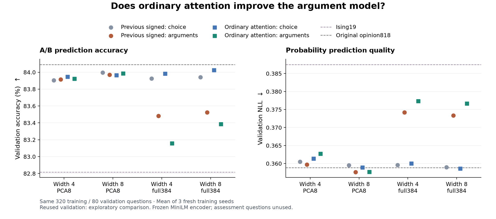

# Ordinary attention with pair-specific friendship inputs

Completed November 14, 2026 at 07:31 PM Central. All 72 tuning fits and 24 fresh-seed refits are complete; recorded fitting totals 136.5 worker-minutes, with 45.8 minutes elapsed from the first fit to model freezing. Independent model sizes run concurrently.

The new architecture encodes the sender state and the receiver–sender relationship together, then uses ordinary scaled dot-product attention. The source conversations, frozen text vectors, question/persona context, opinions, graph, tuning grid and training seeds match the previous study. Old predictions are reused without modification.

The ordinary-attention replacement provides no clear improvement. With compressed arguments, accuracy changes by only +0.007 / +0.015 percentage points from the previous width-four/eight argument models; both paired intervals span zero. The width-eight probability loss is essentially unchanged, while width-four NLL worsens. Full-vector argument models have lower validation accuracy point estimates than before, although those architecture difference intervals span zero. Neither compressed model has a clear argument advantage over its new choice-only control.

The full-vector models retain the overfitting pattern: arguments raise training accuracy by about 0.68 /1.02 points but lower validation accuracy by 0.83 /0.64 points versus their new matched controls. Replacing the special attention mechanisms with shared relationship tokens therefore does not resolve the generalization problem in this experiment. This is evidence about this architecture bundle and training protocol, not a proof that arguments carry no predictive information.

## Validation comparison

Each row reports three-seed mean scores. Higher accuracy and lower NLL are better. The architecture comparison changes token encoding and removes three special attention mechanisms together.

| Hidden / text dimensions | Parameters, previous → new | Input | Previous accuracy | New accuracy | Previous NLL | New NLL |
| --- | ---: | --- | ---: | ---: | ---: | ---: |
| Width 4 / PCA8 | 346 → 346 | Choice only | 83.905% | 83.947% | 0.36053 | 0.36134 |
| Width 4 / PCA8 | 346 → 346 | Arguments | 83.916% | 83.923% | 0.35971 | 0.36272 |
| Width 8 / PCA8 | 882 → 946 | Choice only | 83.996% | 83.965% | 0.35951 | 0.35890 |
| Width 8 / PCA8 | 882 → 946 | Arguments | 83.971% | 83.986% | 0.35764 | 0.35767 |
| Width 4 / full384 | 1,850 → 1,850 | Choice only | 83.926% | 83.983% | 0.35958 | 0.35998 |
| Width 4 / full384 | 1,850 → 1,850 | Arguments | 83.483% | 83.158% | 0.37420 | 0.37732 |
| Width 8 / full384 | 3,890 → 3,954 | Choice only | 83.942% | 84.025% | 0.35894 | 0.35858 |
| Width 8 / full384 | 3,890 → 3,954 | Arguments | 83.524% | 83.385% | 0.37338 | 0.37665 |

| Earlier baseline | Parameters | Training accuracy | Validation accuracy | Validation NLL |
| --- | ---: | ---: | ---: | ---: |
| Ising | 19 | 83.081% | 82.817% | 0.38751 |
| Opinion/context, width 4 | 314 | 84.260% | 83.937% | 0.35992 |
| Opinion/context, width 8 | 818 | 84.422% | 84.092% | 0.35884 |

## Paired changes and training fit

Intervals below are 95% paired question bootstrap intervals, averaging the three seed scores before resampling the 80 validation questions. Positive values mean improvement for the new model or argument condition. These are descriptive pointwise intervals conditional on fitted models; they do not include tuning uncertainty or resampled training seeds.

| Model | New versus previous argument accuracy gain, pp | New versus previous argument NLL reduction | Arguments versus new choice control: accuracy gain, pp | Arguments versus new choice control: NLL reduction |
| --- | --- | --- | --- | --- |
| Width 4 / PCA8 | +0.007 [-0.195, +0.207] | -0.00301 [-0.00492, -0.00114] | -0.024 [-0.186, +0.137] | -0.00138 [-0.00353, +0.00072] |
| Width 8 / PCA8 | +0.015 [-0.187, +0.220] | -0.00003 [-0.00242, +0.00221] | +0.021 [-0.132, +0.168] | +0.00123 [-0.00032, +0.00273] |
| Width 4 / full384 | -0.326 [-0.726, +0.052] | -0.00312 [-0.00815, +0.00163] | -0.825 [-1.266, -0.402] | -0.01734 [-0.02374, -0.01132] |
| Width 8 / full384 | -0.138 [-0.570, +0.252] | -0.00328 [-0.00990, +0.00285] | -0.640 [-1.134, -0.194] | -0.01807 [-0.02640, -0.01071] |

| Model | Previous choice train accuracy | Previous argument train accuracy | New choice train accuracy | New argument train accuracy |
| --- | ---: | ---: | ---: | ---: |
| Width 4 / PCA8 | 84.244% | 84.266% | 84.272% | 84.291% |
| Width 8 / PCA8 | 84.375% | 84.498% | 84.392% | 84.381% |
| Width 4 / full384 | 84.198% | 84.905% | 84.215% | 84.893% |
| Width 8 / full384 | 84.324% | 85.469% | 84.386% | 85.404% |

## Exact architecture and comparison boundary

$$h_i=E([\mathrm{onehot}(s_i),c_i,\log(1+d_i^+),\log(1+d_i^-),\log(1+d_i)]),\qquad n_i=\mathrm{LN}(h_i)$$

$$u_j=n_j+W_{\rm text}\widetilde e_j,\qquad z_{i\leftarrow j}=\mathrm{LN}(\mathrm{GELU}(W_{\rm pair}[u_j;\tau_{ij}]+b_{\rm pair}))$$

$$q_i=W_Q n_i,\quad k_{ij}=W_K z_{i\leftarrow j},\quad v_{ij}=W_V z_{i\leftarrow j},\quad \alpha_{ij}=\frac{\exp(q_i^\top k_{ij}/\sqrt{d_k})}{\sum_{\ell\in\mathcal N(i)}\exp(q_i^\top k_{i\ell}/\sqrt{d_k})}$$

$$m_i=W_O\operatorname{concat}_{\rm heads}\left(\sum_{j\in\mathcal N(i)}\alpha_{ij}v_{ij}\right).$$

The same residual, dropout, feed-forward block and classifier follow. Isolated agents get zero social contribution. There is one shared pair encoder and no learned receiver/sender IDs. Friendship is an input value +1 or −1. Different receivers can therefore have different tokens for the same sender. The graph still determines who can communicate.

The new attention has no edge-type additive bias, signed value multiplier or degree-dependent social multiplier. Graph degree still enters the agent-state encoder. The pair encoder has a linear layer, GELU and learned LayerNorm; this is the nonlinear refinement discussed in chat, not the earlier 322-parameter linear sketch. Width-four models match their old parameter counts; width-eight models have 64 extra parameters.

Only these small predictors are trained. MiniLM has 22,713,216 pretrained, frozen parameters. PCA8 and the existing 16 context features are also frozen, fitted using training inputs. The comparison retains ordinary PCA8 to isolate the architecture change from the separate within-question PCA experiment. Each model forecasts the next majority-of-five opinion after the actual source messages are available; this is conditional one-step prediction, not autonomous conversation simulation.

## Training protocol

Training uses 320 questions /81,920 agent transitions; validation uses 80 questions /20,480 transitions. There are eight familiar signed graphs, 32 personas and eight opinion updates per conversation. The 40 reserved assessment conversations are ungenerated, unloaded and unscored.

Each architecture and condition receives the same nine learning-rate/output-penalty combinations and validation stopping policy as the old experiment. Candidate selection uses seed 42 and lowest validation NLL. Settings and duration freeze before refits at seeds 142, 143 and 144; every seed contributes equally. The output classifier starts at zero, and every shared initial parameter matches the same-width previous architecture at that seed. Training used the faster measured CPU backend with four independent workers, four Torch threads per worker, batch 32, AdamW, dropout 0.1, gradient clipping 1, validation every 512 steps, a 32,768-step cap and patience 10.

| Width / text | Input | Selected candidate | Learning rate | Output penalty | Refit updates |
| --- | --- | --- | ---: | ---: | ---: |
| pico_pca8 | conclusion | c6 | 0.001 | 0.0 | 24,576 |
| pico_pca8 | arguments | c7 | 0.001 | 0.001 | 14,336 |
| pico_full | conclusion | c3 | 0.0003 | 0.0 | 30,720 |
| pico_full | arguments | c7 | 0.001 | 0.001 | 2,560 |
| nano_pca8 | conclusion | c7 | 0.001 | 0.001 | 11,264 |
| nano_pca8 | arguments | c6 | 0.001 | 0.0 | 6,144 |
| nano_full | conclusion | c6 | 0.001 | 0.0 | 11,264 |
| nano_full | arguments | c7 | 0.001 | 0.001 | 1,536 |

## Offline text sensitivity

At evaluation only, messages are replaced by another round from the same question, sender and current stance. The same substitutions as the prior study are used. Receiver state, full history and round are not matched, and donors can be from later rounds. This checks content sensitivity, not causal argument quality or usable prospective inputs.

| Model | Actual versus substituted accuracy gain, pp | Mean probability change, pp |
| --- | --- | ---: |
| Width 4 / PCA8 | -0.008 [-0.072, +0.057] | 0.427 |
| Width 8 / PCA8 | +0.024 [-0.063, +0.111] | 0.831 |
| Width 4 / full384 | +0.010 [-0.187, +0.213] | 4.211 |
| Width 8 / full384 | +0.243 [+0.015, +0.470] | 5.104 |

## Verification and artifacts

Five focused tests pass. The independent final audit reproduces 134 prediction arrays and 84 paired contrasts; maximum aggregate discrepancy is 0. It verifies 400 source episode hashes, 1005 prior artifacts and 652 new frozen artifacts. All 24 trained models have active text and relationship gradients, changed projection/token weights and matching dense/packed attention predictions. Prior artifacts and the independent HPC3 collection remain unchanged.

- [Experiment protocol and commands](../experiments/pair_token_attention_320_v1/README.md)
- [Machine-readable results](../runs/pair_token_attention_320_v1/results/summary.json)
- [Independent audit](../runs/pair_token_attention_320_v1/completion_audit.json)
- [PDF figure](pair_token_attention_320.pdf)

This reused-validation comparison cannot establish performance on untouched questions or unseen graphs. It tests the specified architecture and frozen text representation; it does not establish that arguments are intrinsically uninformative.
