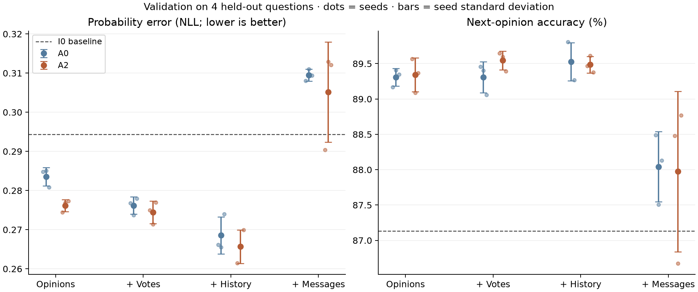
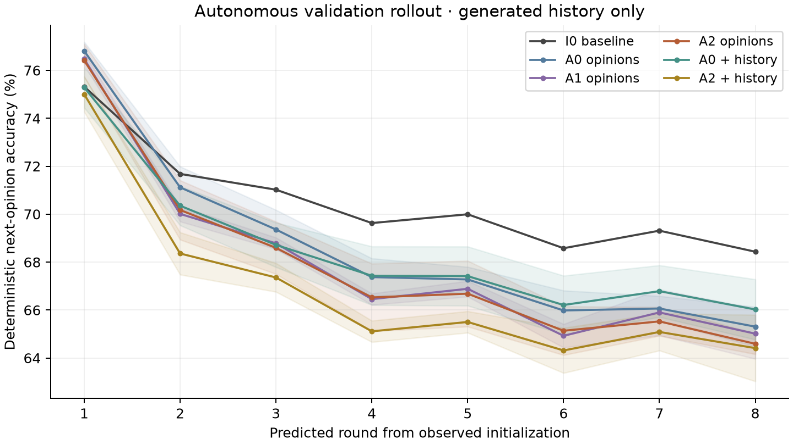

# Controlled validation results

Historical author-context validation screen: nine neural model/state configurations at seeds 42, 43, and 44, plus three baselines. All neural fits stopped by the configured early-stopping rule. These candidates received validation evaluation only. The completed training-only PCA study and its frozen test results are reported separately in [inductive_test_results.md](inductive_test_results.md).

## What this screen shows

This screen does not establish a reliable accuracy advantage for the transformer. The observed mean is 89.34% for opinion-only A2 versus 87.13% for I0, a difference of +2.21 percentage points. Its descriptive paired question-bootstrap 95% interval is [-0.23, +5.63] percentage points, including zero. With only four validation questions also used for checkpoint selection, statistical significance has not been established.

The simpler A0 fixed-aggregation control reaches 89.31% accuracy, only +0.03 percentage points below A2. The observed NLL change versus I0 is 0.2943 → 0.2762, but its paired interval [-0.04333, +0.01071] also includes zero. A2's NLL advantage over A1 is unresolved across questions. The current accuracy results do not justify preferring contextual attention to the simpler control.

Adding history lowers A2 NLL to 0.2657, but changes accuracy by only +0.14 percentage points. Vote counts give a small average change; this pooled message representation worsens NLL. These conclusions concern the implemented features and training protocol.

Autonomous simulation also provides no demonstrated transformer advantage: observed round-eight accuracy is 64.59% for A2/opinion versus 68.43% for I0. The sampled final-opinion distribution is also farther from observations for A2 (Wasserstein 0.2394 versus 0.1876). History does not improve A2's average round-eight accuracy or distribution distance. Four validation questions leave substantial uncertainty; these are development findings.

For A2, 93.8% of the original history-versus-opinion NLL gap occurs at initialization, where no past opinion exists. The availability-only control recovers 53.4% of that aggregate gap. These are different descriptive comparisons, not an additive causal decomposition. The remaining full-history advantage over the matched control needs more independent questions; training-seed repeats alone cannot establish state sufficiency.

The matched control and seed-level results are in [history_availability_control.md](history_availability_control.md).

## Protocol and interpretation

Training uses 16 questions, 512 episodes, and 131,072 agent transitions. Validation uses four other questions, 128 episodes, eight familiar random graphs, and 32,768 agent transitions. Every comparison has identical episode/round/agent keys and targets. No snapshots were missing in this subset. Metrics weight questions equally; accuracy means matching the next agent opinion, not answering the task correctly.

The forecast starts after the current opinions, before the next messages. Opinion models also receive the same static persona/question context and signed graph. History adds the preceding opinion snapshot and availability indicators. Vote counts describe the current vote samples. Message features summarize the existing inbox, from the previous exchange, with separate signed-neighbor means; the initialization inbox is empty. Future messages are excluded.

I0 is the controlled author Ising-style baseline fitted on the same 16 questions. A0 uses fixed signed aggregation with nonlinear context; A1 learns routing from opinion/graph features; A2 permits context in routing. The paper's official 20-question reproduction is in [author_reproduction.md](author_reproduction.md) and is not the baseline score in these tables. The history comparison adds only 768 trainable parameters, but also provides an availability mask that distinguishes initialization; the matched availability-only follow-up is documented in the linked control report.

## One-step validation

Mean ± sample standard deviation across three neural training seeds. NLL is the primary selection metric; Brier is the sum over the two classes. Lower NLL/Brier is better; higher accuracy/FCBA is better. P0 persistence has no assigned probability score.

| Model | State | Parameters | NLL | Brier | Accuracy % | FCBA % | Mean fit seconds |
| --- | --- | ---: | ---: | ---: | ---: | ---: | ---: |
| P0 | Current opinions | 0 | — | — | 61.05 | 50.00 | 0.11 |
| P1 | Current opinions | 2 | 0.6688 | 0.4759 | 61.05 | 50.00 | 0.11 |
| I0 | Current opinions | 19 | 0.2943 | 0.1734 | 87.13 | 83.38 | 3.16 |
| A0 | Current opinions | 119,066 | 0.2836 ± 0.0023 | 0.1570 ± 0.0013 | 89.31 ± 0.12 | 86.63 ± 0.39 | 9.47 |
| A1 | Current opinions | 119,714 | 0.2788 ± 0.0066 | 0.1545 ± 0.0051 | 89.49 ± 0.51 | 87.18 ± 0.48 | 10.33 |
| A2 | Current opinions | 135,458 | 0.2762 ± 0.0016 | 0.1545 ± 0.0022 | 89.34 ± 0.24 | 86.81 ± 0.31 | 12.89 |
| A2 | + Vote counts | 135,842 | 0.2744 ± 0.0029 | 0.1520 ± 0.0009 | 89.54 ± 0.13 | 86.90 ± 0.59 | 14.90 |
| A2 | + Previous opinions | 136,226 | 0.2657 ± 0.0043 | 0.1514 ± 0.0026 | 89.49 ± 0.12 | 87.07 ± 0.24 | 10.14 |
| A2 | + Existing messages | 234,018 | 0.3051 ± 0.0128 | 0.1765 ± 0.0119 | 87.98 ± 1.13 | 86.29 ± 0.24 | 65.24 |
| A0 | + Vote counts | 119,450 | 0.2762 ± 0.0022 | 0.1553 ± 0.0018 | 89.31 ± 0.22 | 86.51 ± 0.25 | 9.70 |
| A0 | + Previous opinions | 119,834 | 0.2686 ± 0.0047 | 0.1514 ± 0.0028 | 89.53 ± 0.27 | 87.07 ± 0.35 | 9.28 |
| A0 | + Existing messages | 217,626 | 0.3095 ± 0.0015 | 0.1760 ± 0.0046 | 88.04 ± 0.50 | 86.04 ± 0.21 | 74.03 |

## Paired differences

Each question's score is averaged across seeds before paired question resampling (1,000 bootstrap draws). Intervals are descriptive: only four independent questions are available, and these same validation questions selected early-stopping checkpoints. They are not confirmatory significance tests. Seed standard deviations in the preceding table do not measure uncertainty across new questions.

Accuracy differences are percentage points; positive favors the first model.

| First model | Reference | Δ accuracy (pp) | Descriptive 95% interval (pp) |
| --- | --- | ---: | --- |
| A2 / opinion | I0 / opinion | +2.21 | [-0.23, +5.63] |
| A2 / opinion | A0 / opinion | +0.03 | [-0.85, +0.77] |
| A2 / opinion | A1 / opinion | -0.15 | [-1.41, +0.96] |
| A2 / history | A2 / opinion | +0.14 | [-0.38, +0.98] |

NLL differences: negative favors the first model.

| First model | Reference | Δ NLL | Descriptive 95% interval |
| --- | --- | ---: | --- |
| A2 / opinion | I0 / opinion | -0.01817 | [-0.04333, +0.01071] |
| A0 / opinion | I0 / opinion | -0.01078 | [-0.04103, +0.02025] |
| A2 / opinion | A0 / opinion | -0.00739 | [-0.01131, -0.00234] |
| A2 / opinion | A1 / opinion | -0.00263 | [-0.01043, +0.00623] |
| A0 / vote_counts | A0 / opinion | -0.00738 | [-0.01724, +0.00248] |
| A0 / history | A0 / opinion | -0.01501 | [-0.02730, -0.00049] |
| A0 / existing_messages | A0 / opinion | +0.02590 | [-0.00270, +0.05450] |
| A2 / vote_counts | A2 / opinion | -0.00173 | [-0.01039, +0.00731] |
| A2 / history | A2 / opinion | -0.01051 | [-0.01549, -0.00553] |
| A2 / existing_messages | A2 / opinion | +0.02897 | [+0.00368, +0.05426] |
| A2 / history | A0 / history | -0.00290 | [-0.01118, +0.00539] |

## Autonomous validation simulation

Each simulation starts from the observed initial opinions and uses only generated states afterward. History models retain their own generated past. Deterministic trajectories and 32 sampled trajectories per initial state cover eight rounds. Vote-count and message models have no autonomous update for their extra state, so they are excluded here.

| Model | State | Round-8 accuracy % | Final fraction Wasserstein | Sampled switches / agent | Sampled unanimity by round 8 % | Mean evaluation seconds |
| --- | --- | ---: | ---: | ---: | ---: | ---: |
| P0 | Current opinions | 60.91 | 0.2024 | 0.000 | 0.00 | 0.08 |
| P1 | Current opinions | 60.91 | 0.2402 | 3.159 | 0.00 | 0.19 |
| I0 | Current opinions | 68.43 | 0.1876 | 3.734 | 0.39 | 0.24 |
| A0 | Current opinions | 65.31 ± 0.83 | 0.2266 ± 0.0079 | 3.389 | 0.11 | 1.40 |
| A1 | Current opinions | 65.01 ± 1.05 | 0.2409 ± 0.0105 | 3.385 | 0.42 | 1.67 |
| A2 | Current opinions | 64.59 ± 0.43 | 0.2394 ± 0.0024 | 3.446 | 0.37 | 1.64 |
| A2 | + Previous opinions | 64.41 ± 1.39 | 0.2428 ± 0.0060 | 3.442 | 0.98 | 2.01 |
| A0 | + Previous opinions | 66.02 ± 1.26 | 0.2405 ± 0.0138 | 3.436 | 0.17 | 1.79 |

Observed trajectories average 3.116 switches per agent; 4.69% reach unanimity within eight rounds. Wasserstein distance compares final positive-opinion fractions within each question/graph condition, then averages conditions and questions. Each condition has only four observed replicas; extra simulated draws do not add reference observations. The trajectory metric compares individual outcomes of a stochastic process and should be read alongside distributional metrics.

## Cost, limits, and next checks

Total recorded fit/validation time across the 30 runs: 651.3 seconds. Autonomous evaluation across 18 runs: 26.0 seconds. Neural computation used MPS float32; baselines used CPU float64. Fit times include checkpointing and validation, but exclude separate message encoding. GPU stages ran sequentially. These are elapsed times from this machine, not estimates of speedup over the source LLM.

The frozen message encoder has 22,713,216 parameters, additional to the trainable predictor. Development message encoding took roughly six minutes plus loading/initial encoding; the exact pass timings and truncation counts are saved in the encoding reports. Opinion/history rollouts make no LLM or encoder calls. Peak process/system memory was not instrumented for these runs, so no measured memory comparison is claimed.

All configurations use the authors' compact question PCA, whose fitting provenance is unverified. A separate training-only PCA configuration is prepared but has not yet been evaluated at full scale. Training includes one source model (GPT-4o-mini), objective tasks, 32 fixed agents, and eight familiar random graphs. Generalization to new graph families, the locked test questions, other source models, and interventions remains untested here. Training seeds measure optimization variability, not new independent question samples.

Before final test evaluation, inspect the seed and question variation, run the training-only PCA control and review the completed availability-only follow-up, and freeze the selected predictor and autonomous simulator with their controls. Short-history improvements alone do not establish a sufficient state or a universal interaction law. Message results concern this frozen encoder and pooling scheme; they cannot show that language content is irrelevant. Causal influence requires a later controlled intervention, such as replacing a sender's argument while holding receiver state, source identity, graph, and other messages fixed.

## Reproducibility

- [Per-run results](validation_runs.csv), [question scores](validation_by_question.csv), [round scores](validation_by_question_round.csv), and [rollout metrics](validation_rollouts.csv).
- [Paired comparisons](validation_paired_comparisons.json) and [integrity audit](validation_integrity.json).
- Manifests, configs, code/data/checkpoint hashes, validation predictions, training histories, and rollout trajectories are stored under the run paths in `validation_runs.csv`.
- Regenerate this report: `.venv/bin/python scripts/report_validation.py`.
- Resume unfinished repetitions, if needed: `.venv/bin/python -u scripts/validation_repeats.py --minutes 60`.
- These author-context candidates were evaluated on validation only; the training-only PCA test study is separate. No test-message encoding was performed. The separately labeled author reproduction follows its original split.
