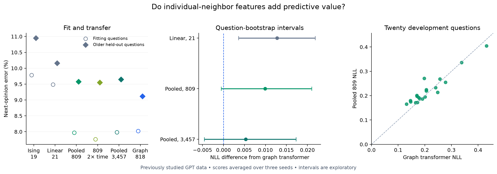

# Does the transformer need individual-neighbor attention?

The transformer has a modest advantage, and most of its observed classification gain can also be obtained by a nonlinear model of aggregate opinions. A pooled network with 809 parameters achieves 9.57% older held-out error, compared with 9.12% for the 818-parameter graph transformer and 10.95% for original Ising. The pooled network fits the training labels at least as well as the graph transformer, but transfers less well. Increasing its size or training duration does not remove the remaining gap in mean classification error.

The overall gap is strongly diluted by easy updates: Ising and the graph transformer both have about 2.17% error on 79.63% of updates. On the remaining 20.37%, the transformer lowers error from 45.27% to 36.28%. These are exploratory results from the old twenty GPT development questions, not results from the new HPC3 Llama study.



The figure's doubled-training condition uses twice as many optimizer updates. Its intervals are pointwise descriptive question-bootstrap intervals, not fresh confirmatory tests.

## What changed

The new models receive the same receiver context used by the graph transformer, but only aggregate information about neighbors. Their twenty inputs are:

- Fifteen nonconstant question/persona PCA features: three persona components, three question components, and nine products.
- The receiver's current opinion.
- Raw opinion sums over friendly and unfriendly neighbors, kept as two separate channels.
- Counts of friendly and unfriendly neighbors.

The unfriendly channel is an unsigned sum over negative edges; its learned coefficient/function determines the response. The graph and relationship labels remain prescribed. No future opinion, argument text, question ID, agent ID, or outcome from another conversation constructs a feature.

The pooled networks do not see which individual neighbors hold each opinion, sender persona features, or sender degrees. The original graph transformer can use those details. Input normalization uses fitting questions only. Removing the constant context feature loses no information because the networks have biases.

The 21-coefficient linear control is a jointly fitted logistic rule over those same inputs:

```text
logit P(next majority = A)
    = b + w·context15 + ρ·own_opinion
      + α·friendly_sum + β·unfriendly_sum
      + γ+·friendly_degree + γ−·unfriendly_degree
```

It differs from the original two-stage Ising estimator in its fitting procedure and additional state/degree terms. It therefore controls the functional form of the new pooled models, rather than being an exact refit of the original Ising parameterization.

The 809-parameter network is `20 → 32 → 4 → 1`; the 3,457-parameter network is `20 → 64 → 32 → 1`. Both use GELU and dropout. They learn directly from observed next majority-of-five opinions. This differs from the earlier explicit-rule investigation, which fitted formulas to transformer probabilities.

## Fitting and evaluation

The four outer whole-question folds and three inner folds within each outer training set are reused exactly. Inner fits use ten questions and select on five; final models fit fifteen and assess the remaining five. All agents, graphs, rounds and replicas of a question stay together. Previously fitted PCA transformations and Ising parameters retain their original training-only scope.

Both neural families use the original six learning-rate/logit-penalty candidates, AdamW decay, dropout, batch size, clipping, 128-step validation interval, six-check patience and 3,072-step cap. Inner mean NLL chooses settings; the median selected number of data passes determines refit duration. Three new-seed scores are averaged within each question, not their predictions. All new fitting uses one CPU thread. The networks and normalization differ from the graph architecture, so this is an alternative-predictor comparison, not a surgical ablation of attention alone.

There are 144 neural tuning fits and 24 ordinary final fits. The linear control has 36 inner fits over three ridge penalties and four final fits. All choices and final models were frozen before outer scoring.

After inner selection, 8/12 selected checkpoints for the 809-parameter model reached the cap, versus 0/12 for the larger model. Before examining the new outer predictions, a separate protocol specified twelve additional 809-parameter fits with exactly twice the selected duration. Their rates, penalties, seeds, normalization and minibatch schedules stay fixed, and no new checkpoint is selected. Each extended run exactly reproduced the original model's weights at its original stopping point. Every extended model also froze before outer evaluation.

## Results

NLL is the primary probability score; classification error and two-class Brier score are secondary. Lower is better. All full-cohort scores weight questions equally.

| Predictor | Fitted parameters | Training error | Older held-out error | Training NLL | Older held-out NLL |
| --- | ---: | ---: | ---: | ---: | ---: |
| Original Ising | 19 | 9.79% | 10.95% | 0.21174 | 0.22755 |
| Joint pooled linear rule | 21 | 9.49% | 10.16% | 0.20951 | 0.22535 |
| Pooled network | 809 | 7.97% | 9.57% | 0.18814 | 0.22251 |
| Pooled network, doubled duration | 809 | 7.76% | 9.55% | 0.17824 | 0.22415 |
| Larger pooled network | 3,457 | 7.98% | 9.65% | 0.18038 | 0.21790 |
| Graph transformer, previous frozen fits | 818 | 8.02% | **9.12%** | 0.18533 | **0.21258** |

The previously fitted Ising-plus-own-opinion correction remains at 10.11% older held-out error / 0.22474 NLL. The new jointly fitted linear rule is close to it; it has not established an improvement over that strengthened baseline.

On the point means, the ordinary 809-parameter pooled network recovers **75.1% of the transformer's classification-error reduction over original Ising**: 1.38 of the graph model's 1.83 percentage points. This fraction concerns accuracy only. It recovers about 33.7% of the graph model's mean NLL reduction; the larger pooled network recovers about 64.5%. These fractions are descriptive comparisons, not causal decompositions or claims of equivalence.

| Comparison | Error difference, percentage points [descriptive 95% interval] | NLL difference [interval] |
| --- | ---: | ---: |
| Pooled linear − Ising | −0.79 [−1.58, −0.04] | −0.00220 [−0.00406, −0.00032] |
| Pooled 809 − graph 818 | +0.46 [+0.06, +1.02] | +0.00992 [−0.00056, +0.02102] |
| Pooled 3,457 − graph 818 | +0.53 [+0.06, +1.18] | +0.00531 [−0.00456, +0.01728] |
| Doubled duration − ordinary pooled 809 | −0.02 [−0.16, +0.11] | +0.00165 [−0.00498, +0.00968] |
| Doubled pooled 809 − graph 818 | +0.43 [−0.02, +1.08] | +0.01157 [+0.00121, +0.02344] |

Intervals use 3,000 paired question resamples, after averaging seed scores within each question. The twenty questions have been studied repeatedly, training sets overlap, and many comparisons have been made. These intervals are exploratory and pointwise; no confirmatory significance, equivalence or noninferiority claim follows. In particular, the ordinary pooled-versus-graph NLL intervals include zero.

## Why the aggregate accuracy gap looks small

The confidence threshold below follows the earlier error diagnosis. Confidence means the larger of the two probabilities from the fold-fitted Ising model. Subgroup rates pool transitions within each subgroup; full-cohort rates remain question-balanced because all twenty questions have the same transition count.

| Subset | Share of updates | Ising error | Pooled 809 error | Graph 818 error |
| --- | ---: | ---: | ---: | ---: |
| Ising confidence at least 0.80 | 79.63% | 2.17% | 2.19% | 2.17% |
| Ising confidence below 0.80 | 20.37% | 45.27% | 38.43% | 36.28% |

The transformer's 8.99-point improvement in the difficult fifth becomes about 1.83 points when averaged over all updates. This directly explains an important part of why the headline accuracies appear close. It does not mean the transformer is identical to Ising or that its hard-case benefit is negligible.

Probability estimates also improve in the difficult group for the 818-parameter model: NLL is 0.64434, compared with Ising's 0.68887 and the ordinary pooled network's 0.65551. This differs from the earlier 34,978-parameter model, whose difficult-group NLL was worse than Ising's.

Relative to Ising, the graph transformer corrects 4.60 percentage points of errors while introducing 2.77 points. The ordinary pooled network corrects 4.27 and introduces 2.89; the doubled-duration version corrects 4.50 and introduces 3.10. More corrections do not guarantee a larger net improvement.

## What this supports, and what remains unresolved

1. **A strong simple baseline and many easy cases compress the aggregate gap.** Most updates already admit highly accurate Ising predictions. The neural gain is concentrated in ambiguous cases.
2. **Useful nonlinearity exists in the aggregate state.** A small network without individual-neighbor attention obtains much of the observed accuracy gain. The data do not require a large transformer to obtain that part of the improvement.
3. **Better training fit is insufficient for better transfer.** Both pooled networks fit at least as accurately as the graph transformer. Doubling the smaller model's duration improves fitting error by 0.21 points but older held-out error by only 0.02 points, with worse mean NLL. The larger network improves fitting NLL substantially without surpassing the graph model in held-out NLL.
4. **Individual-neighbor structure remains a plausible contributor, not an isolated explanation.** The graph model retains the best point means, but the comparison changes both representation and architecture/normalization. A matched intervention on sender features or an additive decomposition of nonlinear context and social terms would be needed to attribute the remaining difference more precisely.

This does not establish irreducible LLM noise, an optimal architecture, a universal law, or that argument text has no value. It also does not prove that insufficient question count is the sole transfer bottleneck. The broader frozen 80/20/40 study remains useful for testing whether these findings transfer to a new question cohort and source model; none of its scientific settings were changed.

## Verification and artifacts

Thirteen focused tests passed, covering signed pooling, permutation behavior, information excluded from pools, parameter counts, learning, training-only question-weighted normalization, independent linear-rule recovery, and bootstrap handling of neural seeds. All 36 new final checkpoints reproduce their saved fitting predictions exactly on CPU. All twelve original graph checkpoints reproduce on both fitting and older held-out samples within 4.24e-06 probability difference. All twelve extended runs exactly reproduce their original training prefix.

All 5,246 tracked prior artifacts and sixteen frozen Llama-study files remain unchanged. The 180 neural fits took 569.3 seconds in the recorded fit timers. There were forty additional small convex fits. No source-model calls, new assessment outcomes, official test scoring or autonomous source generation occurred. Mac source generation remains paused.

Artifacts are in `runs/pooled_state_comparison_v1/`, with separate original and doubled-duration protocols, frozen model manifests, all candidate scores, per-question predictions/metrics, subgroup results, paired intervals and checksums. The PNG and PDF figures are saved next to this report.

```sh
.venv/bin/python scripts/pooled_state_comparison.py prepare
.venv/bin/python scripts/pooled_state_comparison.py fit
.venv/bin/python scripts/extend_pooled_training.py
.venv/bin/python scripts/report_pooled_state_comparison.py
```

These commands describe the completed sequence. The extension intentionally refuses to start after outer evaluation has been recorded; existing artifacts should be verified rather than overwritten. The ongoing source-generation study is separate from this diagnostic.
