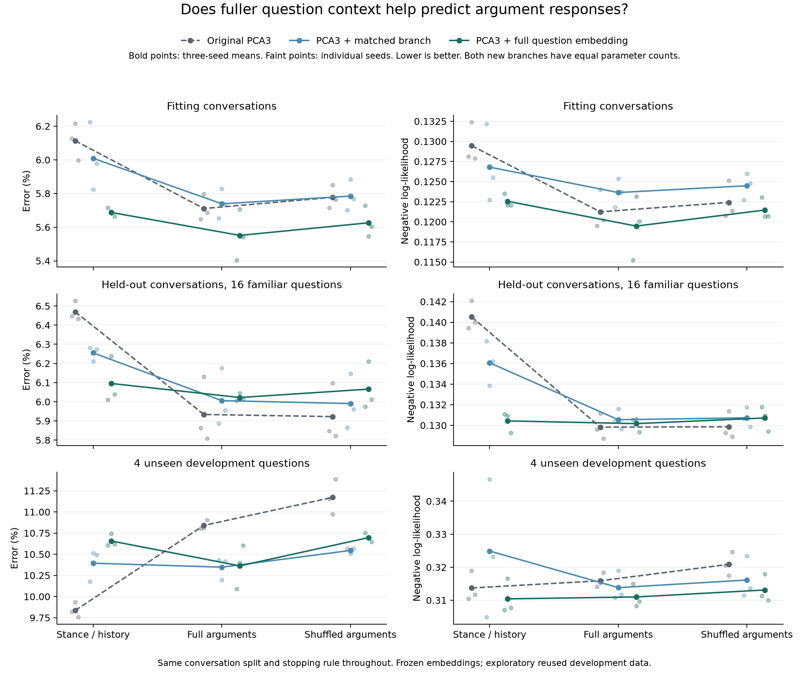

# Fuller question-and-choice context

This experiment restores the cached 1,536-dimensional question/choice embedding in both the no-argument and argument predictors. An equally sized control receives only a reconstruction of the original three principal components. All comparisons use the previous conversation split and stopping rule. This is exploratory research on objective mathematical answer revisions.

**Finding:** fuller frozen question features modestly improve fitting, but do not improve argument-model accuracy over the matched three-component control. Argument-model training error falls from 5.74% to 5.55%; familiar-question error changes from 6.01% to 6.02%, and unseen-question error from 10.35% to 10.36%. The unseen accuracy difference is -0.02 percentage points, descriptive interval [-0.85, +0.76]; the NLL difference is -0.00283 [-0.02022, +0.01700]. These intervals are too broad to claim equivalence, but no clear gain is demonstrated.

With the full question embedding, adding arguments improves mean accuracy by only 0.07 points on familiar questions and 0.29 points on unseen questions; both descriptive intervals include zero, and unseen NLL is slightly worse. Its improvement over the older argument model (10.84% to 10.36% unseen error) is also achieved by the matched PCA3 branch (10.35%), so that change cannot be attributed to the extra question dimensions. The original no-text reference still has the lowest mean unseen error, 9.84%. This tested removal of PCA compression does not resolve the missing argument benefit.

## Design and interpretation

The source LLM sees the complete problem and A/B choices. Earlier predictors received a three-component question PCA, plus persona/context interactions. This study adds a direct learned question projection before the local encoder nonlinearity; the original context is retained. It tests a compression bottleneck in a frozen embedding, not raw-token mathematical reasoning or a jointly encoded question/argument pair.

| Question representation | Information added | Trainable parameters | Fits |
| --- | --- | ---: | ---: |
| Original PCA3 | None; frozen reference | 185,890 | 9 reused |
| PCA3 + matched branch | Same three components reconstructed into 1,536 coordinates | 382,498 | 9 new |
| PCA3 + full question embedding | All 1,536 cached coordinates | 382,498 | 9 new |

The two added branches have the same parameters, initialization, optimizer and training budget. Their zero-initialized projections preserve the original initial predictions and shared RNG. The matched branch adds no question information beyond the existing context, but differs from the original model in parameterization and optimization. Equal nominal parameters do not equalize effective statistical capacity: the new inputs differ in rank by design.

Question features use the existing pinned `text-embedding-3-small` cache. Every cached input string was checked against the complete problem and its two choices. Centering, PCA and scalar RMS normalization fit only the 16 fitting questions; no response labels are used. The original three components retain 35.30% of centered fitting-question embedding variance. The full fitting feature rank is 15, versus 3 for the matched control. Both fitting RMS norms are 1.0; unseen RMS norms are 1.05 for full embeddings and 0.48 for the PCA3 reconstruction. No held-out normalization is fitted. Variance and rank are not measures of retained mathematical meaning.

Fit replicas 0/1 of the 16 questions: 256 conversations, 65,536 agent targets. Replica 2 selects stopping: 128 conversations, 32,768 targets. Replica 3 evaluates familiar questions: 128 conversations, 32,768 targets. All 128 conversations on the four unseen development questions form the other evaluation cohort. Neither evaluation cohort selects checkpoints. These are exactly the same identities as the preceding fusion study.

Stance/history, full arguments and matched-shuffled arguments each use seeds 42–44. The argument encoder and original additive message fusion remain unchanged. Shuffles preserve the earlier matching constraints and separate roles; actual text-change coverage remains 53.3% in fitting, 14.5% in familiar evaluation, and 77.3% in unseen evaluation. The familiar-question shuffle comparison is therefore weak, and some substitutions exchange paraphrases.

## Error rates and loss

Means use all three seeds, weighting questions equally. Error is one minus next-choice accuracy; it is not the source agent's mathematical error rate.

| Question context | Inputs | Training error | Familiar error | Unseen error | Familiar NLL | Unseen NLL |
| --- | --- | ---: | ---: | ---: | ---: | ---: |
| Original PCA3 | stance_only | 6.11% | 6.47% | 9.84% | 0.14051 | 0.31370 |
| Original PCA3 | full_arguments | 5.71% | 5.93% | 10.84% | 0.12982 | 0.31589 |
| Original PCA3 | shuffled_arguments | 5.78% | 5.92% | 11.17% | 0.12986 | 0.32087 |
| PCA3 + matched branch | stance_only | 6.01% | 6.26% | 10.39% | 0.13607 | 0.32490 |
| PCA3 + matched branch | full_arguments | 5.74% | 6.01% | 10.35% | 0.13054 | 0.31381 |
| PCA3 + matched branch | shuffled_arguments | 5.78% | 5.99% | 10.54% | 0.13073 | 0.31612 |
| PCA3 + full question embedding | stance_only | 5.69% | 6.10% | 10.66% | 0.13043 | 0.31042 |
| PCA3 + full question embedding | full_arguments | 5.55% | 6.02% | 10.36% | 0.13016 | 0.31099 |
| PCA3 + full question embedding | shuffled_arguments | 5.63% | 6.07% | 10.70% | 0.13071 | 0.31310 |

## Controlled contrasts

The primary representation comparison is full embedding versus the matched three-component branch. Negative NLL differences and positive accuracy differences favor the first condition. The interaction asks whether richer context increases the added contribution from argument text, beyond changes in the no-argument control.

| Cohort / comparison | Accuracy difference, points [95% interval] | NLL difference [95% interval] |
| --- | ---: | ---: |
| familiar/stance_only: full_embedding minus pca3_matched | +0.16 [-0.09, +0.40] | -0.00564 [-0.00798, -0.00296] |
| familiar/full_arguments: full_embedding minus pca3_matched | -0.02 [-0.16, +0.11] | -0.00038 [-0.00170, +0.00096] |
| familiar/original_pca3: arguments minus stance_only | +0.54 [+0.29, +0.78] | -0.01069 [-0.01554, -0.00658] |
| familiar/pca3_matched: arguments minus stance_only | +0.25 [+0.03, +0.50] | -0.00552 [-0.00788, -0.00302] |
| familiar/full_embedding: arguments minus stance_only | +0.07 [-0.01, +0.15] | -0.00026 [-0.00141, +0.00077] |
| familiar: change in argument contribution, full_embedding minus pca3_matched | -0.18 [-0.45, +0.05] | +0.00526 [+0.00228, +0.00826] |
| unseen/stance_only: full_embedding minus pca3_matched | -0.26 [-1.86, +1.34] | -0.01448 [-0.05784, +0.02831] |
| unseen/full_arguments: full_embedding minus pca3_matched | -0.02 [-0.85, +0.76] | -0.00283 [-0.02022, +0.01700] |
| unseen/original_pca3: arguments minus stance_only | -1.00 [-1.81, -0.20] | +0.00218 [-0.01930, +0.02098] |
| unseen/pca3_matched: arguments minus stance_only | +0.05 [-0.47, +0.71] | -0.01109 [-0.03142, +0.00556] |
| unseen/full_embedding: arguments minus stance_only | +0.29 [-0.02, +0.61] | +0.00057 [-0.00818, +0.00932] |
| unseen: change in argument contribution, full_embedding minus pca3_matched | +0.25 [-0.58, +1.07] | +0.01166 [-0.01374, +0.03795] |

All declared pairwise comparisons, including the unchanged original model and shuffled inputs, are in `question_context_paired.json`. Intervals average seeds within question and use 1,000 paired question bootstrap draws. They are descriptive and pointwise after many development analyses. The 16 familiar and four unseen questions are different cohorts and are not paired with each other. The fixed replica split does not estimate split-to-split variability.

## Each unseen development question

These are seed-mean next-choice error rates. The original questions and choices are preserved in `runs/question_context_v1/questions.json`; no correct-answer labels enter the added features.

| Question | Matched PCA3: stance/history | Matched PCA3: arguments | Full embedding: stance/history | Full embedding: arguments |
| --- | ---: | ---: | ---: | ---: |
| math_train_133 | 10.38% | 10.74% | 11.61% | 10.95% |
| math_train_162 | 17.10% | 16.04% | 15.36% | 15.36% |
| math_train_359 | 5.24% | 5.81% | 7.74% | 7.18% |
| math_train_497 | 8.85% | 8.80% | 7.93% | 7.95% |

## Training and audit

Both new representations use the frozen AdamW trainer (learning rate 0.0003, batch 32 communities), 64 updates per epoch, a 50-epoch limit, and six-epoch patience. Checkpoints are selected by question-mean NLL on replica 2, never by evaluation accuracy. Reported training errors are at those selected checkpoints, not necessarily the minimum attainable training error. Every selected new checkpoint has finite, nonzero learned question-projection weights.

The report reconstructs preprocessing, verifies frozen data/code/baseline hashes, checks identical examples and targets across all 27 scored model runs, audits donor partitions, and recomputes saved metrics. Six focused checks cover exclusion of held-out question information from fitted transforms, the information restriction in the matched control, preservation of dynamic inputs, CPU/GPU initialization and gradients, padding, and permutation equivariance.

All 18 new fits completed at `2026-11-08T06:55:50.294124+00:00`. The driver recorded 465.6 seconds including evaluation. Stopping reasons: {'early_stopping': 18}. No new LLM calls, encoder downloads, test scoring, autonomous rollouts, or changes to prescribed graph signs were made.

## Scope and artifacts

A positive result would support retaining richer frozen question features for this prediction task. A negative result would not show that complete question meaning is unimportant: the cached embedding can discard numbers or logical distinctions, and the frozen message encoder remains unconditioned on the full problem at token level. Only 16 distinct fitting questions are available. No result here establishes a causal influence law or argument irrelevance in the source LLM.

Configuration and driver: `configs/question_context.yaml`, `scripts/question_context.py`. Frozen protocol, transformed question features, model checkpoints, predictions and resume plan: `runs/question_context_v1/`. Tables include per-run, per-question/round, paired contrasts, sensitivity and geometry. Integrity audit: `reports/question_context_integrity.json`. The PNG and PDF are standalone figures.
