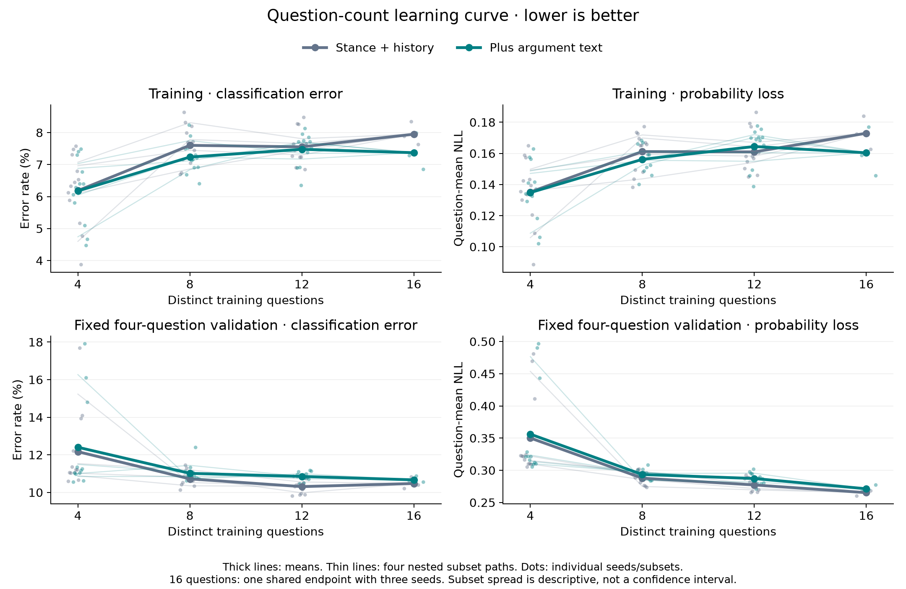

# Question-count learning curve

**Development-only learning curve:** train on 4, 8, 12 or 16 distinct questions and predict the same four validation questions. Error rate means 1 − accuracy; lower is better. The validation questions also choose stopping time and have been inspected in earlier studies, so this is exploratory evidence.

**Finding:** increasing training questions improves mean validation error and NLL from 4 to 16. Most classification improvement occurs from 4 to 8; later accuracy changes are small, while mean NLL continues to improve. Added argument text has worse mean validation error and NLL than the stance/history control at every tested count. Broader training coverage helps, but this curve does not establish that insufficient question count explains the argument model's missing benefit.

## Training and validation error

| Training questions | Stance/history training error | Stance/history validation error | Argument training error | Argument validation error |
| ---: | ---: | ---: | ---: | ---: |
| 4 | 6.19% | 12.17% | 6.18% | 12.40% |
| 8 | 7.60% | 10.72% | 7.24% | 11.02% |
| 12 | 7.55% | 10.31% | 7.48% | 10.85% |
| 16 | 7.95% | 10.47% | 7.37% | 10.67% |

Means use four balanced subset paths × three model seeds at 4, 8 and 12 questions. The 16-question endpoint uses the same three existing seeds once; it is shared by all paths. Each model has 185,890 trainable parameters; the MiniLM encoder stays frozen. Both conditions retain opinion history and the prescribed graph labels.



The small dots and thin lines show subset/seed variability, not confidence intervals from independent datasets. All models predict the same validation transitions.

## Probability loss

NLL is the primary metric and the checkpoint-selection criterion. Lower NLL is better. Training metrics are computed at the selected checkpoint in evaluation mode.

| Questions | Stance/history train NLL | Stance/history validation NLL | Argument train NLL | Argument validation NLL |
| ---: | ---: | ---: | ---: | ---: |
| 4 | 0.13520 | 0.35016 | 0.13482 | 0.35616 |
| 8 | 0.16117 | 0.28783 | 0.15617 | 0.29346 |
| 12 | 0.16096 | 0.27727 | 0.16443 | 0.28727 |
| 16 | 0.17295 | 0.26530 | 0.16040 | 0.27133 |

## Paired changes on the fixed validation questions

Differences are later/larger training set minus earlier/smaller training set. Negative error-rate or NLL changes favor more questions.

| Input | Training-question contrast | Validation error change, points [95% interval] | NLL change [95% interval] |
| --- | --- | ---: | ---: |
| Stance + history | 16 − 4 | -1.69 [-2.63, -0.46] | -0.08486 [-0.10725, -0.06246] |
| Stance + history | 8 − 4 | -1.45 [-2.18, -0.60] | -0.06233 [-0.07391, -0.04645] |
| Stance + history | 12 − 8 | -0.41 [-0.54, -0.26] | -0.01056 [-0.01694, -0.00351] |
| Stance + history | 16 − 12 | +0.17 [-0.20, +0.58] | -0.01197 [-0.03260, +0.00367] |
| Plus argument text | 16 − 4 | -1.73 [-2.66, -0.80] | -0.08483 [-0.10109, -0.06798] |
| Plus argument text | 8 − 4 | -1.39 [-2.35, -0.43] | -0.06270 [-0.08052, -0.04495] |
| Plus argument text | 12 − 8 | -0.16 [-0.48, +0.04] | -0.00619 [-0.00896, -0.00343] |
| Plus argument text | 16 − 12 | -0.18 [-0.46, +0.10] | -0.01594 [-0.02597, -0.00263] |

Average model seeds and subset paths within each validation question, then use 1,000 paired question-bootstrap draws. These pointwise intervals condition on this subset design and the four reused validation questions. They do not estimate uncertainty for a large unseen question population or adjust for all comparisons.

### Does argument text help at any question count?

Full argument text minus stance/history; negative differences favor text.

| Questions | Validation error difference, points [95% interval] | NLL difference [95% interval] |
| ---: | ---: | ---: |
| 4 | +0.23 [-0.07, +0.54] | +0.00600 [-0.00300, +0.01500] |
| 8 | +0.30 [+0.13, +0.46] | +0.00564 [+0.00250, +0.00877] |
| 12 | +0.54 [+0.39, +0.69] | +0.01001 [+0.00374, +0.01594] |
| 16 | +0.19 [-0.26, +0.52] | +0.00603 [-0.00040, +0.01335] |

### Per-validation-question endpoint changes

| Question | Stance/history error: 4 → 16 | Argument error: 4 → 16 |
| --- | ---: | ---: |
| math_train_133 | 12.40% → 10.47% | 12.79% → 10.71% |
| math_train_162 | 17.51% → 15.46% | 17.42% → 16.01% |
| math_train_359 | 8.92% → 6.06% | 9.62% → 6.54% |
| math_train_497 | 9.84% → 9.91% | 9.78% → 9.41% |

### Dependence on which questions are selected

For the argument model, the range of validation errors across the four subset paths shrinks as more questions are included. Each path value below first averages its three model seeds. These are observed ranges over four balanced compositions, not confidence intervals.

| Questions | Lowest path-mean error | Highest path-mean error |
| ---: | ---: | ---: |
| 4 | 10.85% | 16.27% |
| 8 | 10.73% | 11.44% |
| 12 | 10.72% | 11.00% |

The 16-question point has only one available composition, so it cannot estimate variability over alternative 16-question training sets. The argument model's mean training/validation error gap narrows from 6.23 points at four questions to 3.30 points at sixteen, consistent with reduced overfitting within this protocol.

## Experimental controls

- Four nested subset paths come from a seeded random partition into four blocks of four training questions. Every training question appears equally often at each size: once at 4, twice at 8, three times at 12. Validation questions never enter fitting.
- Each selected question retains all eight fitting graphs, four replicas, eight updates and 32 agents. Unique fitting transitions are 32,768 / 65,536 / 98,304 / 131,072 for 4 / 8 / 12 / 16 questions. Validation always contains 32,768 transitions from four questions.
- Question PCA is refitted on the selected training questions alone. The same 32 personas appear in every subset, so persona PCA stays fixed. Input dimension, original text scale, text encoder, network architecture and optimizer are unchanged.
- Models receive a validation check every 128 optimizer updates, six-check patience and a 5,000-update cap. Small subsets are not stopped after fewer optimizer updates merely because their data passes are shorter. Data are reshuffled each pass; seeds 42–44 pair initialization across conditions and subset paths.
- The 16-question context and PCA arrays match the original feature cache exactly. A 128-update GPU replay reproduces the original first validation score. Its six selected models are reused, and their training/validation scores independently recomputed.
- All new fits have their own code/config/data/protocol hashes, optimizer/RNG checkpoints and prediction artifacts. Original studies and the previously consumed test set are unchanged.

### Question blocks

- Block 0: `math_train_357`, `math_train_77`, `math_train_435`, `math_train_331`
- Block 1: `math_train_79`, `math_train_146`, `math_train_54`, `math_train_65`
- Block 2: `math_train_80`, `math_train_309`, `math_train_482`, `math_train_402`
- Block 3: `math_train_440`, `math_train_413`, `math_train_316`, `math_train_45`

Paths begin with blocks 0, 1, 2 or 3 respectively and add the next block cyclically. This gives nested comparisons with balanced question coverage, rather than independent randomly sampled subsets.

## Interpretation limits

Increasing question count also increases unique transitions and changes the fitted PCA. This curve measures the full training pipeline; it does not isolate diversity from sample quantity or feature estimation. Four validation questions constrain inference. A trend up to 16 questions cannot establish what happens beyond 16, identify a final accuracy ceiling, or show that arguments are unnecessary. A fresh question set is needed for confirmatory claims.

The argument model still consumes observed messages after delivery. It is not an autonomous simulator. This study adds no new LLM-generated questions or conversations and does not test agents establishing their own credibility.

## Execution and checks

4 focused checks passed for nested/balanced sampling, subset-only preprocessing, split/trajectory isolation and exact CPU mid-pass resume. The endpoint GPU replay matched. Reporting reconstructed every subset's context/PCA, checked example identities and target equality, verified update-based validation cadence and recomputed all saved metrics.

Completed 72 new fits and reused 6 endpoint models. The driver recorded 1103.5 seconds; new model fitting and final scoring recorded 1091.5 seconds. Stopping reasons: 72 early_stopping. No paid API or source-LLM calls were made.

The full protocol is `runs/question_count_curve_v1/protocol.json`; integrity checks are in `question_count_integrity.json`. Run, question, round, spread and training-step tables are saved as `question_count_*.csv`. The shared endpoint is not counted as extra independent subset repeats.

## Reproduce

```bash
.venv/bin/python -m pytest tests/test_question_count_curve.py
.venv/bin/python -u scripts/question_count_curve.py prepare --device cpu
.venv/bin/python -u scripts/question_count_curve.py smoke --device mps
.venv/bin/python -u scripts/question_count_curve.py run --device mps
.venv/bin/python scripts/report_question_count_curve.py
```
