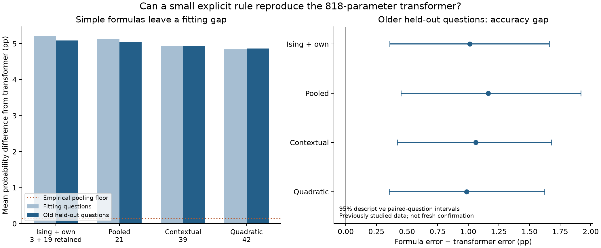

# Can explicit formulas reproduce the 818-parameter transformer?

The four tested formulas do not reproduce the frozen transformer closely. They miss its probabilities by about five percentage points on both fitting and older held-out questions, and their held-out errors remain near the strengthened Ising baseline. More context-dependent coefficients and quadratic terms give only a small fidelity improvement. This is a completed CPU-only diagnostic on the old twenty-question GPT development pool; it does not use the new Llama cohort.



## What was fitted

Each of twelve frozen transformers (four outer folds, three seeds) supplies soft probability targets on its fifteen fitting questions. Each surrogate minimizes equal-question binary cross-entropy to those probabilities, with a fixed 0.0001 ridge penalty on standardized non-intercept coefficients. Standardization uses fitting inputs only. Observed opinion labels never enter the surrogate optimizer. There is no formula or penalty selection from held-out results. All 48 fits were frozen before evaluating their corresponding five older held-out questions.

Let `s` be the receiver's current ±1 opinion, `F` the sum of current opinions over friendly neighbors, `U` the raw opinion sum over unfriendly neighbors, and `d+`, `d−` their counts. The coefficient of `U` carries its sign. Let `φ` be the shared 16-dimensional context: a constant, three persona components, three question components and nine products.

| Formula | Fitted coefficients | Expression |
| --- | ---: | --- |
| Ising + own | 3, retaining 19 Ising coefficients | `b + a·Ising_score + c·s` |
| Pooled linear | 21 | `w·φ + ρs + αF + βU + η+d+ + η−d−` |
| Context-dependent | 39 | The pooled rule, with `ρ`, `α`, `β` each affine in the six persona/question PCA components |
| Context-dependent + quadratic | 42 | The context-dependent rule plus `γ1 F² + γ2 FU + γ3 U²` |

Each expression is a logit; applying the logistic function yields P(next majority = A). The 21/39/42-coefficient rules are standalone predictors over shared context. The first rule also requires its retained Ising coefficients. Pretrained encoder and PCA quantities are outside all these counts. PCA coordinates remain opaque text features, so even a successful surrogate would not yet provide a fully semantic explanation.

## Agreement with the transformer

These numbers measure imitation of the predictor, independently of whether its next-opinion prediction is correct. Means average seed scores within question and then weight questions equally.

| Formula | Fitting probability MAE | Old held-out probability MAE | Old held-out label agreement | Old held-out KL |
| --- | ---: | ---: | ---: | ---: |
| Ising score + own opinion | 5.21 pp | 5.09 pp | 93.92% | 0.03309 |
| Pooled linear rule | 5.12 pp | 5.04 pp | 93.88% | 0.03275 |
| Context-dependent influence | 4.93 pp | 4.93 pp | 94.11% | 0.03195 |
| Context-dependent + quadratic influence | 4.84 pp | 4.87 pp | 94.31% | 0.03075 |

The similar fitting and held-out probability gaps show that these particular formulas already fail to reproduce the teacher on the states used to fit them. This is not simply an additional generalization gap of the surrogates. The fixed formula families, regularization and supplied aggregate features all constrain these fits; this experiment does not establish a lower bound for every interpretable expression.

## Prediction of actual next opinions

| Model | Fitting error | Old held-out error | Old held-out NLL |
| --- | ---: | ---: | ---: |
| Original Ising | Previously reported | 10.95% | 0.22755 |
| Ising + observed-label own-opinion correction | Previously reported | 10.11% | 0.22474 |
| Transformer 818 | 8.02% | 9.12% | 0.21258 |
| Ising score + own opinion | 9.52% | 10.13% | 0.22766 |
| Pooled linear rule | 9.54% | 10.28% | 0.22846 |
| Context-dependent influence | 9.33% | 10.18% | 0.22739 |
| Context-dependent + quadratic influence | 9.24% | 10.10% | 0.22924 |

The observed-label Ising correction is the previously fitted baseline. The new three-coefficient Ising surrogate learns from transformer probabilities instead, so their objectives differ. No new Ising or transformer weights were trained.

| Formula − transformer | Error difference (pp) | Descriptive 95% interval | NLL difference | Descriptive 95% interval |
| --- | ---: | --- | ---: | --- |
| Ising score + own opinion | +1.01 | [+0.36, +1.66] | +0.01508 | [+0.00677, +0.02289] |
| Pooled linear rule | +1.16 | [+0.45, +1.92] | +0.01587 | [+0.00725, +0.02424] |
| Context-dependent influence | +1.06 | [+0.42, +1.68] | +0.01481 | [+0.00605, +0.02297] |
| Context-dependent + quadratic influence | +0.99 | [+0.36, +1.62] | +0.01665 | [+0.00717, +0.02617] |

Intervals use 3,000 paired question resamples, with neural seed scores averaged within question. These are pointwise exploratory comparisons on a repeatedly studied twenty-question pool with overlapping training folds, not independent confirmation or equivalence tests.

## Does pooling discard essential information?

After seeing the fitting gap, a separate recorded follow-up grouped states having exactly the same 21 pooled features. The key excludes arbitrary question/agent/graph IDs and all outcomes. The receiver context is included, so different teacher outputs within a group cannot be explained by differing receiver context, own opinion, friendly/unfriendly sums or counts. They can reflect differences in individual neighbor context/opinions/degrees or other graph information accessible to the transformer.

| Finite-sample constraint | Fitting states | Older held-out states |
| --- | ---: | ---: |
| Minimum probability MAE from identical pooled inputs | 0.163 pp | 0.141 pp |
| Minimum label disagreement from identical pooled inputs | 0.247% | 0.281% |
| States in groups spanning more than 1 pp in teacher probability | 9.57% | 8.80% |

These are empirical oracle floors obtained using teacher predictions within each group: the group median minimizes absolute probability error, the group mean minimizes squared error and teacher KL, and the group majority minimizes label disagreement. They need not share one optimizer. They are not implementable unseen-question predictors, estimates of source-LLM sampling noise, or upper bounds on the cost of aggregation. Small observed floors do not prove that pooling is sufficient for transfer.

The observed held-out MAE floor is 0.141 pp, far below the tested quadratic rule's 4.87 pp. The exact collisions therefore demonstrate some lost information but do not establish pooling as the main explanation for the remaining gap. Nonlinear functional restrictions, regularization, omitted neighborhood detail and transfer across question contexts remain distinguishable possibilities.

One illustrative extreme pair from the older held-out states is independently reproduced on CPU:

- Question `math_train_359`, receiver 8; own opinion +1, friendly sum +0, unfriendly sum +0, friendly/unfriendly counts 4/0. All 21 pooled features match exactly.
- Transformer P(A): **37.13% versus 62.21%**, on graphs J3 and J3. The full recorded neighborhoods differ.
- This pair was selected to illustrate the largest difference among the saved fold/seed examples; it is not a typical effect or evidence of a causal LLM response.

## Implication and verification

The 818-parameter predictor has learned behavior beyond the tested linear/context-affine/quadratic aggregate rules. Its accuracy gain over Ising is modest, yet its function is not closely reproduced by those rules. This does not establish that 818 weights are necessary or that no simpler equation exists. A useful next diagnostic would hold the aggregate input fixed while testing a richer nonlinear predictor, separating limitations of the chosen formulas from limitations of the aggregate state; another would examine individual-neighbor contributions on observed states. Neither should change the ongoing frozen 80/20/40 Llama comparison.

All 48 convex fits converged; total optimizer time 6.6 seconds, maximum final gradient 4.99e-07. Ten focused tests passed. All twelve teacher checkpoints reproduce on CPU on both training and older held-out inputs, with maximum probability difference 4.23e-06. Twelve illustrative pooled-input pairs also reproduce on CPU. All 5,132 tracked earlier artifacts and 16 frozen files of the running Llama study remain unchanged. Execution used one CPU thread, with no GPU fitting, new source calls, new assessment data or paid API use.

The pooling follow-up was specified after seeing the four surrogate results; its separate protocol records that sequence. This is an exploratory investigation, not a preregistered confirmatory test.

Artifacts: `runs/transformer_rule_distillation_v1/`, including frozen protocols, 48 coefficient files, raw-unit expressions, saved predictions, per-question fidelity, subgroups and paired differences. Raw PCA coefficients should be interpreted within their fold because PCA axes differ between folds.

Commands:

```sh
.venv/bin/python scripts/distill_transformer_rule.py prepare
.venv/bin/python scripts/distill_transformer_rule.py fit
.venv/bin/python scripts/distill_transformer_rule.py evaluate
.venv/bin/python scripts/analyze_pooled_rule_limits.py
.venv/bin/python scripts/report_transformer_rule_distillation.py
```
